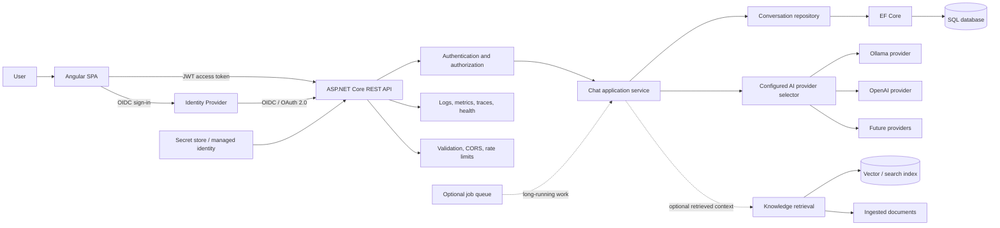

# AI Chat Application: Architecture and Feature Roadmap

## Vision

Build a maintainable AI chat application in stages, using a realistic product
delivery sequence. The application will provide an Angular single-page client,
an ASP.NET Core API, configurable AI providers, persisted conversations, and
secure access. Later stages add retrieval-augmented generation (RAG), Azure
hosting, and production operations.

This is a learning roadmap, not a claim that these features are already
implemented. At the outset, the repository contains an ASP.NET Core API with a
chat endpoint, Ollama and OpenAI-compatible service implementations, a shared
`Result` response, and exception middleware. Angular, authentication, database
persistence, RAG, and cloud deployment are future work.

## Target architecture

SAML is an identity-federation option when required by an organization. Prefer
OIDC for the Angular application and API when the identity provider supports it.
SAML may be integrated at the identity-provider boundary (for example, an
enterprise identity provider federating upstream with SAML and issuing OIDC
tokens to this application); do not build an identity provider into the app.

## Feature delivery roadmap

Each phase adds a user-visible or operational capability. Concepts are learned
in the context of implementing that feature, rather than as a separate
concept-only curriculum. Add concise code comments where a decision is
non-obvious; use this document for fuller explanations and trade-offs.

### Phase 0 — Establish the product baseline and team workflow

**Feature outcome:** A clean, reproducible starting point for development.

- Confirm API behavior, local configuration, supported .NET SDK, and how to run
  the application.
- Keep generated build and IDE state out of version control; provide safe
  configuration examples without credentials.
- Use feature branches and pull requests; protect `main` and require successful
  build/test checks before merging.
- Record initial requirements: explain code, support conversations, choose an
  AI provider, and keep a user's data private.

**Learning in context:** C# project structure, nullable reference types, records,
Git workflow, configuration sources, requirements clarification, estimation,
and design notes/ADRs.

**Done when:** A new developer can clone the repository, configure local
settings, run the API, and understand what is implemented versus planned.

### Phase 1 — Deliver a stable chat API

**Feature outcome:** A documented API accepts code and returns an explanation.

- Define request and response DTOs, validation limits, consistent status codes,
  and a stable error format.
- Keep controller responsibilities small; place orchestration in application
  services.
- Document endpoints with OpenAPI and provide safe example requests.
- Handle client disconnects and propagate cancellation through asynchronous
  work.

**Learning in context:** REST semantics, routing, DTOs, model binding, validation,
middleware ordering, Problem Details, async/await, cancellation, interfaces,
dependency injection, and API boundary design.

**Done when:** Valid and invalid requests produce predictable responses, the API
contract is visible in OpenAPI, and service errors do not leak internal details.

### Phase 2 — Support multiple AI providers through configuration

**Feature outcome:** The application uses the provider configured for the
environment without changing controller code.

- Define a provider abstraction and provider-neutral chat request/response
  contract.
- Implement Ollama and OpenAI-compatible adapters behind that abstraction.
- Bind validated provider settings with the Options pattern.
- Select the configured provider through a small factory/strategy or keyed DI
  registration; fail clearly for unknown provider names.
- Set explicit HTTP timeouts and preserve cancellation. Do not retry
  non-idempotent model requests blindly.

**Learning in context:** Composition, SOLID, Strategy, Factory, Adapter,
`IHttpClientFactory`, typed options, DI lifetimes, JSON parsing, timeout
handling, retries, circuit-breaker trade-offs, model and token limits.

**Done when:** Switching provider/model settings selects a different provider
without modifying the controller; invalid configuration has a useful
diagnostic and a safe API response.

### Phase 3 — Persist conversations and provide relevant context

**Feature outcome:** A signed-in user can continue previous conversations and
the API can provide authorized history as model context.

- Design SQL entities for users (or external subject identifiers), conversations,
  messages, timestamps, and provider/model metadata.
- Add EF Core `DbContext`, migrations, indexes, constraints, and parameterized
  queries.
- Define repository interfaces at the application boundary and implement them
  with EF Core. Avoid exposing `IQueryable` or EF entities across that boundary.
- Add pagination and ownership checks; retrieve only the conversation context
  required for a request.
- Document how a non-SQL implementation would satisfy the same application
  contract and which semantics would need redesign.

**Learning in context:** SQL `SELECT`/filtering/joins/grouping/aggregates,
normalization, `NULL`, sorting, date handling, EF Core tracking, relationships,
migrations, transactions, optimistic concurrency, repository trade-offs,
Unit of Work trade-offs, indexes, execution plans, sargability, pagination,
N+1 detection, and database-specific behavior.

**Done when:** Conversation history is isolated per user, data access is
testable, schema changes are migration-driven, and list endpoints use bounded
pagination.

### Phase 4 — Build the Angular single-page chat application

**Feature outcome:** Users can submit code, read responses, see progress/errors,
and navigate conversation history in a browser.

- Create an Angular SPA with standalone components and a typed API client.
- Add a code-entry/chat view, conversation list, loading state, error state, and
  accessible controls.
- Use reactive forms and client-side validation for usability; keep authoritative
  validation on the API.
- Use RxJS and Angular lifecycle-safe patterns for requests, cancellation, and
  state updates.
- Configure development proxy/origin settings without weakening production CORS.

**Learning in context:** TypeScript strict typing, generics and discriminated
unions, Angular components/templates/binding, services and DI, `HttpClient`,
Observables and operators, reactive forms, routing, lazy loading, change
detection/signals trade-offs, accessibility, frontend tests, and end-to-end
tests.

**Done when:** The Angular app can create and resume conversations, clearly
communicates loading and failure, works with keyboard navigation, and calls
only the API rather than AI provider endpoints directly.

### Phase 5 — Add identity, authentication, and authorization

**Feature outcome:** Users sign in through a trusted identity provider and can
only access their own conversations.

- Register an OIDC client for Angular and an API audience/resource with the
  identity provider.
- Use authorization-code flow with PKCE in the SPA; obtain access tokens for the
  API and send them as bearer tokens.
- Configure ASP.NET Core JWT bearer validation for issuer, audience, signature,
  and token lifetime. Validate policies and claims server-side.
- Enforce ownership at every conversation/message operation; never trust a user
  identifier supplied only by the client.
- Add roles/scopes/policies only for actual product authorization requirements.
- Support enterprise SAML needs through identity-provider federation where
  appropriate; keep the app/API token contract OIDC/JWT-based unless a concrete
  integration requires otherwise.

**Learning in context:** Authentication vs. authorization, OAuth 2.0, OIDC,
JWT claims and validation, PKCE, scopes, roles, policy-based authorization,
token lifecycle, SAML federation, secure redirect handling, and multi-tenant
identity boundaries.

**Done when:** Anonymous calls are rejected, authorized calls have least
privilege, and automated tests prove users cannot read or alter another user's
data.

### Phase 6 — Harden the public API and AI interaction

**Feature outcome:** The application safely handles untrusted clients, input,
and model output.

- Restrict CORS to known frontend origins; do not treat CORS as an access
  control.
- Apply request-size limits, input validation, per-user/IP rate limits, and
  appropriate model usage quotas.
- Store provider credentials in a secret store; use local development secrets
  and managed identity/Key Vault in Azure. Never put API keys in Angular or
  checked-in settings.
- Treat submitted code and retrieved documents as untrusted prompt content.
  Minimize sensitive data, avoid sending unnecessary context, and validate
  model output before rendering or acting on it.
- Add safe rendering for generated content and clear user-facing privacy and
  retention behavior.

**Learning in context:** CORS, secrets, least privilege, rate limiting, abuse
prevention, prompt injection (including indirect injection), data leakage, PII,
output validation, XSS, CSRF/token-storage trade-offs, content filtering,
responsible AI, and cost controls.

**Done when:** Security configuration is environment-specific, secrets are not
in source control or browser bundles, and limits and privacy behavior are
documented and tested.

### Phase 7 — Make quality and maintainability part of delivery

**Feature outcome:** Changes can be made confidently with automated feedback.

- Add unit tests for orchestration, validation, provider selection, and error
  mapping using fakes at external boundaries.
- Add API integration tests for routing, authentication, authorization, and
  serialization.
- Add repository/database integration tests using a database-compatible test
  setup; avoid treating an in-memory provider as proof of SQL behavior.
- Add Angular unit and end-to-end tests for key user flows.
- Add pull-request CI for restore, build, formatting/analyzers, tests, and
  dependency/security checks.

**Learning in context:** Unit, integration, and contract testing, test doubles,
determinism, testable boundaries, code review, CI, dependency scanning, and
maintainability trade-offs.

**Done when:** The main user flows and critical security boundaries are covered
by automated tests, and CI blocks merges on failures.

### Phase 8 — Ground responses with project knowledge (RAG)

**Feature outcome:** The chat can answer questions using approved documents or
repository knowledge and provide citations.

- Add a controlled ingestion flow for supported documents, including ownership,
  source, version, and deletion metadata.
- Chunk content, generate embeddings, and index chunks in a selected vector or
  search store.
- Retrieve relevant chunks with tenant/access filters; consider hybrid search
  and reranking if evaluation shows a need.
- Include source references in the answer and clearly indicate when evidence is
  insufficient.
- Create an evaluation set to measure retrieval relevance and answer grounding.

**Learning in context:** Embeddings, chunking, vector search, hybrid retrieval,
reranking, citations, context windows, prompt templates, structured output,
hallucination evaluation, indirect prompt injection, and tenant isolation.

**Done when:** Answers cite authorized sources, retrieval quality is measurable,
and deleting or revoking a source prevents it from appearing in future
retrievals.

### Phase 9 — Improve reliability, observability, and user experience

**Feature outcome:** Failures are diagnosable and the app behaves predictably
under load or provider outages.

- Add structured logs, metrics, distributed traces, correlation IDs, and
  readiness/liveness health checks without logging prompts or secrets by
  default.
- Set end-to-end deadlines and provider-specific timeouts; choose bounded
  retries/backoff and circuit-breaker behavior based on provider semantics.
- Add graceful shutdown and cancellation propagation.
- Evaluate response quality, latency, token/cost usage, provider failures, and
  user feedback with privacy-conscious telemetry.
- Add caching only where privacy, freshness, and cost behavior are understood.

**Learning in context:** OpenTelemetry, Application Insights, logs/metrics/
traces, SLI/SLO concepts, health checks, production diagnostics, profiling,
memory/CPU performance, GC/allocation basics, backpressure, and failure modes.

**Done when:** Operators can diagnose a failed or slow request from telemetry,
health checks distinguish readiness from liveness, and retries do not amplify
provider outages.

### Phase 10 — Deploy securely to Azure

**Feature outcome:** The API, Angular client, and database are deployed through
repeatable environments.

- Choose hosting (for example App Service or containers) based on runtime,
  deployment, scaling, and operational requirements.
- Provision Azure SQL and other required resources through infrastructure as
  code.
- Configure managed identity and Key Vault access; keep credentials out of
  deployment artifacts.
- Deploy with environment-specific app settings, HTTPS, health probes, and
  staged rollout/rollback strategy.
- Add CI/CD with approvals for production and database migration safeguards.
- Monitor availability, latency, errors, usage, and cost in Azure.

**Learning in context:** App Service, containers, deployment slots, Azure SQL,
Storage, Key Vault, managed identity, networking, infrastructure as code,
autoscaling, CI/CD, rollback, availability, disaster recovery, cost management,
and cloud security.

**Done when:** A documented pipeline can deploy to a non-production
environment, run health checks, and promote or roll back safely.

### Phase 11 — Add queued processing if product requirements call for it

**Feature outcome:** Long-running generation or document ingestion can be
tracked without holding an HTTP request open.

- Add a job API with durable job status and an Azure Service Bus queue only when
  measured latency or workload requires it.
- Make consumers idempotent; use bounded retries, poison-message handling, and
  dead-letter queue operations.
- Define job ownership, cancellation, retention, and status polling or
  notification behavior.
- Consider an outbox when database changes and message publication must remain
  consistent.

**Learning in context:** Service Bus, queues/topics, competing consumers,
ordering, duplicate detection, retries, dead-letter queues, idempotency,
eventual consistency, outbox, and distributed failure handling.

**Done when:** Reprocessing a message does not duplicate user-visible work, and
failed messages can be diagnosed and safely retried or dead-lettered.

### Phase 12 — Capstone review and senior-engineer readiness

**Feature outcome:** The project can be presented as an end-to-end engineering
case study.

- Review requirements, architecture boundaries, security decisions, data model,
  AI provider trade-offs, and deployment topology.
- Use query plans, API traces, and load measurements to justify performance
  changes rather than optimizing by guesswork.
- Practice design review, estimation, prioritization, incident response, and
  explaining alternatives (including why a simpler design may be preferable).
- Prepare an interview walkthrough: requirements, diagram, trade-offs, failure
  scenarios, test strategy, and next steps.

**Learning in context:** System design, capacity estimation, scaling, cache and
database choices, modular monolith vs. microservices, DDD boundaries,
architecture decision records, mentoring, code review, incident ownership, and
technical communication.

**Done when:** The project has a tested feature set, a current architecture
diagram, deployment instructions, operational notes, and clear explanations of
key trade-offs.

## Cross-cutting implementation and learning practices

- Deliver each phase in a feature branch and pull request; do not develop
  directly on `main`.
- Update this roadmap and architecture diagram when implementation changes.
- For every feature, record the behavior, relevant code locations, how to run
  it, verification steps, and important trade-offs.
- Prefer simple, measurable designs. Add abstractions, databases, queues, and
  cloud services when the feature or operational need justifies them.
- Keep comments focused on non-obvious code decisions; use the learning guide
  and pull-request notes for detailed teaching explanations.
- Test failure paths and security boundaries as well as the happy path.
- Review data retention, privacy, and model-provider terms before sending user
  content to hosted models.

## Suggested documentation set as the project grows

- `PROJECT_ROADMAP.md` — this feature sequence, current status, and architecture
  vision.
- `README.md` — prerequisites, local setup, configuration, run instructions,
  and quick API usage.
- `docs/architecture.md` — implemented component diagram, request/data flows,
  trust boundaries, and deployment view.
- `docs/learning-guide.md` — concept explanations tied to actual files and
  feature behavior.
- `docs/decisions/` — short architecture decision records for choices with
  meaningful alternatives, such as identity provider, database, AI selection,
  and RAG store.

Documentation should distinguish implemented behavior from planned work and
should be updated in the same change as the feature it describes.
