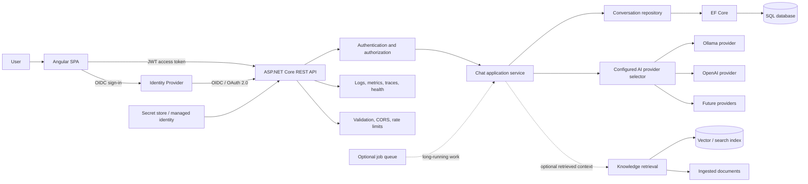

# AI Chat Application: Architecture and Feature Roadmap

## Vision

Build a maintainable AI chat application in stages, using a realistic product
delivery sequence. The application will provide an Angular single-page client,
an ASP.NET Core API, configurable AI providers, persisted conversations, and
secure access. Later stages add retrieval-augmented generation (RAG), Azure
hosting, and production operations.

This is a learning roadmap, not a claim that these features are already
implemented. At the outset, the repository contains an ASP.NET Core API with a
chat endpoint, Ollama and OpenAI-compatible service implementations, a shared
`Result` response, and exception middleware. Angular, authentication, database
persistence, RAG, and cloud deployment are future work.

## Target architecture

SAML is an identity-federation option when required by an organization. Prefer
OIDC for the Angular application and API when the identity provider supports it.
SAML may be integrated at the identity-provider boundary (for example, an
enterprise identity provider federating upstream with SAML and issuing OIDC
tokens to this application); do not build an identity provider into the app.

## Feature delivery roadmap

Each phase adds a user-visible or operational capability. Concepts are learned
in the context of implementing that feature, rather than as a separate
concept-only curriculum. Add concise code comments where a decision is
non-obvious; use this document for fuller explanations and trade-offs.

### Phase 0 — Establish the product baseline and team workflow

**Feature outcome:** A clean, reproducible starting point for development.

- Confirm API behavior, local configuration, supported .NET SDK, and how to run
  the application.
- Keep generated build and IDE state out of version control; provide safe
  configuration examples without credentials.
- Use feature branches and pull requests; protect `main` and require successful
  build/test checks before merging.
- Record initial requirements: explain code, support conversations, choose an
  AI provider, and keep a user's data private.

**Learning in context:** C# project structure, nullable reference types, records,
Git workflow, configuration sources, requirements clarification, estimation,
and design notes/ADRs.

**Done when:** A new developer can clone the repository, configure local
settings, run the API, and understand what is implemented versus planned.

### Phase 1 — Deliver a stable chat API

**Feature outcome:** A documented API accepts code and returns an explanation.

- Define request and response DTOs, validation limits, consistent status codes,
  and a stable error format.
- Keep controller responsibilities small; place orchestration in application
  services.
- Document endpoints with OpenAPI and provide safe example requests.
- Handle client disconnects and propagate cancellation through asynchronous
  work.

**Learning in context:** REST semantics, routing, DTOs, model binding, validation,
middleware ordering, Problem Details, async/await, cancellation, interfaces,
dependency injection, and API boundary design.

**Done when:** Valid and invalid requests produce predictable responses, the API
contract is visible in OpenAPI, and service errors do not leak internal details.

### Phase 2 — Support multiple AI providers through configuration

**Feature outcome:** The application uses the provider configured for the
environment without changing controller code.

- Define a provider abstraction and provider-neutral chat request/response
  contract.
- Implement Ollama and OpenAI-compatible adapters behind that abstraction.
- Bind validated provider settings with the Options pattern.
- Select the configured provider through a small factory/strategy or keyed DI
  registration; fail clearly for unknown provider names.
- Set explicit HTTP timeouts and preserve cancellation. Do not retry
  non-idempotent model requests blindly.

**Learning in context:** Composition, SOLID, Strategy, Factory, Adapter,
`IHttpClientFactory`, typed options, DI lifetimes, JSON parsing, timeout
handling, retries, circuit-breaker trade-offs, model and token limits.

**Done when:** Switching provider/model settings selects a different provider
without modifying the controller; invalid configuration has a useful
diagnostic and a safe API response.

### Phase 3 — Persist conversations and provide relevant context

**Feature outcome:** A signed-in user can continue previous conversations and
the API can provide authorized history as model context.

- Design SQL entities for users (or external subject identifiers), conversations,
  messages, timestamps, and provider/model metadata.
- Add EF Core `DbContext`, migrations, indexes, constraints, and parameterized
  queries.
- Define repository interfaces at the application boundary and implement them
  with EF Core. Avoid exposing `IQueryable` or EF entities across that boundary.
- Add pagination and ownership checks; retrieve only the conversation context
  required for a request.
- Document how a non-SQL implementation would satisfy the same application
  contract and which semantics would need redesign.

**Learning in context:** SQL `SELECT`/filtering/joins/grouping/aggregates,
normalization, `NULL`, sorting, date handling, EF Core tracking, relationships,
migrations, transactions, optimistic concurrency, repository trade-offs,
Unit of Work trade-offs, indexes, execution plans, sargability, pagination,
N+1 detection, and database-specific behavior.

**Done when:** Conversation history is isolated per user, data access is
testable, schema changes are migration-driven, and list endpoints use bounded
pagination.

### Phase 4 — Build the Angular single-page chat application

**Feature outcome:** Users can submit code, read responses, see progress/errors,
and navigate conversation history in a browser.

- Create an Angular SPA with standalone components and a typed API client.
- Add a code-entry/chat view, conversation list, loading state, error state, and
  accessible controls.
- Use reactive forms and client-side validation for usability; keep authoritative
  validation on the API.
- Use RxJS and Angular lifecycle-safe patterns for requests, cancellation, and
  state updates.
- Configure development proxy/origin settings without weakening production CORS.

**Learning in context:** TypeScript strict typing, generics and discriminated
unions, Angular components/templates/binding, services and DI, `HttpClient`,
Observables and operators, reactive forms, routing, lazy loading, change
detection/signals trade-offs, accessibility, frontend tests, and end-to-end
tests.

**Done when:** The Angular app can create and resume conversations, clearly
communicates loading and failure, works with keyboard navigation, and calls
only the API rather than AI provider endpoints directly.

### Phase 5 — Add identity, authentication, and authorization

**Feature outcome:** Users sign in through a trusted identity provider and can
only access their own conversations.

- Register an OIDC client for Angular and an API audience/resource with the
  identity provider.
- Use authorization-code flow with PKCE in the SPA; obtain access tokens for the
  API and send them as bearer tokens.
- Configure ASP.NET Core JWT bearer validation for issuer, audience, signature,
  and token lifetime. Validate policies and claims server-side.
- Enforce ownership at every conversation/message operation; never trust a user
  identifier supplied only by the client.
- Add roles/scopes/policies only for actual product authorization requirements.
- Support enterprise SAML needs through identity-provider federation where
  appropriate; keep the app/API token contract OIDC/JWT-based unless a concrete
  integration requires otherwise.

**Learning in context:** Authentication vs. authorization, OAuth 2.0, OIDC,
JWT claims and validation, PKCE, scopes, roles, policy-based authorization,
token lifecycle, SAML federation, secure redirect handling, and multi-tenant
identity boundaries.

**Done when:** Anonymous calls are rejected, authorized calls have least
privilege, and automated tests prove users cannot read or alter another user's
data.

### Phase 6 — Harden the public API and AI interaction

**Feature outcome:** The application safely handles untrusted clients, input,
and model output.

- Restrict CORS to known frontend origins; do not treat CORS as an access
  control.
- Apply request-size limits, input validation, per-user/IP rate limits, and
  appropriate model usage quotas.
- Store provider credentials in a secret store; use local development secrets
  and managed identity/Key Vault in Azure. Never put API keys in Angular or
  checked-in settings.
- Treat submitted code and retrieved documents as untrusted prompt content.
  Minimize sensitive data, avoid sending unnecessary context, and validate
  model output before rendering or acting on it.
- Add safe rendering for generated content and clear user-facing privacy and
  retention behavior.

**Learning in context:** CORS, secrets, least privilege, rate limiting, abuse
prevention, prompt injection (including indirect injection), data leakage, PII,
output validation, XSS, CSRF/token-storage trade-offs, content filtering,
responsible AI, and cost controls.

**Done when:** Security configuration is environment-specific, secrets are not
in source control or browser bundles, and limits and privacy behavior are
documented and tested.

### Phase 7 — Make quality and maintainability part of delivery

**Feature outcome:** Changes can be made confidently with automated feedback.

- Add unit tests for orchestration, validation, provider selection, and error
  mapping using fakes at external boundaries.
- Add API integration tests for routing, authentication, authorization, and
  serialization.
- Add repository/database integration tests using a database-compatible test
  setup; avoid treating an in-memory provider as proof of SQL behavior.
- Add Angular unit and end-to-end tests for key user flows.
- Add pull-request CI for restore, build, formatting/analyzers, tests, and
  dependency/security checks.

**Learning in context:** Unit, integration, and contract testing, test doubles,
determinism, testable boundaries, code review, CI, dependency scanning, and
maintainability trade-offs.

**Done when:** The main user flows and critical security boundaries are covered
by automated tests, and CI blocks merges on failures.

### Phase 8 — Ground responses with project knowledge (RAG)

**Feature outcome:** The chat can answer questions using approved documents or
repository knowledge and provide citations.

- Add a controlled ingestion flow for supported documents, including ownership,
  source, version, and deletion metadata.
- Chunk content, generate embeddings, and index chunks in a selected vector or
  search store.
- Retrieve relevant chunks with tenant/access filters; consider hybrid search
  and reranking if evaluation shows a need.
- Include source references in the answer and clearly indicate when evidence is
  insufficient.
- Create an evaluation set to measure retrieval relevance and answer grounding.

**Learning in context:** Embeddings, chunking, vector search, hybrid retrieval,
reranking, citations, context windows, prompt templates, structured output,
hallucination evaluation, indirect prompt injection, and tenant isolation.

**Done when:** Answers cite authorized sources, retrieval quality is measurable,
and deleting or revoking a source prevents it from appearing in future
retrievals.

### Phase 9 — Improve reliability, observability, and user experience

**Feature outcome:** Failures are diagnosable and the app behaves predictably
under load or provider outages.

- Add structured logs, metrics, distributed traces, correlation IDs, and
  readiness/liveness health checks without logging prompts or secrets by
  default.
- Set end-to-end deadlines and provider-specific timeouts; choose bounded
  retries/backoff and circuit-breaker behavior based on provider semantics.
- Add graceful shutdown and cancellation propagation.
- Evaluate response quality, latency, token/cost usage, provider failures, and
  user feedback with privacy-conscious telemetry.
- Add caching only where privacy, freshness, and cost behavior are understood.

**Learning in context:** OpenTelemetry, Application Insights, logs/metrics/
traces, SLI/SLO concepts, health checks, production diagnostics, profiling,
memory/CPU performance, GC/allocation basics, backpressure, and failure modes.

**Done when:** Operators can diagnose a failed or slow request from telemetry,
health checks distinguish readiness from liveness, and retries do not amplify
provider outages.

### Phase 10 — Deploy securely to Azure

**Feature outcome:** The API, Angular client, and database are deployed through
repeatable environments.

- Choose hosting (for example App Service or containers) based on runtime,
  deployment, scaling, and operational requirements.
- Provision Azure SQL and other required resources through infrastructure as
  code.
- Configure managed identity and Key Vault access; keep credentials out of
  deployment artifacts.
- Deploy with environment-specific app settings, HTTPS, health probes, and
  staged rollout/rollback strategy.
- Add CI/CD with approvals for production and database migration safeguards.
- Monitor availability, latency, errors, usage, and cost in Azure.

**Learning in context:** App Service, containers, deployment slots, Azure SQL,
Storage, Key Vault, managed identity, networking, infrastructure as code,
autoscaling, CI/CD, rollback, availability, disaster recovery, cost management,
and cloud security.

**Done when:** A documented pipeline can deploy to a non-production
environment, run health checks, and promote or roll back safely.

### Phase 11 — Add queued processing if product requirements call for it

**Feature outcome:** Long-running generation or document ingestion can be
tracked without holding an HTTP request open.

- Add a job API with durable job status and an Azure Service Bus queue only when
  measured latency or workload requires it.
- Make consumers idempotent; use bounded retries, poison-message handling, and
  dead-letter queue operations.
- Define job ownership, cancellation, retention, and status polling or
  notification behavior.
- Consider an outbox when database changes and message publication must remain
  consistent.

**Learning in context:** Service Bus, queues/topics, competing consumers,
ordering, duplicate detection, retries, dead-letter queues, idempotency,
eventual consistency, outbox, and distributed failure handling.

**Done when:** Reprocessing a message does not duplicate user-visible work, and
failed messages can be diagnosed and safely retried or dead-lettered.

### Phase 12 — Capstone review and senior-engineer readiness

**Feature outcome:** The project can be presented as an end-to-end engineering
case study.

- Review requirements, architecture boundaries, security decisions, data model,
  AI provider trade-offs, and deployment topology.
- Use query plans, API traces, and load measurements to justify performance
  changes rather than optimizing by guesswork.
- Practice design review, estimation, prioritization, incident response, and
  explaining alternatives (including why a simpler design may be preferable).
- Prepare an interview walkthrough: requirements, diagram, trade-offs, failure
  scenarios, test strategy, and next steps.

**Learning in context:** System design, capacity estimation, scaling, cache and
database choices, modular monolith vs. microservices, DDD boundaries,
architecture decision records, mentoring, code review, incident ownership, and
technical communication.

**Done when:** The project has a tested feature set, a current architecture
diagram, deployment instructions, operational notes, and clear explanations of
key trade-offs.

## Cross-cutting implementation and learning practices

- Deliver each phase in a feature branch and pull request; do not develop
  directly on `main`.
- Update this roadmap and architecture diagram when implementation changes.
- For every feature, record the behavior, relevant code locations, how to run
  it, verification steps, and important trade-offs.
- Prefer simple, measurable designs. Add abstractions, databases, queues, and
  cloud services when the feature or operational need justifies them.
- Keep comments focused on non-obvious code decisions; use the learning guide
  and pull-request notes for detailed teaching explanations.
- Test failure paths and security boundaries as well as the happy path.
- Review data retention, privacy, and model-provider terms before sending user
  content to hosted models.

## Suggested documentation set as the project grows

- `PROJECT_ROADMAP.md` — this feature sequence, current status, and architecture
  vision.
- `README.md` — prerequisites, local setup, configuration, run instructions,
  and quick API usage.
- `docs/architecture.md` — implemented component diagram, request/data flows,
  trust boundaries, and deployment view.
- `docs/learning-guide.md` — concept explanations tied to actual files and
  feature behavior.
- `docs/decisions/` — short architecture decision records for choices with
  meaningful alternatives, such as identity provider, database, AI selection,
  and RAG store.

Documentation should distinguish implemented behavior from planned work and
should be updated in the same change as the feature it describes.

## Detailed, phase-by-phase engineering tasks

This checklist breaks the feature roadmap into small implementation tasks. Tasks
are ordered dependencies, not promises about calendar duration. Work one small
feature branch / pull request at a time; update the relevant docs and status in
the same pull request.

### Phase 0 — Product baseline and team workflow

- [x] Confirm the repository is an ASP.NET Core Web API and inspect its local
  run profile and configuration.
- [x] Ignore .NET build output, IDE state, and local Postman metadata.
- [x] Add an initial feature roadmap and architecture diagram.
- [ ] Add a README section with SDK prerequisites and exact restore/build/run
  commands.
- [ ] Add an example configuration file containing only non-secret defaults.
- [ ] Move machine-specific launch-profile choices out of shared defaults when
  they are not needed by every developer.
- [ ] Add a short contribution workflow: feature branch, PR, checks, review,
  merge.
- [ ] Add GitHub Actions CI for restore, build, formatting/analyzers, and tests.
- [ ] Record product requirements and non-functional goals (privacy, latency,
  budget, availability) in an ADR or requirements document.

### Phase 1 — Stable chat API

- [ ] Agree on the chat API contract: request fields, response envelope, status
  codes, maximum input length, and whether conversation IDs are optional at
  first.
- [ ] Move API request DTOs out of the controller into an API contracts folder.
- [ ] Add validation attributes or explicit validators for required code,
  maximum length, and supported request options.
- [ ] Define a consistent API error shape and decide whether to standardize on
  `ProblemDetails` or the existing `Result` envelope; do not produce two
  competing error formats.
- [ ] Map service outcomes to HTTP status codes in one clear boundary and avoid
  returning arbitrary status codes from a provider.
- [ ] Keep the controller limited to binding, calling application logic, and
  translating the outcome to HTTP.
- [ ] Add OpenAPI summaries and response documentation for normal and error
  paths.
- [ ] Add a checked-in `.http` example for valid input, invalid input, and a
  provider failure scenario.
- [ ] Preserve cancellation from the HTTP request through orchestration and the
  downstream `HttpClient` request.
- [ ] Verify null, empty, overly large, malformed, and unsupported requests.
- [ ] Confirm exception responses do not disclose stack traces or provider
  credentials outside development.

### Phase 2 — Configurable multi-provider AI

- [ ] Define a provider-neutral request type containing prompt/messages,
  generation options, and cancellation.
- [ ] Define a provider-neutral completion type containing content and only
  metadata the application actually needs.
- [ ] Create an AI provider interface that represents model completion rather
  than an endpoint-specific “explain code” operation.
- [ ] Move provider configuration into validated options classes (provider key,
  endpoint, model, timeout, token/output limit).
- [ ] Decide how secrets enter configuration locally (user secrets/environment)
  and in hosted environments (platform secret store); never check in keys.
- [ ] Refactor the Ollama HTTP implementation to implement the provider
  interface; validate its response shape and report provider errors safely.
- [ ] Refactor the OpenAI implementation to implement the same interface; keep
  its credentials isolated from public/browser code.
- [ ] Add a provider selector/factory that maps a configured provider name to
  the registered implementation.
- [ ] Validate provider selection at startup so misspelled provider names fail
  clearly before serving traffic.
- [ ] Keep provider-specific JSON and HTTP details inside each adapter.
- [ ] Set connection and request timeouts; distinguish timeout, cancellation,
  transport, non-success HTTP, and invalid-response outcomes.
- [ ] Do not retry invalid requests or user-cancelled work; add bounded transient
  retries only after deciding how duplicate model calls affect cost.
- [ ] Test provider selection and provider error mapping with fake HTTP
  responses; do not require Ollama to run for unit tests.
- [ ] Document supported providers, required settings, limitations, and local
  smoke-test commands.

### Phase 3 — SQL persistence, EF Core, and conversation context

- [ ] Select the first SQL engine for local development and hosting; document
  why (for example, SQL Server/Azure SQL alignment or PostgreSQL availability).
- [ ] Define persistence requirements and retention/deletion rules before
  deciding the schema.
- [ ] Create domain/persistence types for conversation, message, timestamps,
  status, model/provider metadata, and external identity subject.
- [ ] Add EF Core packages and a `DbContext`; configure keys, relationships,
  lengths, required fields, and indexes.
- [ ] Create the initial migration and a repeatable local database setup
  command.
- [ ] Define repository interfaces around use cases (create conversation,
  append message, get owned conversation, list page); return domain/application
  data rather than EF entities or `IQueryable`.
- [ ] Implement EF Core repositories with parameterized LINQ; use no-tracking
  queries for read-only views where appropriate.
- [ ] Decide explicitly whether a Unit of Work abstraction adds value beyond
  EF Core `DbContext` transaction/change tracking; avoid a redundant wrapper.
- [ ] Add repository tests against the actual selected database provider or a
  disposable database container; do not assume EF InMemory proves SQL behavior.
- [ ] Add API operations to create a conversation, append a message, and page
  through the caller's conversations.
- [ ] Enforce conversation ownership in repository queries and application
  logic, not only in Angular.
- [ ] Select a bounded, recent conversation context for the provider; enforce a
  token/context budget and define truncation/summarization behavior.
- [ ] Add optimistic concurrency or a clear append-order strategy for
  simultaneous requests.
- [ ] Add delete/export/retention behavior before storing sensitive user data.
- [ ] Inspect query plans and add indexes based on real query patterns.
- [ ] Document migration deployment and rollback considerations.
- [ ] Document what would need to change for a MongoDB adapter; repository
  boundaries reduce coupling but do not erase transactional/query differences.

### Phase 4 — Angular single-page chat application

- [ ] Scaffold an Angular application under a clearly named frontend directory;
  keep frontend and API build/run instructions distinct.
- [ ] Enable TypeScript strict mode and establish formatting/lint conventions.
- [ ] Create app shell, navigation, responsive layout, and accessible page
  landmarks.
- [ ] Define TypeScript API contract types that match the server DTOs without
  copying server-only implementation types.
- [ ] Add an Angular API service using `HttpClient`; configure the API base URL
  per environment.
- [ ] Build the code input form with required/length validation and a submit
  state that prevents accidental duplicate submissions.
- [ ] Display model response as text by default; if supporting Markdown, use a
  maintained safe renderer and avoid unsafe HTML bypasses.
- [ ] Show loading, empty, success, validation, network failure, and server
  error states accessibly.
- [ ] Add conversation list and conversation detail routes after persistence
  endpoints are ready.
- [ ] Use RxJS operators and Angular lifecycle-safe mechanisms to cancel stale
  requests and clean up subscriptions.
- [ ] Add an HTTP interceptor only for cross-cutting concerns (later, token
  attachment); do not hide feature behavior inside it.
- [ ] Configure development proxy/CORS origins explicitly; use separate
  environment configuration for deployment.
- [ ] Add component/service tests and an end-to-end test for submit, response,
  error, and conversation navigation.
- [ ] Add keyboard, screen-reader, contrast, mobile-layout, and generated-output
  rendering checks.

### Phase 5 — OIDC sign-in, JWT API authentication, and authorization

- [ ] Select an identity provider based on budget, learning goals, and
  deployment plan; record a comparison before committing to one.
- [ ] Register the SPA as a public OIDC client and the API as a protected
  resource/audience in the identity provider.
- [ ] Configure authorization-code flow with PKCE and exact allowed redirect and
  logout URLs.
- [ ] Integrate Angular with a maintained OIDC client library; do not implement
  token cryptography or protocol flows yourself.
- [ ] Configure API JWT bearer validation for issuer, audience, signature,
  expiry, and HTTPS metadata as appropriate.
- [ ] Add a protected endpoint and verify anonymous calls receive `401`.
- [ ] Define policies/scopes for API capabilities; distinguish `401`
  unauthenticated from `403` authenticated-but-forbidden.
- [ ] Map the validated token subject to an application owner identifier.
- [ ] Apply owner filters to every conversation/message read, write, and delete.
- [ ] Test cross-user access denial at API/repository level, not only UI routing.
- [ ] Define token storage/session behavior using the OIDC library’s recommended
  approach; document XSS/CSRF trade-offs.
- [ ] For enterprise SAML, use identity-provider federation where necessary and
  continue issuing OIDC/JWT access tokens to the SPA/API where possible.
- [ ] Document that a generic SAML login is not a replacement for API bearer
  token validation.

### Phase 6 — API and AI security hardening

- [ ] Create a threat model for browser, API, identity provider, model provider,
  database, and uploaded/retrieved content.
- [ ] Configure an allowlist of Angular origins; do not use wildcard origins
  with credentials.
- [ ] Set maximum request-body and code length limits at the API boundary.
- [ ] Add authenticated per-user and unauthenticated per-IP rate limits with
  separate policies; test `429` behavior and `Retry-After`.
- [ ] Add model usage quotas/budget alerts where the provider supports them.
- [ ] Store local secrets outside tracked files; add secret scanning to CI.
- [ ] In Azure, use managed identity for Azure resources and a secret store for
  secrets that still require a secret; avoid embedding secrets in Angular.
- [ ] Review logs and traces to ensure prompts, source code, tokens, and
  credentials are not collected by default.
- [ ] Treat code, prompts, and retrieved documents as untrusted instructions;
  keep system instructions separate and do not grant model output direct
  execution authority.
- [ ] Validate structured model output against a schema before consuming it.
- [ ] Render generated Markdown safely and keep any future tool/function calling
  behind server-side authorization and explicit allowlists.
- [ ] Add data retention/deletion behavior and document what content leaves the
  application for hosted models.
- [ ] Add dependency and container/image scanning where applicable.

### Phase 7 — Tests and engineering delivery pipeline

- [ ] Create separate test projects/suites for application unit tests, API
  integration tests, and persistence integration tests.
- [ ] Unit-test validation, provider selection, context construction, status
  mapping, and cancellation.
- [ ] Use fake `HttpMessageHandler` responses for provider adapter tests.
- [ ] Test API serialization, routing, validation, authentication, and
  authorization with `WebApplicationFactory` or an equivalent supported test
  host.
- [ ] Test migrations and repository behavior against the chosen SQL engine.
- [ ] Add Angular unit tests for forms, API states, and rendering.
- [ ] Add Playwright end-to-end tests for critical user journeys, using a test
  identity setup or controlled mock OIDC provider.
- [ ] Add CI jobs to restore/install, build, lint/format-check, test, and publish
  test artifacts.
- [ ] Make CI fail on test, formatting, dependency audit, and secret-scan
  failures according to documented policy.
- [ ] Use PR review templates for behavior, security, tests, docs, cost, and
  migration impacts.
- [ ] Keep tests deterministic; isolate external AI calls and assert contracts,
  not exact probabilistic prose.

### Phase 8 — RAG and document-grounded answers

- [ ] Choose a first knowledge source and define who may upload/read/delete each
  document.
- [ ] Define document metadata, versioning, tenant/owner scope, and deletion
  lifecycle.
- [ ] Create an ingestion pipeline that validates file type/size and extracts
  text safely.
- [ ] Split content into chunks with source/page/section metadata; make chunk
  size and overlap configurable only when evaluation justifies it.
- [ ] Select an embedding model and vector/search store; estimate storage,
  compute, and model costs.
- [ ] Generate embeddings and store chunks with access-control metadata.
- [ ] Retrieve only authorized chunks and limit retrieval count and total
  context tokens.
- [ ] Include citations/source identifiers and a safe “not enough evidence”
  response behavior.
- [ ] Create a small, versioned evaluation set measuring retrieval relevance,
  citation correctness, and groundedness.
- [ ] Test prompt injection inside retrieved documents and tenant isolation.
- [ ] Implement deletion/re-indexing so removed documents cannot remain
  retrievable.

### Phase 9 — Reliability, observability, and performance

- [ ] Add structured logs with correlation/trace IDs and environment-appropriate
  log levels.
- [ ] Add metrics for request count/duration/status, model provider duration and
  failure class, and safe usage/cost estimates.
- [ ] Add distributed tracing across API, database, and outbound provider calls;
  redact sensitive request/response bodies.
- [ ] Add liveness and readiness health checks; readiness should reflect
  dependencies needed to serve requests.
- [ ] Set an end-to-end request deadline and provider-specific timeout budgets.
- [ ] Add resilience policies only for transient errors and account for duplicate
  inference cost, user cancellation, and provider rate limits.
- [ ] Add backpressure/maximum concurrency for local Ollama or constrained
  hosting.
- [ ] Measure before optimizing; use a profiler, query plans, and load tests to
  find the bottleneck.
- [ ] Evaluate cache keys and tenant isolation before caching any AI response.
- [ ] Document operational alerts, runbooks, model outage behavior, and
  escalation/incident notes.

### Phase 10 — Hosting and cloud deployment

- [ ] Select a target deployment profile: local demo, always-on production-like
  service, or Azure learning deployment.
- [ ] Decide whether the Angular build is hosted separately or served as static
  files; keep the API URL and CORS configuration aligned.
- [ ] Compare total monthly cost for app compute, database, identity, logs,
  storage, domain/DNS, egress, and model inference before provisioning.
- [ ] Choose deployment compute based on supported .NET runtime/container model;
  validate platform and region support before selecting a free tier.
- [ ] Provision infrastructure through Bicep/Terraform or another reviewed
  infrastructure-as-code approach when cloud deployment begins.
- [ ] Configure HTTPS, managed identity, Key Vault access, health probes, and
  least-privilege database connectivity.
- [ ] Add deployment environments and pipeline approvals; keep test/staging
  settings separate from production.
- [ ] Define how EF migrations run safely during deployment and how to roll back
  incompatible changes.
- [ ] Configure log/metric retention and budget alerts; test shutdown of
  resources to avoid surprise charges.
- [ ] Document IIS deployment as a self-hosted Windows option, including reverse
  proxy/hosting bundle, TLS, firewall, process identity, updates, backups, and
  database exposure controls.

### Phase 11 — Optional background jobs and messaging

- [ ] Add a queue only if measured latency, workload, or ingestion requirements
  justify asynchronous jobs.
- [ ] Define job lifecycle and API contract (`202 Accepted`, job identifier,
  status/result endpoint).
- [ ] Choose a broker (for example Azure Service Bus for Azure learning) and
  document its cost/free-tier limits and local development alternative.
- [ ] Make handlers idempotent; persist state needed to deduplicate work.
- [ ] Add bounded retry/backoff, poison-message handling, and dead-letter
  monitoring.
- [ ] Add an outbox only if a database update and event publish must be atomic.
- [ ] Test duplicate delivery, worker restart, cancellation, and permanent
  failure.

### Phase 12 — Capstone and senior-engineer interview walkthrough

- [ ] Draw the implemented architecture separately from the target roadmap.
- [ ] Document key ADRs and alternatives rejected, including why they were
  rejected.
- [ ] Prepare a demo of anonymous rejection, authenticated ownership, provider
  configuration, persistence, and failure handling.
- [ ] Use load/query measurements to describe a real performance investigation.
- [ ] Prepare an incident scenario (provider outage, database outage, leaked
  credential, or queue backlog) and the response/runbook.
- [ ] Explain scaling, consistency, modular monolith vs. services, cost, privacy,
  and availability trade-offs.
- [ ] Review documentation and setup from a clean clone to verify a new
  developer can follow it.

## Tooling and cost guide

Prices and free-tier limits change by provider, region, date, and account
eligibility. Verify the linked official pricing page and calculator immediately
before creating resources. “Free tier” is not synonymous with unlimited,
always-on, production-grade, or zero-billing-risk.

| Tool or service | Cost category | Use in this project |
|---|---|---|
| .NET SDK / ASP.NET Core | Free, open source | API runtime and development |
| Angular framework / Angular CLI | Free, open source | SPA framework and tooling |
| Visual Studio Code | Free | Editor |
| Git / GitHub public repository | Git is free; GitHub features/limits vary by plan | Version control, PRs, CI |
| Ollama | Free, open-source software; hardware/electricity are not free | Run models locally; model license and hardware requirements vary |
| Local SQL Server Developer / PostgreSQL | Free developer/community editions; hosting is separate | Local persistence learning |
| EF Core | Free, open source; database provider support varies | Data access and migrations |
| OpenAPI/Swagger tooling | Free/open-source options exist; package licenses vary | API documentation and testing |
| Postman | Free and paid plans; feature/team limits vary | Manual API calls |
| Playwright | Free, open source; hosted CI minutes may be metered | Browser automation |
| GitHub Actions | Free allowances depend on plan/repository/runner; overages may be paid | Build/test CI |
| OIDC identity provider | Depends on provider; some offer free developer tiers, some are paid | Sign-in and test identities |
| OpenAI or other hosted model APIs | Usually usage-based paid service | Hosted inference; set spending limits |
| Azure App Service | Free/shared options may exist with limits; paid tiers for capacity/features | Host API; confirm OS/runtime/region/limits |
| Azure Static Web Apps | Free and paid plans have different features/limits | Angular static SPA hosting |
| Azure SQL Database | Free offers/limits may be available; paid beyond eligibility/allowance | Hosted relational database |
| Azure Key Vault / Application Insights / Service Bus | Free grants/allowances or paid usage depending on service and tier | Secrets, telemetry, and optional messaging |
| Cloudflare Pages / GitHub Pages | Free static hosting plans with product limits | Angular static frontend; not the ASP.NET API/database |
| Render and similar PaaS hosts | Free or low-cost plans depend on current product/region policy; limits may include sleep/quotas | Possible API hosting after verifying .NET/container support |
| Windows + IIS on your own machine | IIS is included with supported Windows editions; the server is not “free” to operate | Learning/self-hosting; power, internet, DNS, TLS, uptime, and security are your responsibility |

### Hosting options for a completely free learning demo

1. **All local (recommended first):** Run Angular, the API, Ollama, and a local
   database on your development machine. There may be no hosting invoice, but
   hardware, electricity, internet, model downloads, and your time still have
   costs. The app is only available while your machine and services are running.
2. **Static frontend + local API:** Publish the Angular static build on a free
   static hosting plan and keep the API/Ollama local. This is not a public
   end-to-end hosted application unless you expose the API securely; exposing a
   development machine to the internet is not recommended.
3. **Azure free allowances:** Azure currently advertises selected free services
   and free/paid App Service plan options, but eligibility, quotas, runtime
   support, region, and duration vary. Azure SQL may have free offers/allowances.
   Confirm the exact offer in your account and calculator, set budget alerts,
   and remove unused resources. Do not assume every component of the complete
   stack stays free.
4. **Self-host IIS on a Windows PC:** This can avoid a cloud compute bill for a
   demo but is not a safe or reliable “free public hosting” shortcut. A public
   server needs patching, TLS, firewall/router configuration, backups, uptime,
   a stable network, and secure database access. Prefer a private demo or VPN
   rather than directly exposing a development PC.
5. **Free third-party tiers:** A static SPA may fit a free tier, while the API
   or database may sleep, have quotas, or require a paid plan. Verify that the
   provider supports the chosen .NET deployment method and that its terms meet
   your needs before relying on it.

Official pricing references:

- [Azure free services](https://azure.microsoft.com/pricing/free-services/)
- [Azure App Service pricing](https://azure.microsoft.com/pricing/details/app-service/)
- [Azure SQL Database pricing](https://azure.microsoft.com/pricing/details/azure-sql-database/single/)
- [Azure pricing calculator](https://azure.microsoft.com/pricing/calculator/)
- [Azure Static Web Apps pricing](https://azure.microsoft.com/pricing/details/app-service/static/)
- [Cloudflare Pages documentation](https://developers.cloudflare.com/pages/)

For a safe zero-cloud-cost start, keep the full stack local with Ollama and a
local database. Treat hosting as its own feature phase; before deploying,
compare a local demo, Azure free allowances, a free static frontend plus a
separately hosted API, and self-hosted IIS. Never put a provider key in the
Angular app.
