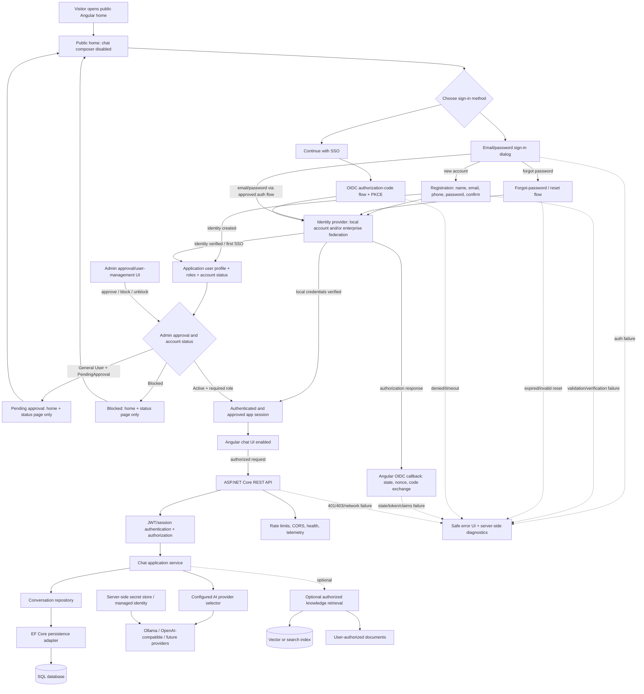

# AI Chat Application: Architecture and Feature Roadmap

## Vision

Build a maintainable AI chat application in stages, using a realistic product
delivery sequence. The application will provide an Angular single-page client,
an ASP.NET Core API, configurable AI providers, persisted conversations, and
secure access. Later stages add retrieval-augmented generation (RAG), Azure
hosting, and production operations.

This is a learning roadmap, not a claim that these features are already
implemented. At the outset, the repository contains an ASP.NET Core API with a
chat endpoint, Ollama and OpenAI-compatible service implementations, a shared
`Result` response, and exception middleware. Angular, authentication, database
persistence, RAG, and cloud deployment are future work.

## Target architecture

SAML is an identity-federation option when required by an organization. Prefer
OIDC for the Angular application and API when the identity provider supports it.
SAML may be integrated at the identity-provider boundary (for example, an
enterprise identity provider federating upstream with SAML and issuing OIDC
tokens to this application); do not build an identity provider into the app.

**Identity architecture is a release-time decision, not implemented behavior.**
The preferred direction is to use a trusted identity platform for both local
email/password accounts and external SSO/federation, so password hashing,
verification, recovery, lockout, MFA, and token issuance are not custom-built.
The Angular UI can present a branded sign-in dialog and registration/recovery
entry points while using the identity platform's supported flows. If the
selected provider cannot support the required local-account UX, evaluate
ASP.NET Core Identity plus a carefully designed session/token boundary before
implementation; do not invent password hashing or token protocols.

Phone number is collected only if there is a concrete product need. The current
recommendation is optional, with a clear purpose and retention policy; do not
use it for verification or recovery unless a verified-phone feature is
explicitly approved.

Application approval and permissions are separate from identity-provider
authentication. The identity provider proves identity; the application stores
its own user profile, account status, roles, and audit history. Every
registration/first SSO login starts as `PendingApproval` with the
`GeneralUser` role. Pending and blocked users may see only the public home and
their own account-status page; they cannot read saved conversations. Chat,
model calls, conversation APIs, and all other AI-related operations remain
disabled and are rejected by the API. An admin must approve a pending user
before the application grants chat access.

Do not give an account the Admin role at registration or based on an email
domain/claim alone. Bootstrap the first admin through an explicit, audited,
out-of-band operator process. Prevent removing/demoting/blocking the last
active administrator without an intentional recovery path. Require reason and
audit records for administrative state changes.

## Release train: gated feature keys

This is the authoritative implementation order. The earlier Phase 0-12 sections
are a topic/capability reference; they are not a second release numbering
system. Release IDs are stable: **key101** through **key110**. A key is not
complete when code merely compiles: finish its acceptance checks, tests,
documentation, review, and demo before starting the next key. Testing,
security, and documentation remain cross-cutting even when they have a
dedicated later key.

For every key:

1. Create a feature branch from the latest `dev`.
2. Confirm the key's outcome, dependencies, scope, and acceptance criteria.
3. Implement the smallest end-to-end slice that meets the outcome.
4. Add/update tests before relying on manual testing alone.
5. Update architecture, learning, and tracker docs as implementation changes.
   The canonical teaching material is in `docs/learning/` (module-wise); keep
   examples labeled implemented, planned, or practice-only. Map every workbook
   topic to a justified project feature or a small learning exercise, but do
   not add production code, packages, or infrastructure solely to demonstrate
   a concept.
6. Run the key's required checks; fix failures before opening a PR.
7. Open a PR to `dev`; review code, security, tests, cost, and docs.
8. Merge only after checks and review pass; demo the result and mark the tracker.
9. Start the next key only after recording any follow-up work as an explicit
   deferred task.

### key101 — Reliable code-explanation API (first release)

**Goal:** A developer can run the API locally, submit code, receive a consistent
explanation or actionable error, and verify the feature without a live hosted AI
account. Use Ollama locally when available; tests must use fake HTTP responses
and must not require Ollama to be running.

**Dependencies:** Existing ASP.NET Core API and current AI service.

**Small technical tasks**

1. Record the current endpoint route, request JSON, success JSON, invalid-input
   behavior, and provider-failure behavior in a checked-in API example.
2. Confirm the supported .NET SDK and document the exact restore/build/run
   commands for a clean clone.
3. Check configuration precedence: checked-in defaults, Development settings,
   environment variables, and User Secrets.
4. Remove any placeholder or real credential from tracked configuration; add
   safe example values and document secret setup.
5. Define the request DTO in an API contracts location rather than beside the
   controller.
6. Add required-code validation and an explicit maximum input length.
7. Define the public success/error response contract and keep its JSON property
   names stable.
8. Decide and document whether errors use the shared `Result` envelope or
   Problem Details; do not accidentally mix contracts.
9. Define a provider-neutral application outcome; keep HTTP status selection
   at the API boundary rather than letting arbitrary provider status codes
   dictate HTTP responses.
10. Keep the controller limited to request binding, application-service call,
    and outcome-to-HTTP mapping.
11. Add OpenAPI summary, request schema, success schema, and documented
    validation/provider error responses.
12. Make downstream HTTP calls respect the request cancellation token.
13. Configure a finite provider request timeout and document its relationship
    to the API request deadline.
14. Parse the provider response defensively; reject missing, empty, or
    incorrectly typed completion content as a provider failure.
15. Log provider failures with structured context, but never log API keys,
    bearer tokens, or submitted source code by default.
16. Return a safe public error message; expose internal exception detail only
    under an explicitly controlled local-development policy.
17. Add unit tests for valid input, blank input, too-long input, valid provider
    response, malformed provider response, non-success HTTP response, timeout,
    and caller cancellation.
18. Use a fake `HttpMessageHandler` or equivalent transport seam so unit tests
    are deterministic and do not call Ollama/OpenAI.
19. Add an API integration test for route, JSON binding, status code, response
    shape, and exception middleware behavior.
20. Add manual smoke-test requests and state clearly which one requires Ollama
    and a downloaded model.
21. Run formatter/analyzers, focused tests, full build, and `git diff --check`.
22. Update the architecture guide with actual request flow and update the
    learning guide with the real DTO/controller/service code paths.

**Exit gate:** clean restore/build, all focused and integration tests pass,
Swagger matches observed responses, valid and invalid requests are demoed, and
no provider call is needed to run automated tests.

### key102 — Configurable multi-model provider system

**Goal:** Switch between Ollama and OpenAI-compatible providers through
validated server configuration without changing controller or application
orchestration code.

**Dependencies:** key101 response and application boundaries are stable.

**Small technical tasks**

1. List provider-neutral capabilities required by the use case: messages,
   model, generation limits, completion text, usage metadata if available.
2. Define immutable application request/completion types; exclude HTTP-specific
   headers and JSON payloads.
3. Define an AI completion interface in the application-facing layer.
4. Move Ollama URL, model, and timeout to a typed options class.
5. Move OpenAI endpoint, model, timeout, and API key configuration to a typed
   options class.
6. Validate required settings and URI formats at application startup.
7. Register typed/named `HttpClient` instances with explicit timeouts.
8. Refactor Ollama serialization/parsing into its provider adapter.
9. Refactor OpenAI-compatible serialization/parsing into its provider adapter.
10. Normalize provider HTTP errors to safe application-level failures while
    preserving useful internal log context.
11. Create a provider selector that resolves only configured, registered
    providers.
12. Reject unknown provider names during startup instead of silently falling
    back to another model.
13. Register providers through DI; keep controllers unaware of concrete
    provider types.
14. Prevent credentials from being written to logs, exceptions, JSON responses,
    frontend settings, or source control.
15. Decide which generation settings are common and which remain optional
    provider capabilities.
16. Add provider adapter tests for request body, endpoint, headers, response
    parsing, non-success status, malformed response, timeout, and cancellation.
17. Add selector tests for each valid provider and invalid configuration.
18. Add a local smoke-test checklist for Ollama and an opt-in checklist for
    hosted inference.
19. Record provider trade-offs (latency, quality, privacy, cost, model license)
    in a decision record.
20. Update API/architecture/learning docs to reflect actual provider-selection
    code.

**Exit gate:** tests prove both adapters satisfy the same application contract;
changing one configuration value switches provider; invalid config fails
clearly; no hosted provider secret is required for the local test suite.

### key103 — Responsive Angular home and gated chat experience

**Goal:** A visitor sees a polished public home page with two clear entry
options—email/password and SSO. Chat controls are unavailable until the
application confirms an authenticated session. This key builds the user
experience and API integration; key104 supplies production authentication.

**Dependencies:** key101 API contract and key102 provider stability. Until
key104, show sign-in entry points as an explicit prototype/disabled
authentication state; do not imply that a decorative login unlocks protected
API access.

**Small technical tasks**

1. Scaffold Angular in a dedicated frontend directory with a supported Node
   version recorded in the repository.
2. Enable TypeScript strict mode and record package manager/install commands.
3. Create the root application shell and public home route.
4. Design a responsive header with product identity and clear **Sign in** and
   **Continue with SSO** actions.
5. Show a non-interactive chat preview for signed-out visitors; disable the
   composer, attachment/send controls, and conversation actions.
6. Explain why chat is locked and provide keyboard-accessible sign-in actions;
   do not rely on a dimmed button alone to convey the state.
7. Define explicit `loading`, `anonymous`, `pending-approval`, `active`,
   `blocked`, `rejected/disabled`, and `session-error` UI states; never infer
   access merely from a previously clicked button.
8. Define TypeScript API request/response types matching the API contract.
9. Add environment-specific API base URL configuration with no secrets.
10. Implement a typed Angular API service using `HttpClient`.
11. Build a reactive code-input form with required and length validation.
12. Disable duplicate submissions while a request is in flight.
13. Add an accessible loading indicator and announce relevant status changes.
14. Render model response as plain text by default.
15. If Markdown is required, select a maintained renderer and sanitize output;
    do not bypass Angular's security APIs to inject raw model HTML.
16. Display validation errors next to fields and provider/network errors in a
    recoverable message area.
17. Add retry behavior only for safe client actions; do not automatically
    resubmit expensive AI calls without user intent.
18. Configure a development proxy or an explicit local CORS origin.
19. Confirm production CORS is not widened just to make local development work.
20. Add unit tests for signed-out locked state, valid/invalid form, success,
    error, loading state, and repeated clicks.
21. Add a browser-level test for the signed-out landing page and
    submit-to-response using a controlled fake API/session.
22. Verify keyboard-only interaction, labels, focus, contrast, and mobile
    layout at narrow, tablet, and desktop widths.
23. Add frontend lint/build/test commands to the README and CI plan.
24. Update architecture and learning docs with actual component and service
    paths.

**Exit gate:** signed-out, pending, and blocked chat remain unusable and visibly
gated; only an active approved test session unlocks the client in tests;
responsive states are tested; no secrets or provider endpoints appear in the
browser bundle; key flows are keyboard accessible.

### key104 — Local account, SSO, approval, roles, and authorization

**Goal:** A user can choose email/password or SSO, complete the appropriate
registration/sign-in flow, and return to the Angular home page. New users begin
as `GeneralUser` + `PendingApproval`. An authorized admin approves them before
they can use chat. Pending and blocked accounts see only the public home and
their account-status page, never saved conversations; the API denies all
model, chat, conversation, and other AI capabilities.

**Dependencies:** key103 public home/login UX. Select an identity architecture
before implementation; record provider, token/session design, cost, and
limitations in the identity ADR. Do not implement custom password hashing,
OIDC, SAML, or JWT cryptography.

**Preferred architecture to evaluate:** one trusted identity platform manages
local credentials and external OIDC/SAML federation, so password hashing,
verification, recovery, lockout, MFA, and token issuance are not custom-built.
The Angular UI can provide branded sign-in/register/recovery entry points while
using supported identity-provider flows. If the selected provider cannot
satisfy local-account UX, evaluate ASP.NET Core Identity with a reviewed
session/token architecture before implementation; these approaches are not
interchangeable.

**Small technical tasks**

1. Compare identity providers for local username/password accounts, branded
   login/register/recovery, SSO federation, OIDC/JWT support, Angular libraries,
   email verification, MFA, free-tier limits, and production pricing.
2. Decide whether the email/password form is rendered in our Angular modal or
   provided by the identity platform; verify supported APIs for registration,
   recovery, lockout, and verification.
3. Decide phone-number policy. Default to optional and collect only for a
   documented purpose; decide whether it needs verification and retention.
4. Define only the account states needed by the selected provider (for example,
   pending verification, active, locked, disabled).
5. Create separate SPA client and API resource/audience registrations where
   required.
6. Configure exact local and deployed redirect, callback, and logout URLs.
7. Configure authorization-code flow with PKCE using a maintained OIDC
   library.
8. Implement SSO start action; redirect to the identity provider instead of
   collecting SSO credentials in the application.
9. Validate callback `state` and `nonce` through the OIDC library and handle
   authorization-code exchange according to the approved client/BFF design.
10. Validate issuer, audience, signature, lifetime, and required scopes/claims
    in the API or trusted session boundary.
11. Obtain only required identity/profile data; bind userinfo claims to the
    validated issuer and subject.
12. Link external accounts by stable issuer + subject, not email alone. Define
    a safe reconciliation policy for duplicate emails.
13. Build email/password sign-in form with email and password, show/hide
    password control, submit/loading/error states, and accessible labels.
14. Build registration form with name, email, phone (per the agreed policy),
    password, and confirm-password fields.
15. Validate password confirmation in the UI; validate security-critical fields
    again at the trusted server/identity boundary.
16. Never store or log raw passwords or confirmation values. Delegate password
    hashing, verification, lockout, and password policy to the selected
    identity platform / ASP.NET Core Identity.
17. Add email verification with a single-use, expiring token if required by the
    chosen provider and product decision.
18. Add forgot-password request that always shows a generic confirmation,
    whether or not the email address exists.
19. Add reset-password page; reject expired, invalid, reused, or mismatched
    reset tokens and offer a safe retry path.
20. Configure lockout, brute-force protection, MFA support, and per-IP/user
    rate limits with the provider.
21. Return users to the intended route only after successful authentication;
    allowlist return URLs to prevent open redirects.
22. Create a single application auth/session state source in Angular and
    re-check it on page refresh.
23. Enable chat only after an authenticated session is confirmed; route guards
    improve UX but do not replace API authorization.
24. Attach access tokens only to the intended API origin using the OIDC library
    or use the approved BFF/session design; document token storage, refresh,
    logout, XSS, and CSRF trade-offs.
25. Add sign-out that clears app session state and performs provider logout
    where supported.
26. Configure API JWT bearer validation for issuer, audience, signature,
    expiry, and HTTPS metadata, unless the approved BFF architecture uses
    another authenticated server-side boundary.
27. Add policies/scopes and a current-user abstraction; derive owner identity
    from validated claims only.
28. Verify `401` (missing/invalid session) vs. `403` (authenticated but not
    authorized); never represent either as a successful chat response.
29. Add tests for valid login, invalid credentials, unknown email without
    account enumeration, locked account, unverified email, registration
    validation, duplicate email, password mismatch, reset success/expiry/reuse,
    and throttling.
30. Add SSO tests for user cancellation/denial, provider unavailable, bad
    `state`/`nonce`, callback error, code exchange failure, invalid issuer or
    audience, expired token, missing required claims, and safe retry.
31. Add session/API tests for missing/expired token, wrong issuer/audience,
    insufficient scope, logout, and attempted cross-user data access.
32. Add an end-to-end test for public home → email/password or SSO → return to
    home → chat enabled, plus sign-out → chat locked.
33. For enterprise SAML, configure upstream identity-provider federation when
    required and continue using OIDC/JWT toward the app where possible.
34. Update the identity ADR with provider, account ownership, recovery, and
    token/session flow decisions.
35. Define application account status separately from roles:
    `PendingApproval`, `Active`, `Blocked`, and (if required) `Rejected` or
    `Disabled`; specify allowed transitions and who can perform each.
36. Define exactly two initial roles: `Admin` and `GeneralUser`. Never assign
    `Admin` through public registration, SSO email domain, or a client claim
    without a trusted provisioning rule.
37. Provision a local application user profile on local-account creation and
    on first successful SSO login; bind external identities by issuer + subject.
38. Assign `GeneralUser` and `PendingApproval` by default, including for valid
    SSO identities, unless an explicitly approved trusted provisioning process
    says otherwise.
39. Decide when the account enters the approval queue (for example, after
    required email verification) and what user-visible state is shown while
    waiting.
40. Add an admin-only pending-user queue with paging/search and a minimal
    profile view; do not expose passwords, tokens, or unnecessary PII.
41. Add approve, reject, block, and unblock actions with explicit confirmation,
    reason capture where appropriate, and resulting status display.
42. Require every admin-management API operation to validate authenticated
    `Admin` role/policy server-side; Angular route guards/buttons are not the
    security boundary.
43. Enforce state + role on every AI/chat endpoint: only `Active` users with an
    allowed role/permission can invoke a model or mutate chat data.
44. For `PendingApproval`, permit only the public home/account-status view;
    reject conversation-history reads, chat/model calls, and other protected
    features even if the Angular UI is bypassed.
45. For `Blocked`, revoke/expire the application session where supported and
    allow only the public home/account-status view; deny saved-history reads,
    conversation operations, model calls, and every AI feature.
46. Re-check account status on each protected request (or use a documented,
    short-lived cache/revocation strategy) so a newly blocked user cannot keep
    using an old long-lived token.
47. Add a secure initial-admin bootstrap procedure: explicit operator-created
    account/role assignment, one-time audited command or deployment procedure,
    never a hard-coded password or public self-registration.
48. Prevent accidental removal, demotion, or blocking of the last active
    administrator; define a break-glass recovery procedure.
49. Record approval, rejection, blocking, unblocking, role changes, actor,
    target user, timestamp, reason, and correlation ID in an append-only
    administrative audit history.
50. Define stable feature-permission keys (for example `chat.use`,
    `conversation.read.own`, `admin.users.review`, `admin.users.block`) and
    map them to roles rather than scattering role-name checks across features.
51. Include `UserPermissionOverrides` in the proposed schema for future
    per-user feature grants/restrictions, but defer enabling it until needed;
    define deny precedence and audit each change before exposing its admin UI.
52. Add tests for default `GeneralUser` + `PendingApproval`, admin approval,
    rejection, block/unblock, admin-only management, last-admin protection,
    pending/blocked API denial, active user success, forged client role, and
    stale status/token behavior.
53. Add end-to-end tests for registration → pending view-only → admin approval
    → chat enabled and active user → blocked → chat disabled/view-only.
54. Update identity ADR, database design, architecture diagram, learning cards,
    and tracker evidence; distinguish implemented behavior from test mocks.

**Failure handling and user experience**

- Invalid credentials: show a generic sign-in error; do not reveal whether the
  email exists.
- Network/provider outage: keep the user signed out, preserve only a safe
  return path, explain sign-in is unavailable, and provide retry.
- Unverified/locked/disabled account: show an approved next action without
  exposing unnecessary account details to an unauthenticated observer.
- Duplicate email/account-linking conflict: never auto-link based on email
  alone; offer a safe recovery/support path.
- Expired/used reset link: reject it and offer a fresh reset request.
- SSO cancelled/denied: return to the public home with a neutral message; keep
  chat disabled.
- OIDC callback state/nonce/code/token failure: clear partial auth state, log a
  correlation ID without tokens, and restart sign-in safely.
- Expired/invalid access token: attempt approved renewal once; if it fails,
  clear session and require sign-in again.
- API `401`/`403`: show sign-in/permission behavior and never retry the same
  unauthorized request indefinitely.
- Pending approval: show a calm “approval pending” page with sign-out and
  support/help options; expose no conversation history and never start a model
  request.
- Rejected or blocked account: show only the public home/account-status page
  and approved support/appeal guidance; do not reveal conversation history,
  admin notes, or internal reason fields.
- Admin approval action failure: retain queue state, show retryable error, and
  do not claim approval succeeded until the server confirms persistence.
- Concurrent admin decisions: reject or safely resolve stale state transitions;
  audit the final action and avoid silently overwriting another admin's change.
- Admin identity/permission unavailable: fail closed; never expose management
  controls or accept the action from a client-only role flag.
- Keep both sign-in options reachable after recoverable failures and preserve
  keyboard focus/accessibility on error messages.

**Exit gate:** both approved sign-in paths work end-to-end; registration,
verification, and recovery work according to the selected identity provider;
public chat is disabled until authentication **and account approval/status**
are confirmed; only Admin can manage approvals; pending/blocked users can see
only public home/account status (not conversation history) and cannot use any
AI feature even by calling the API directly; database state transitions and
audit history are tested; failure cases are automated and manually demoed; no
credential or token is logged or shipped to an untrusted client.

### key105 — SQL conversation persistence and private history

**Goal:** Authenticated users can save and retrieve their own conversations;
conversation context is loaded from SQL and sent to the selected AI provider
within a bounded context budget.

**Dependencies:** key104 identity and stable key102 provider contract.

**Small technical tasks**

1. Select initial SQL engine and record local/hosted options and cost.
2. Define retention, export, and deletion requirements before storing chats.
3. Extend the key104 application user/authorization schema with conversation
   tables; keep `AppUsers`, `Roles`, `UserRoles`, `Permissions`,
   `RolePermissions`, `AdminAuditEvents`, and the planned
   `UserPermissionOverrides` as shared foundations.
4. Keep authentication-provider credentials outside this application schema
   when a managed identity provider owns passwords; store its stable issuer +
   subject mapping and only necessary profile data.
5. Add unique constraints for external identity `(Issuer, Subject)` and
   appropriate normalized email rules; do not assume email alone is a
   permanent identity key.
6. Model Conversation, Message, timestamps, provider/model metadata, and
   external user subject with foreign keys to the application user.
7. Define primary keys, foreign keys, required fields, max lengths, ownership
   relations, delete behavior, and concurrency fields.
8. Add EF Core packages and configure `DbContext`.
9. Add indexes for user lookup, approval queue, role/status lookup,
   owner-based conversation list/detail, and message ordering based on actual
   queries.
10. Create and review migrations for user/authorization and conversation data.
11. Document local database creation and migration commands.
12. Define repository interfaces around actual user, approval, authorization,
   audit, and conversation use cases.
13. Ensure repository contracts do not leak `DbContext`, EF entities, or
    `IQueryable`.
14. Implement EF Core repositories with parameterized queries and explicit
    state-transition checks.
15. Use no-tracking for read-only results when appropriate and verify query
    behavior.
16. Add repository integration tests against the actual SQL provider or a
    disposable SQL instance.
17. Add create conversation and append message application use cases.
18. Add active-account/permission-filtered history endpoints with bounded
    pagination.
19. Add owner checks to every read, update, and delete path; reject history
    access for pending/blocked users even when they own the conversation.
20. Build prompt context from a documented number/token budget of recent
    messages.
21. Define behavior when the history exceeds the model context window.
22. Define transaction and simultaneous append/concurrency behavior.
23. Add retention/deletion tests and ensure deleted data is not reloaded into
    model context.
24. Inspect generated SQL and query plans for history/list/approval queries.
25. Explain repository portability limitations; document what a MongoDB
    implementation would need to change.
26. Update architecture diagram and learning guide with concrete persistence
    paths and migration commands.

**Exit gate:** migrations apply to an empty local database; active authorized
users can create/list/read only their own histories; pending/blocked users
cannot read history or call AI; approval, role, permission, and audit records
are persisted; integration tests prove authorization isolation and pagination;
model prompt context is bounded.

### key106 — API, frontend, and AI security hardening

**Goal:** The application safely handles untrusted users/content and limits
resource and model-cost abuse before any public deployment.

**Dependencies:** key104 identity and key105 ownership rules.

**Small technical tasks**

1. Draw a threat model covering browser, identity provider, API, database,
   provider, logs, and future document ingestion.
2. Create an allowlist of development/production Angular origins.
3. Verify CORS does not use permissive wildcard origins with credentials.
4. Add request body size and input length limits.
5. Add per-user authenticated rate limits.
6. Add an appropriate unauthenticated/IP-partitioned rate-limit policy for
   endpoints that remain public.
7. Return and test `429` behavior and retry guidance.
8. Add provider/model usage quotas or a clearly documented local-only mode.
9. Put local credentials in User Secrets/environment settings and check tracked
   config for credentials.
10. Configure hosted secret storage and managed identity where supported.
11. Run secret scanning and dependency vulnerability checks in CI.
12. Redact prompt, source code, access tokens, and provider credentials from
    logs/traces by default.
13. Document what code/chat content is sent to hosted providers and retention
    implications.
14. Treat user code and any retrieved content as untrusted prompt material.
15. Ensure model output cannot directly run code, SQL, shell commands, or
    privileged tools.
16. Validate model-generated structured output before application use.
17. Verify Angular renders generated content safely.
18. Add tests for rate limits, CORS, input limits, authorization ownership,
    sensitive logging, and safe failure behavior.
19. Add user-facing privacy/retention information before public demo.
20. Update threat model, architecture security boundaries, and learning cards.

**Exit gate:** documented threat model mitigations have tests; no secrets are
committed or shipped to the browser; rate limits and ownership controls are
verified.

### key107 — Quality engineering and continuous integration

**Goal:** Each pull request receives repeatable build, test, security, and
documentation validation.

**Dependencies:** Start the relevant tests in key101 and keep expanding them in
every prior key.

**Small technical tasks**

1. Inventory API, provider, frontend, persistence, and security test projects.
2. Set deterministic test configuration and avoid real external AI calls.
3. Add unit tests for application validation, context selection, provider
   selection, and error translation.
4. Add fake transport tests for every provider adapter branch.
5. Add API integration tests for routing, JSON, middleware, auth, and status
   mapping.
6. Add database integration tests for migrations, ownership, pagination, and
   concurrency behavior.
7. Add Angular component/service tests for form and state behavior.
8. Add Playwright end-to-end tests for the most important user journey.
9. Configure CI restore/install, build, lint/format, test, and artifact output.
10. Add dependency and secret scanning; document false-positive handling.
11. Configure required status checks before merging PRs.
12. Add PR checklist covering code, API compatibility, security, database
    migrations, tests, docs, and cost.
13. Publish test results and make failures actionable.
14. Verify CI from a clean branch with no local files or secrets.
15. Add a test coverage baseline; use coverage to find untested behavior, not
    as the only quality target.
16. Record test commands by backend/frontend test type in README.

**Exit gate:** clean checkout CI passes; core flows and security boundaries are
covered; merges cannot bypass required checks.

### key108 — RAG knowledge feature with measurable quality

**Goal:** Users can ask questions grounded in authorized knowledge documents
and receive relevant citations.

**Dependencies:** key105 ownership and persistence, key106 security rules, and
an explicit decision that grounded knowledge is in product scope.

**Small technical tasks**

1. Choose one supported document source and file type for the first slice.
2. Define upload permission, document owner, version, and deletion lifecycle.
3. Enforce file size, file type, and content extraction limits.
4. Create ingestion status and failure reporting.
5. Extract plain text with a safe, tested parser.
6. Define chunk metadata including source ID and page/section where available.
7. Add chunking tests for boundaries, empty content, and large documents.
8. Select embedding provider/model and calculate cost/privacy impact.
9. Select a local/hosted vector or search backend and record trade-offs.
10. Persist embeddings with owner/tenant access metadata.
11. Retrieve only authorized chunks and cap count and token budget.
12. Add source references to the application completion contract.
13. Return a safe insufficient-evidence outcome when retrieval is weak.
14. Create a small versioned evaluation dataset for retrieval and groundedness.
15. Measure retrieval relevance, citation correctness, and answer support.
16. Test prompt injection embedded in a document.
17. Test that users cannot retrieve documents owned by another user.
18. Ensure deletion removes content from future retrieval.
19. Add re-indexing behavior for updated documents.
20. Document embedding/index cost, data retention, and source attribution.

**Exit gate:** answers cite authorized documents; retrieval behavior is evaluated;
deletion and tenant-isolation tests pass; no result is claimed as grounded
without source evidence.

### key109 — Hosting and deployment

**Goal:** Deploy the tested application to a chosen environment with repeatable
configuration, secure secrets, health checks, and cost controls.

**Dependencies:** key107 CI and key106 security; key105 database migration
strategy.

**Small technical tasks**

1. Choose a deployment target and record why it fits runtime, learning, budget,
   and availability requirements.
2. Compare local-only, Azure free allowances, static frontend plus API host, and
   IIS/self-hosted options.
3. Calculate expected cost for compute, SQL, identity, model inference,
   telemetry, domain, storage, and egress.
4. Confirm runtime/OS/region and free-tier eligibility from current official
   documentation.
5. Create separate development/staging/production configuration values.
6. Create infrastructure-as-code for required cloud resources when using Azure.
7. Configure Angular build/deployment and the correct API URL.
8. Configure API hosting, HTTPS, health probes, and managed identity.
9. Configure database networking and least privilege.
10. Store secrets in platform secret storage/Key Vault; verify no secret enters
    build artifacts.
11. Define safe database migration execution and expand/contract changes.
12. Add CI/CD deployment to a non-production environment.
13. Require approval before production deployment.
14. Add rollback/redeploy procedure and verify it works.
15. Configure budget alerts, log retention, and cleanup instructions.
16. If IIS is chosen, document hosting bundle, app pool identity, TLS,
    firewall, reverse proxy, backups, and patching.
17. If hosting Ollama, verify RAM/CPU/GPU and model licensing; otherwise
    configure a remote provider without exposing its secret to Angular.
18. Run post-deployment smoke tests and verify telemetry/health state.

**Exit gate:** deployment can be repeated from CI; public endpoints use HTTPS;
secrets are server-side; health/smoke checks pass; budget alerts and teardown
steps are documented.

### key110 — Production-readiness, optional jobs, and capstone

**Goal:** Demonstrate operational reliability, senior-level trade-offs, and
optional durable background work only if measurements justify it.

**Dependencies:** key109 deployed environment and measured request behavior.

**Small technical tasks**

1. Measure request latency, provider failure rate, database query time, and
   model cost before adding reliability features.
2. Add structured logs with correlation IDs and safe fields.
3. Add metrics for endpoint status/duration, provider latency/error, and
   resource usage without sensitive prompt content.
4. Add distributed traces across API, database, and provider calls.
5. Distinguish liveness from readiness checks and test dependency outage states.
6. Define end-to-end deadline and per-provider timeout budgets.
7. Add bounded retry/backoff only for safe transient failures; test duplicate
   cost and cancellation behavior.
8. Add circuit breaker/backpressure only if outage/load evidence warrants it.
9. Profile memory/CPU and inspect SQL plans before optimizing.
10. Add cache only with documented privacy, freshness, key, and invalidation
    behavior.
11. Decide whether long inference/document ingestion needs background jobs.
12. If needed, add `202 Accepted`, job ID, durable status, and authorized result
    polling.
13. If using a queue, implement idempotent handlers, bounded retries, poison
    message handling, and dead-letter monitoring.
14. Add an outbox only if database write plus event publication needs atomic
    coordination.
15. Test duplicate delivery, worker restarts, cancellation, and permanent
    failure.
16. Write runbooks for provider outage, database outage, expired credentials,
    queue backlog, and budget threshold.
17. Conduct a final threat-model and dependency review.
18. Update the implemented architecture diagram, ADR status, and learning
    guide code references.
19. Prepare a demo covering auth, ownership, provider selection, SQL history,
    testing, and deployment.
20. Prepare interview answers explaining requirements, alternatives, scaling,
    failure modes, cost, and why the project remains a modular monolith.

**Exit gate:** operational dashboards/runbooks are usable; optional jobs are
justified by evidence; core failure scenarios are tested; the implementation
and docs agree; capstone demo can be completed from a clean setup.

### Key gates and dependencies

| Release key | Deliverable | Must pass before next key |
|---|---|---|
| key101 | Tested local API vertical slice | API contract, validation, provider fake tests, integration tests, docs |
| key102 | Configurable model providers | Settings validation, adapter tests, provider switch demo |
| key103 | Angular chat SPA | UI states, accessibility, frontend tests, API integration |
| key104 | OIDC/JWT identity | Token validation, `401`/`403`, ownership identity tests |
| key105 | Private SQL conversation history | Migrations, repository tests, owner isolation, bounded context |
| key106 | Security hardening | Threat-model controls, CORS/rate-limit/secrets/output tests |
| key107 | CI and maintainable tests | Clean CI pass and merge gates |
| key108 | Evaluated RAG | Authorized retrieval, citations, evaluation, deletion tests |
| key109 | Secure hosted deployment | Repeatable deploy, smoke/health checks, cost/teardown plan |
| key110 | Operational capstone | Runbooks, observability, reliability tests, demo, updated docs |

## Feature delivery roadmap

Each phase adds a user-visible or operational capability. Concepts are learned
in the context of implementing that feature, rather than as a separate
concept-only curriculum. Add concise code comments where a decision is
non-obvious; use this document for fuller explanations and trade-offs.

### Phase 0 — Establish the product baseline and team workflow

**Feature outcome:** A clean, reproducible starting point for development.

- Confirm API behavior, local configuration, supported .NET SDK, and how to run
  the application.
- Keep generated build and IDE state out of version control; provide safe
  configuration examples without credentials.
- Use feature branches and pull requests; protect `main` and require successful
  build/test checks before merging.
- Record initial requirements: explain code, support conversations, choose an
  AI provider, and keep a user's data private.

**Learning in context:** C# project structure, nullable reference types, records,
Git workflow, configuration sources, requirements clarification, estimation,
and design notes/ADRs.

**Done when:** A new developer can clone the repository, configure local
settings, run the API, and understand what is implemented versus planned.

### Phase 1 — Deliver a stable chat API

**Feature outcome:** A documented API accepts code and returns an explanation.

- Define request and response DTOs, validation limits, consistent status codes,
  and a stable error format.
- Keep controller responsibilities small; place orchestration in application
  services.
- Document endpoints with OpenAPI and provide safe example requests.
- Handle client disconnects and propagate cancellation through asynchronous
  work.

**Learning in context:** REST semantics, routing, DTOs, model binding, validation,
middleware ordering, Problem Details, async/await, cancellation, interfaces,
dependency injection, and API boundary design.

**Done when:** Valid and invalid requests produce predictable responses, the API
contract is visible in OpenAPI, and service errors do not leak internal details.

### Phase 2 — Support multiple AI providers through configuration

**Feature outcome:** The application uses the provider configured for the
environment without changing controller code.

- Define a provider abstraction and provider-neutral chat request/response
  contract.
- Implement Ollama and OpenAI-compatible adapters behind that abstraction.
- Bind validated provider settings with the Options pattern.
- Select the configured provider through a small factory/strategy or keyed DI
  registration; fail clearly for unknown provider names.
- Set explicit HTTP timeouts and preserve cancellation. Do not retry
  non-idempotent model requests blindly.

**Learning in context:** Composition, SOLID, Strategy, Factory, Adapter,
`IHttpClientFactory`, typed options, DI lifetimes, JSON parsing, timeout
handling, retries, circuit-breaker trade-offs, model and token limits.

**Done when:** Switching provider/model settings selects a different provider
without modifying the controller; invalid configuration has a useful
diagnostic and a safe API response.

### Phase 3 — Persist users, approvals, roles, and conversation context

**Feature outcome:** Application user/account status and authorization are
persisted separately from identity-provider credentials. Admin decisions are
audited, and users can access only their own conversation history.

- Design SQL entities for app users, external issuer/subject identifiers,
  account status, Admin/GeneralUser roles, conversations, messages, timestamps,
  and provider/model metadata.
- Add EF Core `DbContext`, migrations, indexes, constraints, and parameterized
  queries.
- Define application-focused repositories for user approval, role assignment,
  administrative audit, and conversation operations; implement with EF Core.
- Keep account status separate from roles; default registrations to
  GeneralUser + PendingApproval and require admin approval before AI use.
- Add feature-permission mappings so later per-user restrictions can be managed
  without changing every endpoint.
- Add pagination and owner/status checks; retrieve only the conversation
  context required for a request.
- Document how a non-SQL implementation would satisfy the same application
  contract and which semantics would need redesign.

**Learning in context:** SQL `SELECT`/filtering/joins/grouping/aggregates,
normalization, `NULL`, sorting, date handling, EF Core tracking, relationships,
migrations, transactions, optimistic concurrency, repository trade-offs,
Unit of Work trade-offs, indexes, execution plans, sargability, pagination,
N+1 detection, and database-specific behavior.

**Done when:** Approval/status/role/audit and conversation history are
persisted with migrations; only approved active accounts can use AI; history is
isolated per user; data access is testable; list endpoints use bounded
pagination.

### Phase 4 — Build the Angular public home and gated chat SPA

**Feature outcome:** Visitors see a responsive home page with email/password
and SSO choices; the chat UI remains locked until the application reports an
approved active session. Pending and blocked users see only the public home and
account-status page, not conversation history.

- Create an Angular SPA with standalone components and a typed API client.
- Add a code-entry/chat view, conversation list, loading state, error state, and
  accessible controls.
- Use reactive forms and client-side validation for usability; keep authoritative
  validation on the API.
- Use RxJS and Angular lifecycle-safe patterns for requests, cancellation, and
  state updates.
- Configure development proxy/origin settings without weakening production CORS.
- Show separate **Sign in** and **Continue with SSO** actions; provide
  registration and forgot-password entry points.
- Display pending-approval, blocked, denied, and failed-session states without
  exposing conversation history or internal admin notes.
- Hide/disable AI controls in view-only states while relying on API enforcement
  to deny direct calls.

**Learning in context:** TypeScript strict typing, generics and discriminated
unions, Angular components/templates/binding, services and DI, `HttpClient`,
Observables and operators, reactive forms, routing, lazy loading, change
detection/signals trade-offs, accessibility, frontend tests, and end-to-end
tests.

**Done when:** The Angular app shows the correct signed-out/pending/blocked/
active UX, active approved users can chat, failures are accessible, and the
browser calls only the API rather than AI provider endpoints directly.

### Phase 5 — Add identity, account approval, roles, and authorization

**Feature outcome:** Users authenticate by email/password or SSO, start as
GeneralUser + PendingApproval, and only gain chat access after Admin approval.
Admins can approve, reject, block, and unblock users. Pending/blocked users
see only public home/account status with no conversation history; the API
denies all AI-related features and protected conversation operations.

- Register an OIDC client for Angular and an API audience/resource with the
  identity provider.
- Use authorization-code flow with PKCE in the SPA; obtain access tokens for the
  API and send them as bearer tokens.
- Configure ASP.NET Core JWT bearer validation for issuer, audience, signature,
  and token lifetime. Validate policies and claims server-side.
- Enforce ownership at every conversation/message operation; never trust a user
  identifier supplied only by the client.
- Keep application account status separate from identity and role; enforce
  status + permission server-side on each protected request.
- Seed only Admin and GeneralUser roles; provision initial admin out-of-band,
  audit it, and protect the last active admin.
- Record approval/block/unblock/rejection and future permission changes in
  append-only audit history.
- Model feature permissions and role-permission associations now; introduce
  user-specific overrides only when the admin feature requires them.
- Support enterprise SAML needs through identity-provider federation where
  appropriate; keep the app/API token contract OIDC/JWT-based unless a concrete
  integration requires otherwise.

**Learning in context:** Authentication vs. authorization, OAuth 2.0, OIDC,
JWT claims and validation, PKCE, scopes, roles, policy-based authorization,
token lifecycle, SAML federation, secure redirect handling, and multi-tenant
identity boundaries.

**Done when:** Anonymous calls are rejected, authorized calls have least
privilege, only Admin can manage approvals, pending/blocked users cannot use
AI or read saved conversation history, and automated tests prove role/status
enforcement and user data isolation.

### Phase 6 — Harden the public API and AI interaction

**Feature outcome:** The application safely handles untrusted clients, input,
and model output.

- Restrict CORS to known frontend origins; do not treat CORS as an access
  control.
- Apply request-size limits, input validation, per-user/IP rate limits, and
  appropriate model usage quotas.
- Store provider credentials in a secret store; use local development secrets
  and managed identity/Key Vault in Azure. Never put API keys in Angular or
  checked-in settings.
- Treat submitted code and retrieved documents as untrusted prompt content.
  Minimize sensitive data, avoid sending unnecessary context, and validate
  model output before rendering or acting on it.
- Add safe rendering for generated content and clear user-facing privacy and
  retention behavior.

**Learning in context:** CORS, secrets, least privilege, rate limiting, abuse
prevention, prompt injection (including indirect injection), data leakage, PII,
output validation, XSS, CSRF/token-storage trade-offs, content filtering,
responsible AI, and cost controls.

**Done when:** Security configuration is environment-specific, secrets are not
in source control or browser bundles, and limits and privacy behavior are
documented and tested.

### Phase 7 — Make quality and maintainability part of delivery

**Feature outcome:** Changes can be made confidently with automated feedback.

- Add unit tests for orchestration, validation, provider selection, and error
  mapping using fakes at external boundaries.
- Add API integration tests for routing, authentication, authorization, and
  serialization.
- Add repository/database integration tests using a database-compatible test
  setup; avoid treating an in-memory provider as proof of SQL behavior.
- Add Angular unit and end-to-end tests for key user flows.
- Add pull-request CI for restore, build, formatting/analyzers, tests, and
  dependency/security checks.

**Learning in context:** Unit, integration, and contract testing, test doubles,
determinism, testable boundaries, code review, CI, dependency scanning, and
maintainability trade-offs.

**Done when:** The main user flows and critical security boundaries are covered
by automated tests, and CI blocks merges on failures.

### Phase 8 — Ground responses with project knowledge (RAG)

**Feature outcome:** The chat can answer questions using approved documents or
repository knowledge and provide citations.

- Add a controlled ingestion flow for supported documents, including ownership,
  source, version, and deletion metadata.
- Chunk content, generate embeddings, and index chunks in a selected vector or
  search store.
- Retrieve relevant chunks with tenant/access filters; consider hybrid search
  and reranking if evaluation shows a need.
- Include source references in the answer and clearly indicate when evidence is
  insufficient.
- Create an evaluation set to measure retrieval relevance and answer grounding.

**Learning in context:** Embeddings, chunking, vector search, hybrid retrieval,
reranking, citations, context windows, prompt templates, structured output,
hallucination evaluation, indirect prompt injection, and tenant isolation.

**Done when:** Answers cite authorized sources, retrieval quality is measurable,
and deleting or revoking a source prevents it from appearing in future
retrievals.

### Phase 9 — Improve reliability, observability, and user experience

**Feature outcome:** Failures are diagnosable and the app behaves predictably
under load or provider outages.

- Add structured logs, metrics, distributed traces, correlation IDs, and
  readiness/liveness health checks without logging prompts or secrets by
  default.
- Set end-to-end deadlines and provider-specific timeouts; choose bounded
  retries/backoff and circuit-breaker behavior based on provider semantics.
- Add graceful shutdown and cancellation propagation.
- Evaluate response quality, latency, token/cost usage, provider failures, and
  user feedback with privacy-conscious telemetry.
- Add caching only where privacy, freshness, and cost behavior are understood.

**Learning in context:** OpenTelemetry, Application Insights, logs/metrics/
traces, SLI/SLO concepts, health checks, production diagnostics, profiling,
memory/CPU performance, GC/allocation basics, backpressure, and failure modes.

**Done when:** Operators can diagnose a failed or slow request from telemetry,
health checks distinguish readiness from liveness, and retries do not amplify
provider outages.

### Phase 10 — Deploy securely to Azure

**Feature outcome:** The API, Angular client, and database are deployed through
repeatable environments.

- Choose hosting (for example App Service or containers) based on runtime,
  deployment, scaling, and operational requirements.
- Provision Azure SQL and other required resources through infrastructure as
  code.
- Configure managed identity and Key Vault access; keep credentials out of
  deployment artifacts.
- Deploy with environment-specific app settings, HTTPS, health probes, and
  staged rollout/rollback strategy.
- Add CI/CD with approvals for production and database migration safeguards.
- Monitor availability, latency, errors, usage, and cost in Azure.

**Learning in context:** App Service, containers, deployment slots, Azure SQL,
Storage, Key Vault, managed identity, networking, infrastructure as code,
autoscaling, CI/CD, rollback, availability, disaster recovery, cost management,
and cloud security.

**Done when:** A documented pipeline can deploy to a non-production
environment, run health checks, and promote or roll back safely.

### Phase 11 — Add queued processing if product requirements call for it

**Feature outcome:** Long-running generation or document ingestion can be
tracked without holding an HTTP request open.

- Add a job API with durable job status and an Azure Service Bus queue only when
  measured latency or workload requires it.
- Make consumers idempotent; use bounded retries, poison-message handling, and
  dead-letter queue operations.
- Define job ownership, cancellation, retention, and status polling or
  notification behavior.
- Consider an outbox when database changes and message publication must remain
  consistent.

**Learning in context:** Service Bus, queues/topics, competing consumers,
ordering, duplicate detection, retries, dead-letter queues, idempotency,
eventual consistency, outbox, and distributed failure handling.

**Done when:** Reprocessing a message does not duplicate user-visible work, and
failed messages can be diagnosed and safely retried or dead-lettered.

### Phase 12 — Capstone review and senior-engineer readiness

**Feature outcome:** The project can be presented as an end-to-end engineering
case study.

- Review requirements, architecture boundaries, security decisions, data model,
  AI provider trade-offs, and deployment topology.
- Use query plans, API traces, and load measurements to justify performance
  changes rather than optimizing by guesswork.
- Practice design review, estimation, prioritization, incident response, and
  explaining alternatives (including why a simpler design may be preferable).
- Prepare an interview walkthrough: requirements, diagram, trade-offs, failure
  scenarios, test strategy, and next steps.

**Learning in context:** System design, capacity estimation, scaling, cache and
database choices, modular monolith vs. microservices, DDD boundaries,
architecture decision records, mentoring, code review, incident ownership, and
technical communication.

**Done when:** The project has a tested feature set, a current architecture
diagram, deployment instructions, operational notes, and clear explanations of
key trade-offs.

## Cross-cutting implementation and learning practices

- Deliver each phase in a feature branch and pull request; do not develop
  directly on `main`.
- Update this roadmap and architecture diagram when implementation changes.
- For every feature, record the behavior, relevant code locations, how to run
  it, verification steps, and important trade-offs.
- Prefer simple, measurable designs. Add abstractions, databases, queues, and
  cloud services when the feature or operational need justifies them.
- Keep comments focused on non-obvious code decisions; use the learning guide
  and pull-request notes for detailed teaching explanations.
- Test failure paths and security boundaries as well as the happy path.
- Review data retention, privacy, and model-provider terms before sending user
  content to hosted models.

## Suggested documentation set as the project grows

- `PROJECT_ROADMAP.md` — this feature sequence, current status, and architecture
  vision.
- `README.md` — prerequisites, local setup, configuration, run instructions,
  and quick API usage.
- `docs/architecture.md` — implemented component diagram, request/data flows,
  trust boundaries, and deployment view.
- `docs/learning/README.md` and its module files — canonical concept
  explanations tied to actual or clearly labeled planned project examples.
- `docs/learning-guide.md` — compatibility page pointing to the canonical
  module-wise guide.
- `docs/decisions/` — short architecture decision records for choices with
  meaningful alternatives, such as identity provider, database, AI selection,
  and RAG store.

Documentation should distinguish implemented behavior from planned work and
should be updated in the same change as the feature it describes.

## Detailed, phase-by-phase engineering tasks

This checklist breaks the feature roadmap into small implementation tasks. Tasks
are ordered dependencies, not promises about calendar duration. Work one small
feature branch / pull request at a time; update the relevant docs and status in
the same pull request.

### Phase 0 — Product baseline and team workflow

- [x] Confirm the repository is an ASP.NET Core Web API and inspect its local
  run profile and configuration.
- [x] Ignore .NET build output, IDE state, and local Postman metadata.
- [x] Add an initial feature roadmap and architecture diagram.
- [ ] Add a README section with SDK prerequisites and exact restore/build/run
  commands.
- [ ] Add an example configuration file containing only non-secret defaults.
- [ ] Move machine-specific launch-profile choices out of shared defaults when
  they are not needed by every developer.
- [ ] Add a short contribution workflow: feature branch, PR, checks, review,
  merge.
- [ ] Add GitHub Actions CI for restore, build, formatting/analyzers, and tests.
- [ ] Record product requirements and non-functional goals (privacy, latency,
  budget, availability) in an ADR or requirements document.

### Phase 1 — Stable chat API

- [ ] Agree on the chat API contract: request fields, response envelope, status
  codes, maximum input length, and whether conversation IDs are optional at
  first.
- [ ] Move API request DTOs out of the controller into an API contracts folder.
- [ ] Add validation attributes or explicit validators for required code,
  maximum length, and supported request options.
- [ ] Define a consistent API error shape and decide whether to standardize on
  `ProblemDetails` or the existing `Result` envelope; do not produce two
  competing error formats.
- [ ] Map service outcomes to HTTP status codes in one clear boundary and avoid
  returning arbitrary status codes from a provider.
- [ ] Keep the controller limited to binding, calling application logic, and
  translating the outcome to HTTP.
- [ ] Add OpenAPI summaries and response documentation for normal and error
  paths.
- [ ] Add a checked-in `.http` example for valid input, invalid input, and a
  provider failure scenario.
- [ ] Preserve cancellation from the HTTP request through orchestration and the
  downstream `HttpClient` request.
- [ ] Verify null, empty, overly large, malformed, and unsupported requests.
- [ ] Confirm exception responses do not disclose stack traces or provider
  credentials outside development.

### Phase 2 — Configurable multi-provider AI

- [ ] Define a provider-neutral request type containing prompt/messages,
  generation options, and cancellation.
- [ ] Define a provider-neutral completion type containing content and only
  metadata the application actually needs.
- [ ] Create an AI provider interface that represents model completion rather
  than an endpoint-specific “explain code” operation.
- [ ] Move provider configuration into validated options classes (provider key,
  endpoint, model, timeout, token/output limit).
- [ ] Decide how secrets enter configuration locally (user secrets/environment)
  and in hosted environments (platform secret store); never check in keys.
- [ ] Refactor the Ollama HTTP implementation to implement the provider
  interface; validate its response shape and report provider errors safely.
- [ ] Refactor the OpenAI implementation to implement the same interface; keep
  its credentials isolated from public/browser code.
- [ ] Add a provider selector/factory that maps a configured provider name to
  the registered implementation.
- [ ] Validate provider selection at startup so misspelled provider names fail
  clearly before serving traffic.
- [ ] Keep provider-specific JSON and HTTP details inside each adapter.
- [ ] Set connection and request timeouts; distinguish timeout, cancellation,
  transport, non-success HTTP, and invalid-response outcomes.
- [ ] Do not retry invalid requests or user-cancelled work; add bounded transient
  retries only after deciding how duplicate model calls affect cost.
- [ ] Test provider selection and provider error mapping with fake HTTP
  responses; do not require Ollama to run for unit tests.
- [ ] Document supported providers, required settings, limitations, and local
  smoke-test commands.

### Phase 3 — SQL persistence, EF Core, and conversation context

- [ ] Select the first SQL engine for local development and hosting; document
  why (for example, SQL Server/Azure SQL alignment or PostgreSQL availability).
- [ ] Define persistence requirements and retention/deletion rules before
  deciding the schema.
- [ ] Create domain/persistence types for conversation, message, timestamps,
  status, model/provider metadata, and external identity subject.
- [ ] Add EF Core packages and a `DbContext`; configure keys, relationships,
  lengths, required fields, and indexes.
- [ ] Create the initial migration and a repeatable local database setup
  command.
- [ ] Define repository interfaces around use cases (create conversation,
  append message, get owned conversation, list page); return domain/application
  data rather than EF entities or `IQueryable`.
- [ ] Implement EF Core repositories with parameterized LINQ; use no-tracking
  queries for read-only views where appropriate.
- [ ] Decide explicitly whether a Unit of Work abstraction adds value beyond
  EF Core `DbContext` transaction/change tracking; avoid a redundant wrapper.
- [ ] Add repository tests against the actual selected database provider or a
  disposable database container; do not assume EF InMemory proves SQL behavior.
- [ ] Add API operations to create a conversation, append a message, and page
  through the caller's conversations.
- [ ] Enforce conversation ownership in repository queries and application
  logic, not only in Angular.
- [ ] Select a bounded, recent conversation context for the provider; enforce a
  token/context budget and define truncation/summarization behavior.
- [ ] Add optimistic concurrency or a clear append-order strategy for
  simultaneous requests.
- [ ] Add delete/export/retention behavior before storing sensitive user data.
- [ ] Inspect query plans and add indexes based on real query patterns.
- [ ] Document migration deployment and rollback considerations.
- [ ] Document what would need to change for a MongoDB adapter; repository
  boundaries reduce coupling but do not erase transactional/query differences.

### Phase 4 — Angular single-page chat application

- [ ] Scaffold an Angular application under a clearly named frontend directory;
  keep frontend and API build/run instructions distinct.
- [ ] Enable TypeScript strict mode and establish formatting/lint conventions.
- [ ] Create app shell, navigation, responsive layout, and accessible page
  landmarks.
- [ ] Define TypeScript API contract types that match the server DTOs without
  copying server-only implementation types.
- [ ] Add an Angular API service using `HttpClient`; configure the API base URL
  per environment.
- [ ] Build the code input form with required/length validation and a submit
  state that prevents accidental duplicate submissions.
- [ ] Display model response as text by default; if supporting Markdown, use a
  maintained safe renderer and avoid unsafe HTML bypasses.
- [ ] Show loading, empty, success, validation, network failure, and server
  error states accessibly.
- [ ] Add conversation list and conversation detail routes after persistence
  endpoints are ready.
- [ ] Use RxJS operators and Angular lifecycle-safe mechanisms to cancel stale
  requests and clean up subscriptions.
- [ ] Add an HTTP interceptor only for cross-cutting concerns (later, token
  attachment); do not hide feature behavior inside it.
- [ ] Configure development proxy/CORS origins explicitly; use separate
  environment configuration for deployment.
- [ ] Add component/service tests and an end-to-end test for submit, response,
  error, and conversation navigation.
- [ ] Add keyboard, screen-reader, contrast, mobile-layout, and generated-output
  rendering checks.

### Phase 5 — Email/password, SSO, account recovery, and API authorization

- [ ] Select an identity platform that supports the desired local account and
  external SSO flows; compare budget, registration/recovery UX, federation, and
  deployment terms in ADR 0003.
- [ ] Present email/password and SSO as distinct choices on the public home;
  chat remains locked until the application confirms a real session.
- [ ] Add registration fields for name, email, phone (optional unless justified),
  password, and confirmation; never store confirmation or raw passwords.
- [ ] Add email verification, forgot-password, and reset-password flows using
  the identity platform's secure single-use, expiring tokens.
- [ ] Use generic sign-in/reset messages to prevent account enumeration; add
  lockout, throttling, and safe duplicate-email handling.
- [ ] Redirect SSO users to the identity provider and support authorization-code
  flow with PKCE; do not collect enterprise SSO passwords in the app.
- [ ] Register the SPA as a public OIDC client and the API as a protected
  resource/audience in the identity provider.
- [ ] Configure authorization-code flow with PKCE and exact allowed redirect and
  logout URLs.
- [ ] Integrate Angular with a maintained OIDC client library; do not implement
  token cryptography or protocol flows yourself.
- [ ] Configure API JWT bearer validation for issuer, audience, signature,
  expiry, and HTTPS metadata as appropriate.
- [ ] Add a protected endpoint and verify anonymous calls receive `401`.
- [ ] Define policies/scopes for API capabilities; distinguish `401`
  unauthenticated from `403` authenticated-but-forbidden.
- [ ] Map the validated token subject to an application owner identifier.
- [ ] Apply owner filters to every conversation/message read, write, and delete.
- [ ] Test cross-user access denial at API/repository level, not only UI routing.
- [ ] Define token storage/session behavior using the OIDC library’s recommended
  approach; document XSS/CSRF trade-offs.
- [ ] For enterprise SAML, use identity-provider federation where necessary and
  continue issuing OIDC/JWT access tokens to the SPA/API where possible.
- [ ] Document that a generic SAML login is not a replacement for API bearer
  token validation.
- [ ] Test invalid credentials, unknown email, duplicate registration,
  verification pending, locked account, invalid/expired reset links, SSO cancel,
  provider outage, callback state/nonce failure, invalid claims/token,
  expired session, and unauthorized API requests.
- [ ] Clear partial sign-in state on callback failures, log only safe
  correlation IDs, and keep chat disabled until sign-in succeeds.

### Phase 6 — API and AI security hardening

- [ ] Create a threat model for browser, API, identity provider, model provider,
  database, and uploaded/retrieved content.
- [ ] Configure an allowlist of Angular origins; do not use wildcard origins
  with credentials.
- [ ] Set maximum request-body and code length limits at the API boundary.
- [ ] Add authenticated per-user and unauthenticated per-IP rate limits with
  separate policies; test `429` behavior and `Retry-After`.
- [ ] Add model usage quotas/budget alerts where the provider supports them.
- [ ] Store local secrets outside tracked files; add secret scanning to CI.
- [ ] In Azure, use managed identity for Azure resources and a secret store for
  secrets that still require a secret; avoid embedding secrets in Angular.
- [ ] Review logs and traces to ensure prompts, source code, tokens, and
  credentials are not collected by default.
- [ ] Treat code, prompts, and retrieved documents as untrusted instructions;
  keep system instructions separate and do not grant model output direct
  execution authority.
- [ ] Validate structured model output against a schema before consuming it.
- [ ] Render generated Markdown safely and keep any future tool/function calling
  behind server-side authorization and explicit allowlists.
- [ ] Add data retention/deletion behavior and document what content leaves the
  application for hosted models.
- [ ] Add dependency and container/image scanning where applicable.

### Phase 7 — Tests and engineering delivery pipeline

- [ ] Create separate test projects/suites for application unit tests, API
  integration tests, and persistence integration tests.
- [ ] Unit-test validation, provider selection, context construction, status
  mapping, and cancellation.
- [ ] Use fake `HttpMessageHandler` responses for provider adapter tests.
- [ ] Test API serialization, routing, validation, authentication, and
  authorization with `WebApplicationFactory` or an equivalent supported test
  host.
- [ ] Test migrations and repository behavior against the chosen SQL engine.
- [ ] Add Angular unit tests for forms, API states, and rendering.
- [ ] Add Playwright end-to-end tests for critical user journeys, using a test
  identity setup or controlled mock OIDC provider.
- [ ] Add CI jobs to restore/install, build, lint/format-check, test, and publish
  test artifacts.
- [ ] Make CI fail on test, formatting, dependency audit, and secret-scan
  failures according to documented policy.
- [ ] Use PR review templates for behavior, security, tests, docs, cost, and
  migration impacts.
- [ ] Keep tests deterministic; isolate external AI calls and assert contracts,
  not exact probabilistic prose.

### Phase 8 — RAG and document-grounded answers

- [ ] Choose a first knowledge source and define who may upload/read/delete each
  document.
- [ ] Define document metadata, versioning, tenant/owner scope, and deletion
  lifecycle.
- [ ] Create an ingestion pipeline that validates file type/size and extracts
  text safely.
- [ ] Split content into chunks with source/page/section metadata; make chunk
  size and overlap configurable only when evaluation justifies it.
- [ ] Select an embedding model and vector/search store; estimate storage,
  compute, and model costs.
- [ ] Generate embeddings and store chunks with access-control metadata.
- [ ] Retrieve only authorized chunks and limit retrieval count and total
  context tokens.
- [ ] Include citations/source identifiers and a safe “not enough evidence”
  response behavior.
- [ ] Create a small, versioned evaluation set measuring retrieval relevance,
  citation correctness, and groundedness.
- [ ] Test prompt injection inside retrieved documents and tenant isolation.
- [ ] Implement deletion/re-indexing so removed documents cannot remain
  retrievable.

### Phase 9 — Reliability, observability, and performance

- [ ] Add structured logs with correlation/trace IDs and environment-appropriate
  log levels.
- [ ] Add metrics for request count/duration/status, model provider duration and
  failure class, and safe usage/cost estimates.
- [ ] Add distributed tracing across API, database, and outbound provider calls;
  redact sensitive request/response bodies.
- [ ] Add liveness and readiness health checks; readiness should reflect
  dependencies needed to serve requests.
- [ ] Set an end-to-end request deadline and provider-specific timeout budgets.
- [ ] Add resilience policies only for transient errors and account for duplicate
  inference cost, user cancellation, and provider rate limits.
- [ ] Add backpressure/maximum concurrency for local Ollama or constrained
  hosting.
- [ ] Measure before optimizing; use a profiler, query plans, and load tests to
  find the bottleneck.
- [ ] Evaluate cache keys and tenant isolation before caching any AI response.
- [ ] Document operational alerts, runbooks, model outage behavior, and
  escalation/incident notes.

### Phase 10 — Hosting and cloud deployment

- [ ] Select a target deployment profile: local demo, always-on production-like
  service, or Azure learning deployment.
- [ ] Decide whether the Angular build is hosted separately or served as static
  files; keep the API URL and CORS configuration aligned.
- [ ] Compare total monthly cost for app compute, database, identity, logs,
  storage, domain/DNS, egress, and model inference before provisioning.
- [ ] Choose deployment compute based on supported .NET runtime/container model;
  validate platform and region support before selecting a free tier.
- [ ] Provision infrastructure through Bicep/Terraform or another reviewed
  infrastructure-as-code approach when cloud deployment begins.
- [ ] Configure HTTPS, managed identity, Key Vault access, health probes, and
  least-privilege database connectivity.
- [ ] Add deployment environments and pipeline approvals; keep test/staging
  settings separate from production.
- [ ] Define how EF migrations run safely during deployment and how to roll back
  incompatible changes.
- [ ] Configure log/metric retention and budget alerts; test shutdown of
  resources to avoid surprise charges.
- [ ] Document IIS deployment as a self-hosted Windows option, including reverse
  proxy/hosting bundle, TLS, firewall, process identity, updates, backups, and
  database exposure controls.

### Phase 11 — Optional background jobs and messaging

- [ ] Add a queue only if measured latency, workload, or ingestion requirements
  justify asynchronous jobs.
- [ ] Define job lifecycle and API contract (`202 Accepted`, job identifier,
  status/result endpoint).
- [ ] Choose a broker (for example Azure Service Bus for Azure learning) and
  document its cost/free-tier limits and local development alternative.
- [ ] Make handlers idempotent; persist state needed to deduplicate work.
- [ ] Add bounded retry/backoff, poison-message handling, and dead-letter
  monitoring.
- [ ] Add an outbox only if a database update and event publish must be atomic.
- [ ] Test duplicate delivery, worker restart, cancellation, and permanent
  failure.

### Phase 12 — Capstone and senior-engineer interview walkthrough

- [ ] Draw the implemented architecture separately from the target roadmap.
- [ ] Document key ADRs and alternatives rejected, including why they were
  rejected.
- [ ] Prepare a demo of anonymous rejection, authenticated ownership, provider
  configuration, persistence, and failure handling.
- [ ] Use load/query measurements to describe a real performance investigation.
- [ ] Prepare an incident scenario (provider outage, database outage, leaked
  credential, or queue backlog) and the response/runbook.
- [ ] Explain scaling, consistency, modular monolith vs. services, cost, privacy,
  and availability trade-offs.
- [ ] Review documentation and setup from a clean clone to verify a new
  developer can follow it.

## Tooling and cost guide

Prices and free-tier limits change by provider, region, date, and account
eligibility. Verify the linked official pricing page and calculator immediately
before creating resources. “Free tier” is not synonymous with unlimited,
always-on, production-grade, or zero-billing-risk.

| Tool or service | Cost category | Use in this project |
|---|---|---|
| .NET SDK / ASP.NET Core | Free, open source | API runtime and development |
| Angular framework / Angular CLI | Free, open source | SPA framework and tooling |
| Visual Studio Code | Free | Editor |
| Git / GitHub public repository | Git is free; GitHub features/limits vary by plan | Version control, PRs, CI |
| Ollama | Free, open-source software; hardware/electricity are not free | Run models locally; model license and hardware requirements vary |
| Local SQL Server Developer / PostgreSQL | Free developer/community editions; hosting is separate | Local persistence learning |
| EF Core | Free, open source; database provider support varies | Data access and migrations |
| OpenAPI/Swagger tooling | Free/open-source options exist; package licenses vary | API documentation and testing |
| Postman | Free and paid plans; feature/team limits vary | Manual API calls |
| Playwright | Free, open source; hosted CI minutes may be metered | Browser automation |
| GitHub Actions | Free allowances depend on plan/repository/runner; overages may be paid | Build/test CI |
| OIDC identity provider | Depends on provider; some offer free developer tiers, some are paid | Sign-in and test identities |
| OpenAI or other hosted model APIs | Usually usage-based paid service | Hosted inference; set spending limits |
| Azure App Service | Free/shared options may exist with limits; paid tiers for capacity/features | Host API; confirm OS/runtime/region/limits |
| Azure Static Web Apps | Free and paid plans have different features/limits | Angular static SPA hosting |
| Azure SQL Database | Free offers/limits may be available; paid beyond eligibility/allowance | Hosted relational database |
| Azure Key Vault / Application Insights / Service Bus | Free grants/allowances or paid usage depending on service and tier | Secrets, telemetry, and optional messaging |
| Cloudflare Pages / GitHub Pages | Free static hosting plans with product limits | Angular static frontend; not the ASP.NET API/database |
| Render and similar PaaS hosts | Free or low-cost plans depend on current product/region policy; limits may include sleep/quotas | Possible API hosting after verifying .NET/container support |
| Windows + IIS on your own machine | IIS is included with supported Windows editions; the server is not “free” to operate | Learning/self-hosting; power, internet, DNS, TLS, uptime, and security are your responsibility |

### Hosting options for a completely free learning demo

1. **All local (recommended first):** Run Angular, the API, Ollama, and a local
   database on your development machine. There may be no hosting invoice, but
   hardware, electricity, internet, model downloads, and your time still have
   costs. The app is only available while your machine and services are running.
2. **Static frontend + local API:** Publish the Angular static build on a free
   static hosting plan and keep the API/Ollama local. This is not a public
   end-to-end hosted application unless you expose the API securely; exposing a
   development machine to the internet is not recommended.
3. **Azure free allowances:** Azure currently advertises selected free services
   and free/paid App Service plan options, but eligibility, quotas, runtime
   support, region, and duration vary. Azure SQL may have free offers/allowances.
   Confirm the exact offer in your account and calculator, set budget alerts,
   and remove unused resources. Do not assume every component of the complete
   stack stays free.
4. **Self-host IIS on a Windows PC:** This can avoid a cloud compute bill for a
   demo but is not a safe or reliable “free public hosting” shortcut. A public
   server needs patching, TLS, firewall/router configuration, backups, uptime,
   a stable network, and secure database access. Prefer a private demo or VPN
   rather than directly exposing a development PC.
5. **Free third-party tiers:** A static SPA may fit a free tier, while the API
   or database may sleep, have quotas, or require a paid plan. Verify that the
   provider supports the chosen .NET deployment method and that its terms meet
   your needs before relying on it.

Official pricing references:

- [Azure free services](https://azure.microsoft.com/pricing/free-services/)
- [Azure App Service pricing](https://azure.microsoft.com/pricing/details/app-service/)
- [Azure SQL Database pricing](https://azure.microsoft.com/pricing/details/azure-sql-database/single/)
- [Azure pricing calculator](https://azure.microsoft.com/pricing/calculator/)
- [Azure Static Web Apps pricing](https://azure.microsoft.com/pricing/details/app-service/static/)
- [Cloudflare Pages documentation](https://developers.cloudflare.com/pages/)

For a safe zero-cloud-cost start, keep the full stack local with Ollama and a
local database. Treat hosting as its own feature phase; before deploying,
compare a local demo, Azure free allowances, a free static frontend plus a
separately hosted API, and self-hosted IIS. Never put a provider key in the
Angular app.
