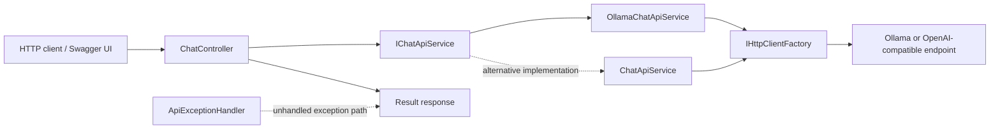
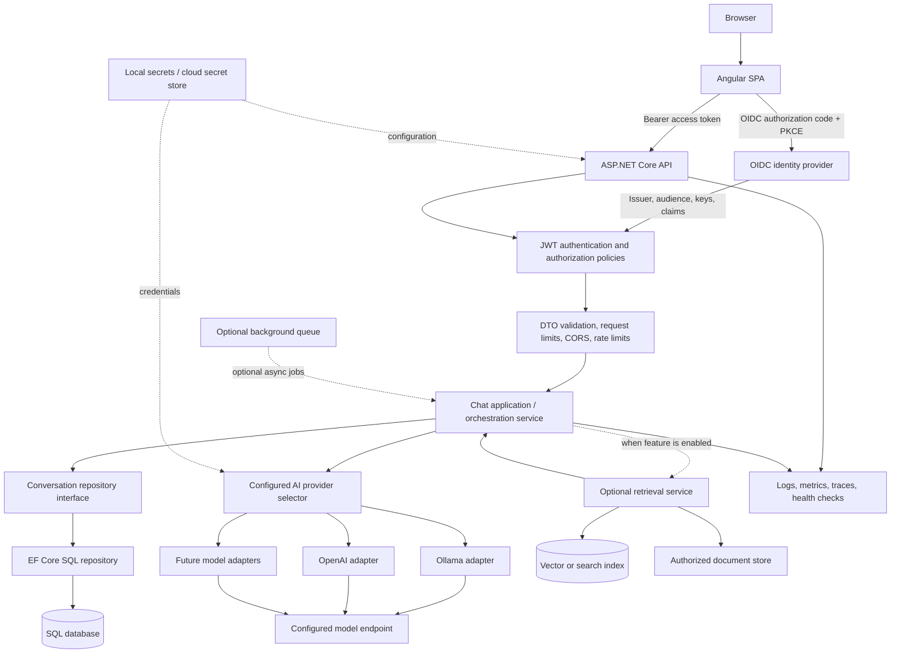
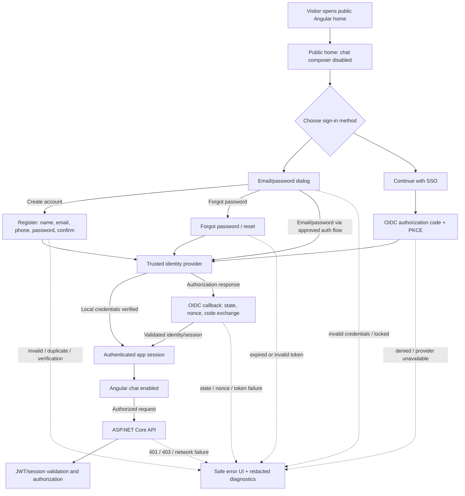

# AI Chat Application Architecture

## Document status

This document separates the **current implementation** from the **target
architecture**. Planned components are not represented as existing code.
Implementation status and work sequence live in
[the project roadmap](../PROJECT_ROADMAP.md).
Development is gated by release keys **key101-key110**; each key must pass its
acceptance checks before the next begins. The
[topic tracker](TOPIC_TRACKER.md) records learning progress, and the
[learning guide](learning-guide.md) expands concepts in the order their feature
is implemented.

## Product vision

Provide a browser-based chat experience where a user submits code, receives
AI-generated explanations, and can later manage private conversation history.
The application will use an Angular single-page application (SPA), an
ASP.NET Core REST API, a configurable AI provider, and a relational database.
Authentication, persistence, retrieval-augmented generation (RAG), and cloud
deployment are introduced in separate feature phases.

## Current repository architecture

### Current implementation notes

- The backend is an ASP.NET Core Web API targeting .NET 10.
- `ChatController` exposes the code-explanation endpoint and delegates to
  `IChatApiService`.
- `OllamaChatApiService` and `ChatApiService` implement the current service
  contract. `Program.cs` registers Ollama as the active implementation.
- Provider requests are made with `HttpClient`; no provider SDK abstraction is
  currently used.
- The API has a shared `Result` envelope and an exception handler.
- The active Ollama endpoint/model are configured in `appsettings.json`.
- There is no Angular project, authentication, database, EF Core, conversation
  history, RAG, or cloud deployment implemented yet.
- The `main` branch is protected from this feature work by doing development on
  `dev` and proposing changes for manual PR review.

Relevant implementation files:

- [Program.cs](../Program.cs) — service registrations and HTTP pipeline.
- [ChatController.cs](../Controllers/ChatController.cs) — current API entry
  point.
- [IChatApiService.cs](../Services/IChatApiService.cs) — current chat service
  contract.
- [OllamaChatApiService.cs](../Services/OllamaChatApiService.cs) — Ollama HTTP
  call and response parsing.
- [ChatApiService.cs](../Services/ChatApiService.cs) — OpenAI-compatible
  implementation.
- [Result.cs](../Responses/Result.cs) — shared API response envelope.
- [ApiExceptionHandler.cs](../Middleware/ApiExceptionHandler.cs) — unhandled
  exception response handling.

## Target logical architecture

### Identity and home-page flow

All identity components in this flow are planned. The exact identity provider
and whether credentials are managed by that provider or ASP.NET Core Identity
must be decided in key104 and recorded in
[ADR 0003](decisions/0003-identity-and-federation.md). The preferred approach
is a trusted identity platform that supports local accounts and upstream
federation. Do not create a custom password store or token protocol simply to
keep all screens inside Angular.

### Public home and sign-in UX

The home page is accessible without a session, but the chat composer and
conversation actions stay disabled until an authenticated session is confirmed.
Show a read-only preview and a clear message explaining why chat is locked.
Provide two visible actions: **Sign in** (email/password dialog with create
account and forgot-password links) and **Continue with SSO** (redirect to the
identity provider). On small screens, stack the actions; retain visible labels,
keyboard access, dialog focus management, and assistive-technology status
announcements.

Registration collects name, email, phone according to the approved policy,
password, and confirmation. Confirm-password is a client-side check and must
not be stored. Phone is recommended to be optional unless a concrete feature
requires it. Password hashing, email verification, reset, lockout, and
credentials must be handled at the trusted identity boundary.

### Authentication failure behavior

| Failure | UI behavior | Security behavior |
|---|---|---|
| Wrong credentials | Generic sign-in error and retry | Do not reveal if an email is registered; rate-limit attempts |
| Duplicate registration | Offer sign-in or password-reset path | Avoid account enumeration; never auto-link by email |
| Password confirmation mismatch | Inline validation before submit | Server/identity provider validates submitted registration |
| Email verification pending | Offer resend/continue verification | Keep protected API/chat access disabled |
| Locked or disabled account | Show safe next step/support route | Do not bypass lockout |
| Unknown email on password reset | Show the same generic confirmation | Do not reveal account existence |
| Expired/reused reset token | Explain link expiry and offer a fresh request | Reject the token; never allow replay |
| User cancels SSO | Return to public home with neutral message | Keep chat disabled |
| Identity provider unavailable | Show temporary issue and retry option | Do not fall back to a fake authenticated session |
| State/nonce/code-exchange failure | Clear partial login state and offer restart | Reject callback; never log codes or tokens |
| Invalid issuer/audience/signature/claims | Safe sign-in failure message | Reject identity/token and deny API access |
| Expired token/session | Try only approved renewal, then request sign-in | API returns `401`; do not retry indefinitely |
| Insufficient permission | Show access-denied state | API returns `403`; do not treat as signed out success |
| API/network unavailable | Show retryable chat error | Never call model provider directly from Angular |
| Session state cannot be verified | Return to locked home/login options | Fail closed until authentication is re-established |

Log only safe failure categories and correlation IDs. Never log passwords,
reset tokens, authorization codes, access tokens, or full user-info payloads.

### Request flow: chat completion

1. The user establishes a session through the approved email/password or SSO
   flow; SSO uses OIDC authorization-code flow with PKCE where configured.
2. Angular obtains the approved API access token or uses the approved BFF
   session and calls the API over HTTPS.
3. ASP.NET Core validates the JWT or trusted session and authorizes the
   requested operation.
4. The API validates the request and applies input, request-size, CORS, and
   rate-limit policies.
5. The chat application verifies conversation ownership and loads only the
   bounded context needed for the request.
6. The configured provider adapter converts the provider-neutral request into
   the provider's HTTP/SDK format.
7. The adapter applies timeouts/cancellation, parses the response, and maps
   provider errors to application outcomes without exposing secrets.
8. The application persists user and assistant messages according to the
   retention rules and returns a stable API response.
9. Angular renders the answer as text or safely sanitized Markdown, with
   loading/error states and accessible controls.

### Request flow: RAG (future)

1. An authorized user uploads or selects content they are allowed to access.
2. An ingestion workflow validates the file, extracts text, chunks it, and
   stores source metadata plus embeddings.
3. On a chat request, retrieval filters by tenant/user permissions before
   searching.
4. Only relevant, authorized chunks within the model context budget are added
   as untrusted reference material.
5. The response contains source identifiers/citations; the UI displays them
   safely.
6. Deleting or revoking a source removes it from future retrieval.

## Trust boundaries and security controls

| Boundary | Controls to implement |
|---|---|
| Browser to API | HTTPS, JWT validation, authorization policies, request validation, size limits, rate limits |
| SPA origin to API | Explicit CORS allowlist; CORS is not authentication |
| API to database | Least-privilege identity/credentials, parameterized queries, encrypted transport, ownership enforcement |
| API to model provider | Provider-specific credentials kept server-side, outbound timeout, cancellation, bounded input/context, cost controls |
| User content to model | Treat code and documents as untrusted; mitigate prompt injection; do not execute generated output |
| Model response to browser | Validate structured output; render safe text/Markdown; never trust model HTML or tool arguments |
| Build/deployment pipeline | Secret scanning, dependency checks, protected branch/PR, environment separation, controlled migrations |
| Operations/telemetry | Redact tokens, prompts and source code by default; configure retention and access controls |

## Component responsibilities in the target design

- **Angular SPA:** user interface, form-level validation, OIDC client flow,
  API calls, accessible loading/error states. It must not call model providers
  directly or contain provider secrets.
- **Controllers/API layer:** HTTP contract, binding, authorization metadata, and
  conversion of application outcomes to HTTP status/responses. Keep provider
  details and database queries out of controllers.
- **Chat application service:** use-case orchestration: validate ownership,
  load context, call retrieval if enabled, select AI provider, persist results,
  and return an application outcome.
- **AI provider adapters:** isolate provider-specific endpoint, credential,
  serialization, response parsing, and error translation behind a common
  application-owned interface.
- **Provider selector:** use validated configuration to select a registered
  provider. Unknown provider names should fail clearly at startup.
- **Repository interfaces:** express persistence use cases without returning
  EF Core entities or `IQueryable`. They reduce infrastructure coupling but do
  not make SQL and document databases semantically identical.
- **EF Core persistence adapter:** own `DbContext`, migrations, mapping,
  database-specific query behavior, indexes, and transactions.
- **Identity provider:** authenticate users and issue tokens. The API validates
  JWT access tokens; it must not trust user IDs supplied only in a request body.
- **RAG/queue/observability:** optional components introduced only when product
  and operational requirements justify them.

## Hosting topology options

### Local learning setup

Run Angular, ASP.NET Core, Ollama, and a local database on the developer's
machine. This avoids cloud resource charges but consumes local hardware and
electricity. It is available only while services are running and should not be
treated as secure public hosting.

### Low-cost/free-tier demo

Host the Angular static build on a static hosting plan and the API/database on
separate services whose current free allowances support the chosen runtime.
Cloud free tiers can sleep, have quota/region/account restrictions, or change.
Ollama needs compute/memory suitable for the selected model; do not assume a
small shared web tier can run it.

### Azure learning deployment

Potential topology: Angular on Azure Static Web Apps, API on App Service or a
container host, SQL on Azure SQL, secrets through managed identity/Key Vault,
telemetry through Application Insights. Exact cost depends on region, account
eligibility, tier, logs, storage, networking, and usage. Check the live
[Azure free services page](https://azure.microsoft.com/pricing/free-services/)
and [pricing calculator](https://azure.microsoft.com/pricing/calculator/)
before deploying; create budget alerts and remove unused resources.

### IIS/self-hosted deployment

ASP.NET Core can be hosted behind IIS on Windows, but the machine, reliable
internet, TLS/domain, firewall configuration, backups, patching, monitoring,
and operational responsibility are not free. For learning, use a private
network or VPN rather than exposing a development PC directly to the internet.

See [the roadmap's tooling and cost guide](../PROJECT_ROADMAP.md#tooling-and-cost-guide)
for the distinction between free software, free-tier hosting, and operating
costs.

## Architecture decisions and open questions

Proposed decisions and alternatives are tracked in
[docs/decisions](decisions/README.md). The following remain open until their
feature phase:

- Which OIDC identity provider and whether enterprise SAML federation is needed.
- Which relational database to start with and where it will run.
- Whether the first hosted environment needs to be always-on or can be a
  sleeping/quota-limited demo.
- Which AI provider selection mechanism best matches the number of providers.
- Whether RAG and background processing are product requirements or later
  optional extensions.
- Retention, export, and deletion policy for submitted source code and chats.

## Keeping this document current

Update this file in the same PR whenever a component is implemented, removed,
or changes responsibility. Keep the current-state diagram factual. Update the
target diagram only when the intended architecture changes. Link the PR's
decision records and implementation files; do not document a planned feature as
deployed.
