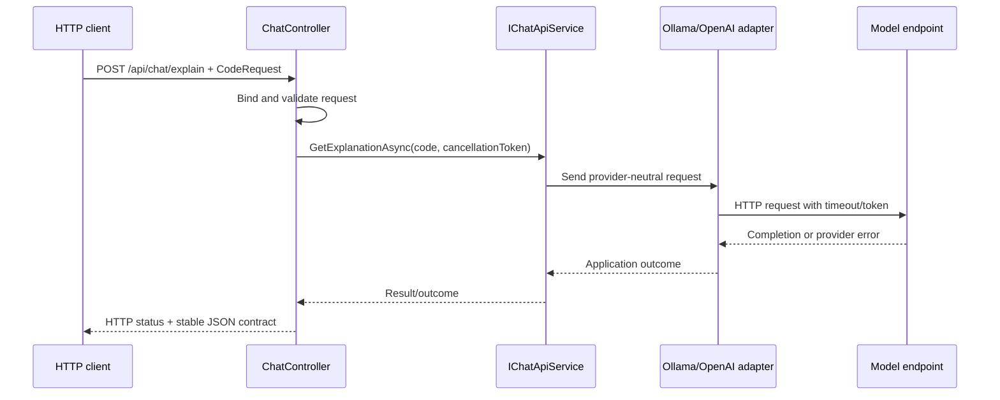
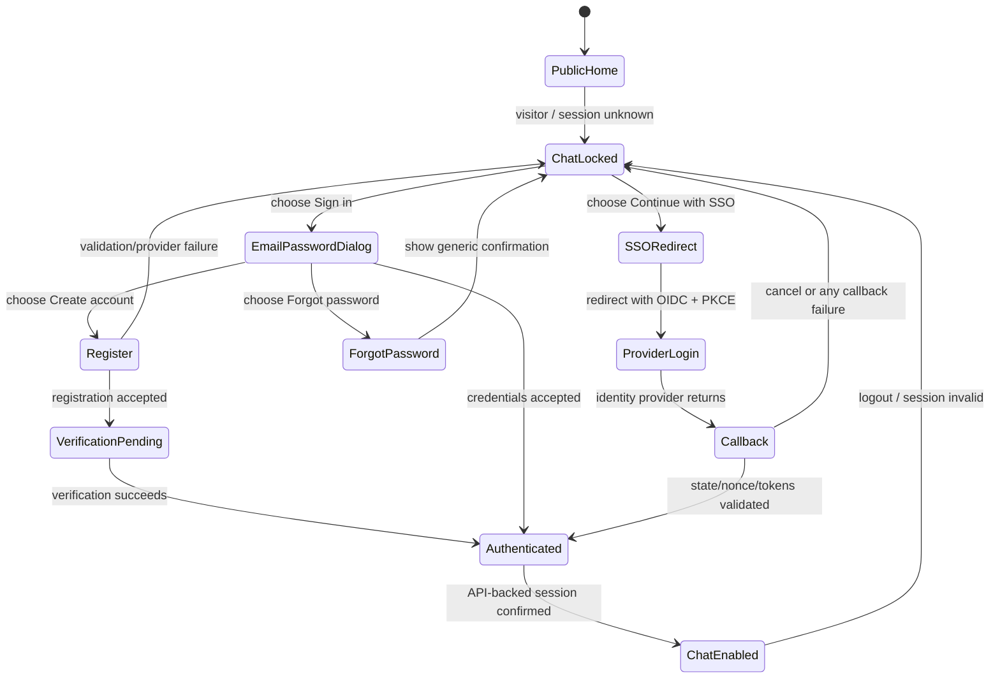

# AI Chat Application Learning Guide

## How to use this guide

This is a practical learning guide for building and operating this application,
not a list of disconnected tutorials. Follow the feature sequence in the
[project roadmap](../PROJECT_ROADMAP.md). For each phase:

1. Read the feature outcome and its acceptance criteria.
2. Identify the API/UI/data behavior before editing code.
3. Implement a small vertical slice on a feature branch.
4. Add or update tests and run them locally.
5. Update the architecture, this guide, and any relevant decision record in
   the same pull request.
6. Review trade-offs and explain why the chosen design fits this stage.

The repository currently has an ASP.NET Core API, two provider implementations,
a shared response envelope, and exception handling. Angular, identity,
persistence, RAG, tests, and hosting are roadmap work, not current capabilities.
See [architecture.md](architecture.md) for current and target diagrams.

## Feature-to-concept learning map

| Feature phase | Where the concepts appear | What to understand and explain |
|---|---|---|
| 0. Baseline | `Program.cs`, project files, configuration, Git/CI docs | How the app starts, nullable types, records/classes, repository workflow, requirements, configuration sources, local vs. deployment settings |
| 1. Chat API | `Controllers/`, API contracts, validation, middleware | HTTP semantics, routing/model binding, DTOs vs. domain types, status codes, Problem Details/Result consistency, cancellation, middleware order |
| 2. AI providers | `Services/`, provider interfaces, options, DI | Async HTTP, `IHttpClientFactory`, serialization, error mapping, interface/composition, SOLID, Strategy/Factory/Adapter, timeout/retry/circuit-breaker trade-offs |
| 3. Persistence | `Infrastructure/`, EF Core `DbContext`, repositories, migrations | SQL joins/aggregates/indexes, relational modeling, EF tracking, transactions, concurrency, query plans, repository and Unit of Work trade-offs |
| 4. Angular SPA | `frontend/` Angular components, services, routes, forms | TypeScript strict mode, templates/data binding, Angular DI, `HttpClient`, RxJS streams/cancellation, reactive forms, accessibility, component/e2e testing |
| 5. Sign-in and access | Angular OIDC setup and API auth policies | OAuth 2.0 vs. OIDC, PKCE, JWT issuer/audience/signature/lifetime validation, claims/scopes/roles, authentication vs. authorization, SAML federation |
| 6. Security hardening | API CORS/rate-limit/validation config, secret config, rendering | CORS boundaries, least privilege, secrets, prompt injection, PII, XSS, output validation, rate/cost limiting, threat modeling |
| 7. Quality pipeline | Test projects, frontend tests, CI workflows | Unit/integration/contract/e2e tests, fakes, deterministic tests, testable boundaries, code review, dependency and secret scans |
| 8. RAG | Ingestion, chunking, embedding, retrieval and citations | Tokens/context budgets, embeddings, vector/hybrid search, reranking, citations, relevance evaluation, tenant filtering, indirect prompt injection |
| 9. Operations | Logging, metrics, tracing, health checks, resilience | OpenTelemetry, Application Insights, SLI/SLO, profiling, GC/allocation basics, timeouts, backpressure, retries, graceful shutdown, incident diagnosis |
| 10. Hosting | Infrastructure as code, deployment workflows, Azure/IIS config | App Service vs. containers vs. IIS, Azure SQL, managed identity, Key Vault, staging/rollback, network/security boundaries, cost and availability |
| 11. Background work | Queue API, worker, broker, persistence/outbox | Service Bus queues/topics, at-least-once delivery, idempotency, retries, DLQ, outbox, eventual consistency, poison messages |
| 12. Capstone | Architecture docs, ADRs, runbooks, demo | System design, capacity estimates, modular monolith vs. microservices, requirements, trade-offs, estimation, incident response, technical communication |

File names shown for future features describe intended code locations; they may
change as implementation evolves. Update this table when the repository
structure is established.

## Required teaching format for every topic

Each detailed topic card in this guide uses the same structure:

1. **Definition** — what the concept means in plain, technically accurate
   language.
2. **Why we use it** — the problem it solves in this application.
3. **How we use it** — the specific design or implementation steps.
4. **Project example** — an actual snippet/file once implemented; until then,
   label examples as proposed rather than pretending planned code exists.
5. **Trade-offs and alternatives** — disadvantages, misuse cases, and another
   reasonable choice.
6. **Interview-ready answer** — a concise explanation plus likely follow-up
   questions.
7. **Check your understanding** — a practical question/task; mark the tracker
   topic Done only after you can answer it and connect it to evidence.

The topic inventory is in [TOPIC_TRACKER.md](TOPIC_TRACKER.md). To keep examples
accurate and useful, detailed cards are expanded just before or during their
release key. This guide includes the **key101 foundation cards** now; later
keys add the same full card format for their topics. The tracker lists all 122
topics from the outset, but listing a topic is not the same as having completed
its lesson.

The release sequence and its completion gates are in the
[key101-key110 roadmap](../PROJECT_ROADMAP.md#release-train-gated-feature-keys).
Do not start a later key until the prior key's exit gate is met and its
documentation and tracker are updated.

## key101 foundation: tested code-explanation API

### Request-to-provider-to-HTTP response flow



The current code is an early implementation of this flow. Provider-neutral
request/outcome types and fully consistent error mapping are key101 work, not
assumptions about the current implementation.

### Topic card: REST endpoint and HTTP semantics (tracker T021)

**Definition.** REST is a way to design a network API around resources and
representations, using HTTP methods/statuses consistently. A chat action can
also be modeled as an operation endpoint; the important part is a stable,
understandable contract and correct HTTP behavior.

**Why we use it.** Angular, Swagger, automated tests, and future clients need a
clear way to submit code and understand success, validation errors, and provider
failures.

**How we use it.** Expose a route such as `POST /api/chat/explain`; bind a
request DTO; return a documented success representation; use `400` for invalid
client input, `401` for absent/invalid authentication after auth is added,
`403` for insufficient permission, `429` for rate limits, and a safe server or
gateway status for provider failures. Do not return `200` with an error hidden
in the response body.

**Current project example.** [ChatController.cs](../Controllers/ChatController.cs)
has a controller route and an `explain` action. The implementation calls the
service and uses its returned status. key101 will stabilize the result-to-HTTP
mapping and document the contract.

```csharp
[HttpPost("explain")]
public async Task<IActionResult> Explain(
    [FromBody] CodeRequest request,
    CancellationToken cancellationToken)
{
    var result = await _chatApiService.GetExplanationAsync(
        request.Code, cancellationToken);
    return StatusCode(result.StatusCode, result);
}
```

**Trade-offs and alternatives.** A controller can return `IActionResult` for
flexible status mapping, or a typed `ActionResult<T>` when the response
contract is fixed. A `POST` action is reasonable for a completion request; do
not force it into CRUD-shaped routes. Returning provider status codes directly
couples the public API to vendors, so map provider errors to application-owned
outcomes.

**Interview-ready answer.** “I define an HTTP contract independently of the
provider protocol. The controller owns HTTP status mapping; the service returns
an application outcome. That keeps provider changes from changing the client
contract and lets us test status behavior at the API boundary.”

**Check your understanding.** Explain why a malformed request should not return
`200`, and distinguish `400`, `401`, `403`, `429`, and a provider failure.

### Topic card: DTOs and API contracts (tracker T023)

**Definition.** A Data Transfer Object (DTO) is an explicit shape used to move
data across a boundary, such as JSON between Angular and ASP.NET Core. It is not
the same thing as a database entity or provider SDK request.

**Why we use it.** Separate DTOs let us evolve database and AI-provider
internals without accidentally changing the public API or exposing fields the
client should not see.

**How we use it.** Define a request contract for code and a response contract
for the explanation/error. Keep secrets, database navigation properties, raw
provider payloads, and internal exceptions out of these types. Validate at the
API boundary and version the contract deliberately.

**Current project example.** `CodeRequest` is currently declared at the bottom
of [ChatController.cs](../Controllers/ChatController.cs). key101 moves public
contracts into a dedicated API contracts location and adds bounds/validation.
The shared [Result.cs](../Responses/Result.cs) is the current response envelope.

```csharp
public record CodeRequest(string Code);
```

**Trade-offs and alternatives.** Records provide concise value-based models but
do not automatically make every DTO correct or validate it. A separate DTO per
endpoint can create mapping work; reusing database entities saves lines but
couples layers and risks data exposure. Prefer boundary-specific types when
their contracts have different lifetimes or responsibilities.

**Interview-ready answer.** “DTOs isolate transport contracts from domain,
persistence, and vendor models. I validate them at the boundary and map them to
application inputs so schema changes do not ripple through every layer.”

**Check your understanding.** Name two fields that belong in an AI provider
request but should not appear in the public chat response.

### Topic card: Validation and input limits (tracker T024)

**Definition.** Validation checks whether input satisfies syntactic and
business rules before expensive or stateful work begins. A size limit bounds
resource consumption even when the input is otherwise valid.

**Why we use it.** Empty, malformed, or extremely large source code can waste
inference cost, exceed model context, or make the API vulnerable to resource
exhaustion.

**How we use it.** Validate required fields, maximum length, allowed options,
and request-body size on the server. Return a stable client error before making
the model call. Angular can mirror simple checks for user experience, but the
API remains authoritative.

**Current project example.** The current `CodeRequest` has no visible length
constraint. key101 adds server validation and tests for missing/blank and
over-limit values.

```csharp
// Illustrative key101 direction, not yet an implemented DTO:
public sealed record ExplainCodeRequest
{
    [System.ComponentModel.DataAnnotations.Required]
    [System.ComponentModel.DataAnnotations.MaxLength(20_000)]
    public required string Code { get; init; }
}
```

**Trade-offs and alternatives.** Data annotations are simple for basic rules;
dedicated validators are useful for complex or reusable rules. Duplicating
validation in Angular improves UX but duplicates logic, so keep server rules
authoritative. Choose limits from context/token and cost requirements, not an
arbitrary number.

**Interview-ready answer.** “I validate at the trust boundary before model
inference, enforce both content and transport limits, and return actionable
client errors. Client-side validation is convenience, never authorization or
security.”

**Check your understanding.** Where would you enforce a maximum request body
size, and why should an Angular-only length check not be trusted?

### Topic card: Async I/O and cancellation (tracker T011/T012)

**Definition.** `async`/`await` lets a method suspend while an I/O operation is
pending instead of blocking a request thread. A `CancellationToken` communicates
that the caller no longer needs the work.

**Why we use it.** Model calls can take seconds. Blocking threads for every
active request limits server throughput. If a browser disconnects, continuing
an expensive inference may waste compute and money.

**How we use it.** Use asynchronous HTTP APIs, accept a token at the endpoint,
and pass it through each service and `HttpClient` call. Distinguish caller
cancellation from provider timeout; do not catch cancellation and return a
success-shaped result.

**Current project example.** The controller accepts `CancellationToken` and
passes it to `GetExplanationAsync`; [OllamaChatApiService.cs](../Services/OllamaChatApiService.cs)
passes it to `PostAsync` and response body reading.

```csharp
using var response = await client.PostAsync(
    endpoint, content, cancellationToken);
```

**Trade-offs and alternatives.** Async does not make model inference faster; it
improves thread utilization during I/O. Cancellation is cooperative and may not
stop remote work already accepted by a provider. Use a finite timeout/deadline
as well as cancellation; avoid `.Result`/`.Wait()` on async operations.

**Interview-ready answer.** “I propagate the request cancellation token through
the full I/O call chain and configure a separate timeout budget. Cancellation
means the caller disconnected; timeout means the operation exceeded our
service limit, so I observe and handle them distinctly.”

**Check your understanding.** Trace cancellation from controller to the remote
HTTP request. What can happen if the provider has already started generation?

### Topic card: Interfaces, dependency injection, and lifetimes (tracker T018)

**Definition.** An interface describes a behavior contract; dependency
injection supplies an implementation to a consumer. Lifetime determines
whether the container creates a new instance per request, per scope, or for the
application lifetime.

**Why we use it.** The controller should not know whether an explanation comes
from Ollama, OpenAI, or a test fake. DI centralizes composition and allows
automated tests to replace external boundaries.

**How we use it.** Inject `IChatApiService` into the controller and register the
selected implementation in `Program.cs`. Select lifetime according to state
and dependencies; do not inject a scoped database context into a singleton.

**Current project example.** [IChatApiService.cs](../Services/IChatApiService.cs)
defines the chat contract, [ChatController.cs](../Controllers/ChatController.cs)
depends on the interface, and [Program.cs](../Program.cs) currently registers
`OllamaChatApiService` as scoped.

```csharp
builder.Services.AddScoped<IChatApiService, OllamaChatApiService>();
```

**Trade-offs and alternatives.** Interfaces can become unnecessary indirection
if they have only one implementation and no seam is needed. A singleton is
appropriate only for thread-safe, application-wide state; a transient service
may be wasteful or unsafe if it owns expensive resources. `HttpClientFactory`
is preferred over creating/discarding raw clients for every call.

**Interview-ready answer.** “I use DI at genuine substitution boundaries, such
as external AI providers. I select lifetimes based on thread safety and
dependency lifetimes, and test orchestration using a fake implementation
without calling a real model.”

**Check your understanding.** Why is a singleton service that captures a
scoped `DbContext` invalid, and what lifetime does the current chat service use?

### Topic card: Middleware and centralized exception handling (tracker T025/T026)

**Definition.** Middleware is an ordered request/response pipeline. Exception
handling middleware can catch unhandled downstream exceptions and create a
consistent safe response.

**Why we use it.** Without a central policy, endpoints may expose stack traces,
return inconsistent errors, or duplicate try/catch logic.

**How we use it.** Register the exception handler and place it early enough in
the pipeline to cover downstream middleware/endpoints. Log internal details
server-side with redaction; return a stable public message and correct status.
Expected validation/provider failures should be represented deliberately,
rather than relying on a broad catch to hide all programming errors.

**Current project example.** [Program.cs](../Program.cs) registers and enables
`ApiExceptionHandler`; [ApiExceptionHandler.cs](../Middleware/ApiExceptionHandler.cs)
logs an unhandled error and writes a `Result`. key101 verifies that this does
not conflict with deliberate application outcomes.

```csharp
builder.Services.AddExceptionHandler<ApiExceptionHandler>();
builder.Services.AddProblemDetails();
app.UseExceptionHandler();
```

**Trade-offs and alternatives.** Global handling is a safety net, not a reason
to catch every exception in a service and convert it to `500`. RFC Problem
Details and a custom `Result` envelope are both possible; choose one public
error contract and document it.

**Interview-ready answer.** “The global handler is for unexpected exceptions;
known validation and provider failures are mapped intentionally. I keep
internal details in protected logs and return a stable, non-sensitive API
error.”

**Check your understanding.** Which exceptions should become validation errors,
which should remain unexpected, and how does middleware order affect handling?

### Topic card: Configuration and secret separation (tracker T019/T069)

**Definition.** Configuration is environment-dependent application behavior
such as endpoint and model selection. A secret is sensitive configuration such
as an API key and needs stricter storage/access controls.

**Why we use it.** The same build should run locally, in CI, and in hosting
without recompilation. Credentials must not be committed or shipped to
Angular.

**How we use it.** Use safe defaults for non-secret values, typed validated
Options for related settings, and User Secrets/environment/secret stores for
credentials. Fail clearly when required production settings are missing.

**Current project example.** [appsettings.json](../appsettings.json) currently
contains the local Ollama endpoint and model name. A hosted provider key should
not be added there as a real value.

```json
{
  "Ollama": {
    "Endpoint": "http://localhost:11434/v1/chat/completions",
    "Model": "llama3.2"
  }
}
```

**Trade-offs and alternatives.** Environment variables work across many hosts
but need secure provisioning and rotation. A secret manager gives access
control/audit integration but adds cloud dependency/cost. Never treat a
frontend environment file as secret storage; browser bundles are public.

**Interview-ready answer.** “I separate non-secret configuration from
credentials, validate settings at startup, and use a local secret store during
development and managed identity/secret management in hosting. The Angular
bundle never receives model-provider credentials.”

**Check your understanding.** Which Ollama settings are safe defaults, and
where would you put an OpenAI key locally and in Azure?

### Topic card: Unit tests, integration tests, and provider fakes (tracker T071-T073)

**Definition.** Unit tests check a small behavior in isolation. Integration
tests exercise collaborating application components. A fake transport supplies
controlled HTTP responses without using the real provider.

**Why we use it.** Hosted inference is slow, costly, nondeterministic, and
unavailable in CI. A test should verify our contract and error handling without
depending on model wording or network availability.

**How we use it.** Unit-test validation/orchestration with a fake service. Test
provider serialization and parsing through a fake `HttpMessageHandler`. Use an
API test host for routing, serialization, middleware, and status behavior.
Reserve live-model calls for a clearly labeled manual smoke test.

**Current project example.** The project has no test project yet. key101 adds
the first test suite before moving to the next release key.

```csharp
// Conceptual fake-handler test:
var handler = new StubHttpMessageHandler(
    HttpStatusCode.OK,
    """{"choices":[{"message":{"content":"Explanation"}}]}""");
```

**Trade-offs and alternatives.** Excessive mocking can test implementation
details instead of behavior. A real provider smoke test catches configuration
issues but is not deterministic and must not be required for every PR.
Testcontainers or a disposable SQL instance is more representative than EF
InMemory for database behavior.

**Interview-ready answer.** “I isolate external inference behind a transport
seam. Automated tests assert request shape, parsing, status mapping, and
cancellation using deterministic responses; a separate opt-in smoke test checks
live provider connectivity.”

**Check your understanding.** Which assertions should not compare exact
AI-generated prose, and what does a fake HTTP handler let you verify?

## Important concepts, with practical examples

### C# and .NET

- **Value and reference types:** use them to reason about copying, identity,
  nullability, and allocations. Avoid changing a type to a struct solely for
  perceived speed; measure first.
- **Nullable reference types:** make absent configuration and optional API
  data explicit. Treat warnings as useful feedback rather than suppressing them
  globally.
- **Records and DTOs:** records can make immutable API contracts concise; they
  are not automatically a good choice for every mutable EF entity.
- **Interfaces and composition:** define a contract where application behavior
  needs substitution (AI providers, repositories); avoid interfaces for every
  trivial class without a use case.
- **Generics and collections:** select collection types based on required
  semantics. `Dictionary` supports keyed lookup, `HashSet` uniqueness,
  `IEnumerable<T>` iteration, and `IQueryable<T>` provider-translated
  expressions. Do not leak `IQueryable` from persistence into application/API
  boundaries.
- **Async and cancellation:** asynchronous I/O frees request threads while
  waiting; it does not make model inference intrinsically faster. Pass
  `CancellationToken` through the call chain and do not turn a client
  cancellation into a fabricated success.
- **Concurrency controls:** use bounded concurrency for a local model or
  constrained API. `Task.WhenAll` is suitable only when parallel operations
  are independent and the total load is acceptable.
- **Runtime/performance:** learn allocation, garbage collection, LOH, JIT, and
  profiling after measuring a real hot path. Do not optimize a demo from
  guesses.

### ASP.NET Core APIs

- **Controller boundary:** bind/validate HTTP input, call application behavior,
  and map outcomes to HTTP. Controllers should not build provider JSON or issue
  EF queries directly.
- **DTOs:** public HTTP shapes should be explicit and stable. Do not expose EF
  entities, access tokens, provider secrets, or internal exception details.
- **Validation:** enforce server-side rules even if Angular validates the same
  form. Browser validation is a usability feature, not a security boundary.
- **Middleware:** ordering matters. Authentication must run before authorization;
  exception handling should surround downstream processing.
- **Result and Problem Details:** choose one consistent public error contract.
  Map domain/provider failures to safe status codes at a deliberate boundary.
- **Cancellation and deadlines:** HTTP disconnect cancellation should reach
  downstream operations. An application deadline should prevent work from
  running indefinitely.
- **OpenAPI:** document the API contract and use it to catch accidental
  breaking changes; it is not a substitute for integration tests.

### AI and LLM application design

- **Provider abstraction:** normalize only what the application needs. Keep
  provider-specific options/features available without leaking transport
  details everywhere.
- **Configuration-driven provider selection:** validate names/settings at
  startup. Avoid selecting providers based on untrusted request input unless
  explicitly authorized and cost-controlled.
- **Tokens and context:** prompts, message history, and retrieved chunks share a
  model context budget. Measure or estimate before appending unbounded chat
  history.
- **Temperature and generation settings:** tune against a repeatable evaluation
  set. A parameter change can affect determinism/quality but does not guarantee
  factual correctness.
- **Structured output:** validate JSON/schema from a model; model output is
  untrusted input.
- **Prompt injection:** system instructions are not a security boundary.
  Retrieved text and submitted code can contain adversarial instructions; do
  not give model output direct authority to access data or execute actions.
- **Evaluation:** keep a small versioned set of representative prompts and
  expected criteria. Compare answer usefulness, groundedness, citation
  correctness, latency, and cost rather than checking exact wording alone.
- **RAG:** use when users need answers grounded in a known corpus. Retrieval
  must respect authorization; citations must refer to the retrieved source.
- **Privacy/cost:** decide what user code is sent to a provider, how long data
  is retained, and how quotas/budgets are enforced.

### SQL and EF Core

- **Model from use cases:** define ownership, retention, and query patterns
  before tables. Conversation/message relationships are a starting point, not
  an assumption that all data belongs in one table.
- **Indexes:** support measured filters and sort orders, such as an owner's
  conversations ordered by update time. Extra indexes increase write/storage
  cost.
- **Pagination:** always bound list queries. Choose stable ordering and consider
  keyset pagination when offset pagination becomes expensive.
- **Tracking:** tracked entities support updates; no-tracking queries can reduce
  overhead for read-only operations. Verify behavior before applying globally.
- **Transactions/concurrency:** protect multi-step writes and define what
  happens when two messages append at once.
- **Repository trade-offs:** use application-focused operations, not a generic
  CRUD repository that hides important query semantics. Different databases
  have different transactions, query language, indexing, and consistency.
- **Migrations:** review generated migrations and plan deployment ordering;
  schema changes can be incompatible with a running previous application
  version.
- **Performance:** inspect generated SQL and execution plans. Avoid N+1 queries,
  unbounded result materialization, and filtering on non-sargable expressions.

### Angular

- **Components and services:** components own view behavior; services own
  reusable API access/state. Avoid making components a second backend.
- **TypeScript strictness:** represent API success/error variants explicitly
  rather than using `any`; server validation remains authoritative.
- **RxJS:** understand subscription lifetimes, cancellation, error paths, and
  operators before composing more streams. Prefer Angular lifecycle-aware
  cleanup patterns.
- **Forms:** use reactive forms for typed validation and predictable state.
- **Routing:** lazy-load feature areas when application size warrants it;
  route guards improve navigation UX but do not replace API authorization.
- **OIDC:** use a maintained OIDC library and authorization code with PKCE.
  Never place provider API keys in browser code.
- **Rendering:** model output is untrusted. Render plain text by default or
  sanitize Markdown; do not bypass Angular sanitization for convenience.
- **Accessibility:** support keyboard use, labels, focus management, status
  announcements, contrast, and reduced-motion preferences.
- **Testing:** component tests cover UI behavior; browser tests verify complete
  user flows and integration boundaries.

### Authentication and application security

- **Authentication (authn):** establish who the user is.
- **Authorization (authz):** decide what that authenticated user may do.
- **OIDC:** identity layer built on OAuth 2.0; typically appropriate for SPA
  sign-in and API access-token issuance.
- **JWT:** a token format, not an authentication protocol by itself. Validate
  signature, issuer, audience, lifetime, and relevant claims.
- **SAML:** commonly used in enterprise identity federation. Prefer having the
  identity provider translate/federate SAML to OIDC for the SPA/API instead of
  writing SAML protocol handling into the application.
- **CORS:** browser cross-origin policy, not API authentication or a general
  firewall.
- **Secrets:** keep credentials out of source control, frontend bundles, logs,
  and exception responses. Rotate and scope them.
- **Rate limits:** protect availability and model budgets. User identity and
  abuse patterns determine suitable partitions and limits.
- **OWASP mindset:** validate inputs, minimize data, apply least privilege,
  review dependencies, and test ownership/security boundaries.

## key103-key104 learning: signed-out home, accounts, and SSO

### User journey at a glance



The home page can be public, but chat is a protected feature. Until the session
is confirmed, keep the composer, send action, and conversation actions disabled
and explain the reason. The API still enforces authorization if someone bypasses
the Angular UI.

### Topic card: authentication vs. authorization (tracker T061)

**Definition.** Authentication (authn) establishes the identity of a caller.
Authorization (authz) decides whether that identity may perform a specific
operation on a specific resource.

**Why we use it.** Successful login should unlock the chat feature, but it must
not automatically let a user read every other user's conversations.

**How we use it.** Angular displays signed-in state after a verified session.
The API validates the caller and applies authorization policies. When
conversation persistence is implemented, each query must also scope the
resource to the validated caller identity.

**Project example.** This is target behavior for key104/key105, not current
code. The roadmap's key104 exit gate requires API token/session validation;
key105 adds account-scoped SQL data.

```text
No valid session                  -> 401 Unauthorized
Valid session, insufficient rights -> 403 Forbidden
Valid session, owns conversation   -> allow operation
```

**Trade-offs and alternatives.** Hiding a button or adding an Angular route
guard improves UX but is not a security control. Duplicating every policy in
the client creates drift. Keep server-side authorization authoritative and
mirror only enough logic in the UI to guide navigation.

**Interview-ready answer.** “Authentication answers who the caller is;
authorization answers whether that caller may perform this action. I enforce
authorization in the API and resource ownership in the data/application layer;
frontend guards are only a user-experience aid.”

**Check your understanding.** If a user has a valid JWT but requests another
user's conversation, should the API return `401` or `403`, and where should the
ownership check run?

### Topic card: OIDC authorization code with PKCE (tracker T063/T064)

**Definition.** OpenID Connect (OIDC) is an identity layer built on OAuth 2.0.
For a browser SPA, authorization code with PKCE redirects authentication to
the identity provider. PKCE binds the authorization code to a verifier held by
the client flow, reducing the risk of an intercepted code being reused.

**Why we use it.** The application should not collect enterprise SSO
credentials. The identity provider handles sign-in, MFA, and any upstream
federation (including SAML where needed), then returns a protocol response for
the application to validate.

**How we use it.** Use a maintained OIDC library; register exact client,
redirect, logout, and API audience settings. Initiate authorization-code flow
with PKCE, validate state/nonce, complete code exchange using the approved SPA
or BFF design, validate the API access token at the API, and request profile
information only when necessary.

**Project example.** Planned for key104; no OIDC callback or identity provider
is currently configured. The feature flow is documented in
[architecture.md](architecture.md) and the key104 implementation checklist in
[PROJECT_ROADMAP.md](../PROJECT_ROADMAP.md).

```text
Angular -> Identity Provider: authorize + PKCE challenge + state/nonce
Identity Provider -> Angular callback: authorization code + state
OIDC library: validate state, exchange code using PKCE verifier
Angular -> API: access token for the API audience
API: validate issuer, audience, signature, expiry, and scopes
```

**Trade-offs and alternatives.** A SPA with a bearer token has browser token
storage/XSS considerations. A Backend-for-Frontend (BFF) can keep tokens
server-side and use an HttpOnly cookie, but adds server/session and CSRF
design. Choose the approach deliberately; do not implement an OIDC protocol by
hand. ID token and access token have different purposes; an ID token should not
be sent as an API bearer token unless the API contract explicitly uses it (the
normal design is an access token).

**Interview-ready answer.** “I use a maintained OIDC client with authorization
code and PKCE for the SPA. The API validates the access token's issuer,
audience, signature, expiry, and permissions. I choose SPA token handling or a
BFF based on threat model and deployment, rather than treating the UI as the
security boundary.”

**Check your understanding.** What does PKCE protect, why is `state` needed,
and why should an API validate audience as well as signature?

### Topic card: Local accounts, password handling, and recovery (tracker T069)

**Definition.** A local account authenticates with application-associated
credentials (usually email/password). Registration, verification, password
reset, lockout, and credential storage are identity-system responsibilities,
not ordinary chat form fields.

**Why we use it.** Users need an email/password option in addition to SSO, but
password mistakes or account enumeration can expose users and create account
takeover risk.

**How we use it.** Prefer an identity platform that supports both local
accounts and external federation. If the product requires app-managed
credentials, use ASP.NET Core Identity or another maintained identity system
and review its secure session/token architecture. Require server-side
validation; use secure password hashing, single-use expiring reset tokens,
verification/lockout policy, and rate limits. Confirm password is a UI
validation field and is never stored. Return a generic reset confirmation
regardless of whether the address exists.

**Project example.** Planned for key104. The roadmap calls for a sign-in
dialog, registration fields (name, email, phone by approved policy, password,
confirm password), forgot-password/reset, and explicit failure tests. No
credential system exists in the current repository.

**Trade-offs and alternatives.** A provider-hosted flow lowers the amount of
sensitive authentication code the application owns but can constrain branding
and UX. Custom Angular forms provide control but must call a trusted
identity API; never store raw passwords or implement hashing/reset tokens
yourself. Phone number is personal data: keep it optional unless there is a
specific need, and define purpose, verification, and retention.

**Interview-ready answer.** “I delegate credential storage, hashing, reset
tokens, lockout, and policy to a maintained identity system. The UI validates
password confirmation but never persists it; reset responses are generic to
avoid account enumeration, and chat remains locked until the trusted auth
boundary confirms a session.”

**Check your understanding.** What prevents an attacker from learning whether
an email is registered through the forgot-password endpoint? Why is confirming
the password not a value to persist?

### Authentication failures: expected behavior

| Scenario | User-facing result | Must not happen |
|---|---|---|
| Invalid email/password | Generic credentials error; retry or reset links | Reveal whether email exists |
| Duplicate email on registration | Offer sign-in/reset guidance | Auto-link SSO identity just because email matches |
| Password mismatch | Inline form validation | Store/send confirmation value as account data |
| Pending email verification | Explain next verification step; chat stays locked | Create a fully authorized session if verification is required |
| Forgot-password address unknown | Same confirmation as known address | Account enumeration |
| Reset link invalid/expired/reused | Explain expiry and offer a fresh link | Accept token replay |
| SSO cancel/denial | Return to public home; chat stays locked | Treat cancelled login as success |
| Provider unavailable | Temporary error with retry/other sign-in option | Fall back to a fabricated local session |
| Callback state/nonce mismatch | Clear partial state; restart safely | Accept callback or log code/token |
| Invalid token or required claims missing | Safe error; stay signed out | Enable chat from untrusted userinfo |
| Session expires | Try approved renewal once or require sign-in | Infinite API retry loop |
| API returns 401/403 | Prompt sign-in or show access denied | Treat forbidden data as empty success |
| Auth state cannot be checked | Fail closed and keep composer disabled | Assume the old in-memory flag is valid |

### Topic card: RBAC and feature-level authorization (tracker T121)

**Definition.** Role-Based Access Control (RBAC) assigns users roles and grants
permissions to roles. A permission is a stable capability such as `chat.use`
or `admin.users.review`. Feature-level authorization checks the specific
capability required by an operation instead of making every decision a
hard-coded role-name comparison.

**Why we use it.** The first release needs `Admin` and `GeneralUser`, and later
the admin should be able to restrict individual features. A role-permission
mapping supports that growth without scattering role checks throughout every
controller.

**How we use it.**

1. Authenticate the subject, then load the application profile by trusted
   identity issuer + subject.
2. Check account status independently of role. Pending and blocked accounts
   cannot use chat even if a role has `chat.use`.
3. For an active account, check the named permission required by the operation.
4. Record admin approval/block/role/permission changes with actor, target,
   timestamp, and reason.
5. Enforce the decision in the API/application layer. Angular guards and
   hidden controls only improve UX.

**Project example.** This is planned, not current code. The proposed relational
schema is in
[architecture.md](architecture.md#user-roles-approval-status-and-feature-permissions).
Initial roles are `Admin` and `GeneralUser`; feature permissions are designed
so later configuration can restrict capabilities.

```csharp
// Illustrative policy check; not yet implemented in this repository.
if (user.AccountStatus != AccountStatus.Active ||
    !userPermissions.Contains("chat.use"))
{
    return ChatOutcome.Forbidden();
}
```

**Trade-offs and alternatives.** Direct `[Authorize(Roles = "Admin")]` checks
are simple when a small role list will remain fixed. They become rigid when
each feature needs configurable access. Fine-grained permissions add schema,
policy, caching, and admin UI complexity. Start with role-to-permission
mapping, but defer user-specific overrides until there is a concrete need.
Never store comma-separated role strings or trust roles supplied by Angular.

**Interview-ready answer.** “I authenticate the subject, check application
account status, then evaluate a named feature permission. Roles map to
permissions, while pending/blocked status is an independent deny gate. The API
is authoritative; frontend guards are not security.”

**Check your understanding.** Why does Admin not automatically mean Active?
What happens if a GeneralUser has `chat.use` but their account is Blocked?

### Topic card: Account approval, lifecycle, and admin audit (tracker T122)

**Definition.** An approval workflow is an authorized transition in an
account's lifecycle. An audit trail records who changed what, when, and why.
Account lifecycle status (for example, `PendingApproval`, `Active`, or
`Blocked`) is distinct from role (for example, `Admin` or `GeneralUser`).

**Why we use it.** New accounts must wait for an Admin, and an Admin can block
an account later. These decisions must take effect even if a user keeps an old
browser tab or calls the API directly.

**How we use it.**

- New local/SSO identities become `GeneralUser + PendingApproval`.
- Only an authorized Admin may approve/reject/block/unblock; every change is
  checked against allowed transitions.
- Pending and blocked users see only the public home and their own
  account-status page; they cannot read previous conversation history. The API
  denies chat, model, conversation, RAG, and tool operations.
- Re-check current application status on protected calls, or define a
  short-lived cache/revocation mechanism with a maximum block propagation time.
- Save an append-only audit record with actor, target, prior/new state, reason,
  time, and correlation ID.
- Bootstrap the first Admin with an audited out-of-band operator procedure;
  never allow public self-registration as Admin. Protect the last active Admin.

**Project example.** This is planned for key104/key105. The
[architecture guide](architecture.md) includes the account-state diagram and a
relational design with `AppUsers.AccountStatus`, `Roles`, `UserRoles`, and
`AdminAuditEvents`.

```text
PendingApproval --Admin approves--> Active
Active          --Admin blocks----> Blocked
Blocked         --Admin unblocks--> Active

PendingApproval or Blocked + any role -> AI/chat denied
PendingApproval or Blocked -> status page only; no conversation history
```

**Trade-offs and alternatives.** An identity provider may disable sign-in, but
application feature approval can still require app-owned state. Storing status
only in a long-lived JWT is fast but permits stale access until expiry. Reading
the database for every operation is current but adds load; caching needs
explicit invalidation/expiry. Approval queues add admin workload and require a
secure initial-admin recovery plan.

**Interview-ready answer.** “I model lifecycle status separately from roles.
New users default to pending, an audited Admin action activates them, and
blocking overrides every feature grant. The API checks current status so
disabling the chat in Angular cannot bypass approval.”

**Check your understanding.** Draw the legal status transitions. After an
Admin blocks a user, what stops an old token from continuing to authorize chat?
Why must the user lose access to existing history as well as new AI requests?

### Azure, delivery, and operations

- **Hosting choice:** use App Service for managed web hosting, containers when
  packaging/runtime control is needed, or IIS for Windows self-hosting. Choose
  based on operational needs, not only a free badge.
- **Managed identity:** prefer workload identity to a stored credential for
  Azure-to-Azure access when supported.
- **Key Vault:** use for secrets that remain necessary; restrict access and
  audit secret reads.
- **CI/CD:** build/test on pull requests; deploy immutable artifacts to
  environments with controlled configuration.
- **Infrastructure as code:** make cloud resources reviewable/reproducible.
- **Observability:** correlate logs, metrics, and traces without collecting
  sensitive prompt content.
- **Health checks:** distinguish a process being alive from being ready to
  accept useful requests.
- **Queues:** add only for durable background work. Assume at-least-once delivery
  and design idempotent handlers.
- **Reliability:** retry only transient failures, bound retries, use deadlines,
  and consider circuit breakers/backpressure based on measured behavior.
- **Cost:** include inference, compute, database, logs, storage, bandwidth,
  identity plan, domain, and backups—not only the API host.

## Free and paid tooling

“Free” can mean free/open-source software, a free account tier with quotas, a
trial, or a paid service with a free allowance. Check terms/limits before
depending on it; they change.

| Category | Free options / local use | Paid or potentially paid parts |
|---|---|---|
| .NET and Angular | .NET SDK/ASP.NET Core and Angular are free/open source | Hosting and some commercial support are separate |
| IDE | VS Code is free | Some IDE editions/features and AI coding services have paid tiers |
| AI inference | Ollama software is free; local model use avoids per-request provider billing | Hardware/electricity; hosted model APIs commonly charge per usage |
| SQL | Local developer/community databases and EF Core learning tools | Managed database hosting, storage, backups, and production licenses/tiers as applicable |
| Testing | xUnit/NUnit/MSTest, Playwright, and many libraries are free/open source | CI hosted minutes, test management platforms, and device/browser farms can cost |
| Identity | Some identity providers offer developer/free tiers | User counts, enterprise features, MAU, or production requirements may be paid |
| Static web hosting | GitHub Pages, Cloudflare Pages, and some Azure Static Web Apps tiers have free offerings/limits | Custom features, usage beyond quotas, API hosting, domains, and enterprise support |
| API hosting | Local hosting; some clouds/PaaS offer limited free/shared tiers | Always-on compute, scale, storage, bandwidth, custom networking, production SLA |
| Observability | Local OpenTelemetry stack and some free quotas | Retention, ingestion volume, dashboards, and managed telemetry beyond quota |
| Messaging/RAG | Local broker/search tools may be used for learning | Managed queue, embedding inference, vector storage, and search usage |

### Completely free hosting: realistic expectation

There is no general guarantee that the **entire** app (Angular, .NET API, SQL,
identity, Ollama inference, storage, TLS/domain, logs, and reliable uptime) can
be hosted publicly and permanently for zero cost.

- A local-only stack can avoid cloud bills, but requires your own computer and
  is not continuously available.
- Free static hosting can serve Angular files but does not run the .NET API,
  SQL database, or Ollama.
- Free/shared API plans may sleep or have strict CPU/memory/egress/runtime
  restrictions. Confirm the current .NET support explicitly.
- Free SQL allowances may be temporary, capped, or limited by region/account.
- Running Ollama in the cloud can require significant memory/CPU/GPU and is
  unlikely to be a dependable zero-cost hosted component.
- IIS on your PC avoids a cloud VM invoice but not electricity, internet,
  domain/TLS, security maintenance, backups, and uptime risk. Do not directly
  expose a development machine as a production server.

For the first demo, prefer local Angular + API + Ollama + local SQL. Later,
compare Azure free allowances and a static frontend with a separately hosted
API. Check live pricing and create budget alerts before provisioning resources.
References are maintained in the
[roadmap hosting/tooling section](../PROJECT_ROADMAP.md#tooling-and-cost-guide).

## Documentation and comments

- Code comments should explain a non-obvious decision, security constraint, or
  tricky behavior, not restate the next line of code.
- Use this guide for longer concept explanations and link to actual files after
  those files exist.
- Update the phase mapping when filenames or implementation boundaries change.
- Mark planned features as planned; do not imply an unimplemented feature is
  operational.
- Record consequential choices in `docs/decisions/` and link them here.
