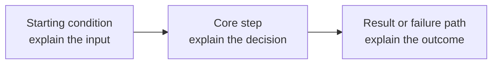

# Topic Lesson Template

Copy this document for **one focused topic**. Keep independent concepts in
separate lessons (for example: JWT, OAuth 2.0 and OIDC are related, but they
are not interchangeable). A lesson may reference companion lessons without
replacing its own explanation.

## Lesson metadata

- **Phase / module:**
- **Topic ID:**
- **Priority:**
- **Prerequisites:**
- **Learning outcome:** What should the learner be able to explain or decide?
- **Official references:**

## 1. Interview-ready answer (3–5 lines)

Give a direct answer that a senior candidate could say aloud. State the
concept, the problem it solves, the key mechanism, and the most important
trade-off. Avoid unexplained acronyms.

## 2. Simple definition and explanation

Explain the concept in plain language first. Define every small term needed to
understand it. Separate similar terms instead of treating them as synonyms.

## 3. Why do we need it?

Describe the real problem, failure, cost, or constraint. Explain what becomes
harder if the concept is not used.

## 4. Real-world analogy

Use one short analogy that maps the important parts accurately. Follow it with
one sentence stating where the analogy stops being exact.

## 5. Practical enterprise-level example

Describe a realistic system, its actors, data, constraints, and expected
behavior. Explain why this concept fits that situation and what alternatives
were considered.

## 6. Code, query, or concrete steps

Provide a small, correct, relevant example in C#, SQL, Angular/TypeScript, or
clear numbered steps. Explain important lines and assumptions. Mark
pseudocode as pseudocode. For destructive SQL, show a preview and a safe
transaction/rollback approach before deletion.

```text
Add a focused example here.
```

### Walk-through

1. What input enters the example?
2. What does each important step change or produce?
3. What result should the learner observe?
4. What boundary, failure, or edge case should be tested?

## 7. Internal working, step by step

Trace the real execution path in order. Identify who owns state, where
validation occurs, what is synchronous/asynchronous, what can fail, and what
is guaranteed. Distinguish a logical model from an implementation detail.

## 8. Diagram (required)

Include one topic-specific diagram. Choose a flow, sequence, memory/reference
map, query pipeline, component relationship, or architecture boundary that
actually explains this topic. Each node/arrow must have a meaningful label;
define unusual terms in the diagram or its legend. Do not reuse generic boxes
with only different topic names.



**Diagram walkthrough:** Explain each node and any important branch. State
whether this is a logical flow, a protocol flow, or one possible physical
implementation.

## 9. Advantages and disadvantages

| Benefits | Costs, risks, or limitations |
|---|---|
| Explain a concrete benefit | Explain the corresponding cost or failure mode |

Discuss meaningful trade-offs, not generic “fast/easy/scalable” claims.

## 10. When to use it — and when to avoid it

- **Use when:** Give conditions, constraints, or measurable symptoms.
- **Avoid or reconsider when:** Explain the mismatch and a better alternative.
- **Decision rule:** Give a short rule an engineer can apply in a design review.

## 11. Compare related concepts

| Concept A | Concept B | Choose based on |
|---|---|---|
| Explain first concept | Explain second concept | State the boundary or decision |

Compare only concepts that help answer this lesson’s question. Link out to a
separate lesson when the related concept needs its own full explanation.

## 12. Interviewer counter questions (8–10, with answers)

1. **Question:**  
   **Answer:** Give a concise but technically complete answer.
2. **Question:**  
   **Answer:**
3. **Question:**  
   **Answer:**
4. **Question:**  
   **Answer:**
5. **Question:**  
   **Answer:**
6. **Question:**  
   **Answer:**
7. **Question:**  
   **Answer:**
8. **Question:**  
   **Answer:**

Add up to two more when they test materially different edge cases. Include at
least one “what if this fails?”, one trade-off, and one boundary/alternative
question when relevant. Do not pad the list with reworded duplicates.

## 13. Challenging senior-level scenario

State the constraints and failure symptoms. Explain how an architect would
gather evidence, choose a solution, protect correctness/security, roll it out,
and measure success. Include one reasonable alternative and why it was not
chosen.

## 14. Common mistakes

- Name a plausible mistake and explain why it is wrong.
- Name a failure mode or incorrect assumption and show how to avoid it.
- Include security, concurrency, performance, or correctness traps relevant
  to this topic.

## 15. Best practices

- Give actionable implementation and review guidance.
- Include validation, observability, testing, and failure handling when
  relevant.
- Prefer standards, platform-supported mechanisms, and measured decisions
  over custom mechanisms without a need.

## 16. Sixty-second answer and revision points

### 60-second interview answer

Write a natural spoken answer that connects definition, mechanism, use case,
trade-off, and one real project decision. It should take about a minute to say
without reading.

### Five revision points

1. One-sentence definition.
2. The main mechanism or flow.
3. The decision boundary versus a related concept.
4. The most important trade-off or failure mode.
5. The senior-level design rule to remember.

## Quality check before publishing

- [ ] One focused topic; related concepts are compared, not conflated.
- [ ] Every unfamiliar term and acronym is explained.
- [ ] The code/query/steps are correct, relevant, and walked through.
- [ ] A meaningful topic-specific diagram is present and explained.
- [ ] Trade-offs, decision guidance, counter-question answers, mistakes, and
      best practices are substantive.
- [ ] The scenario includes evidence, constraints, a decision, failure
      handling, and measurable outcomes.
- [ ] References point to official or primary sources and support the claims.
