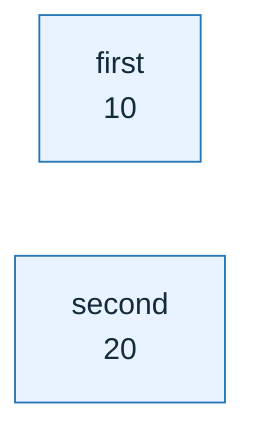
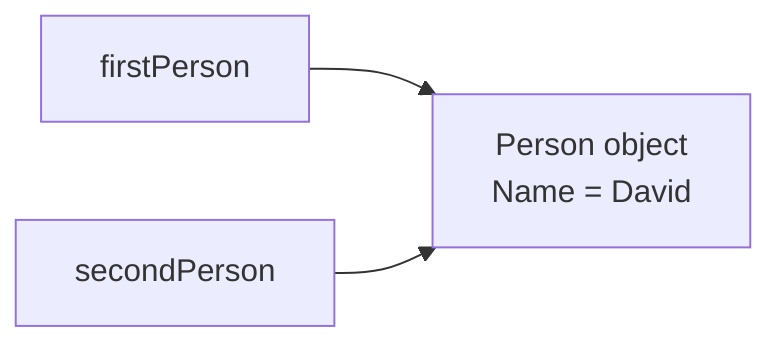
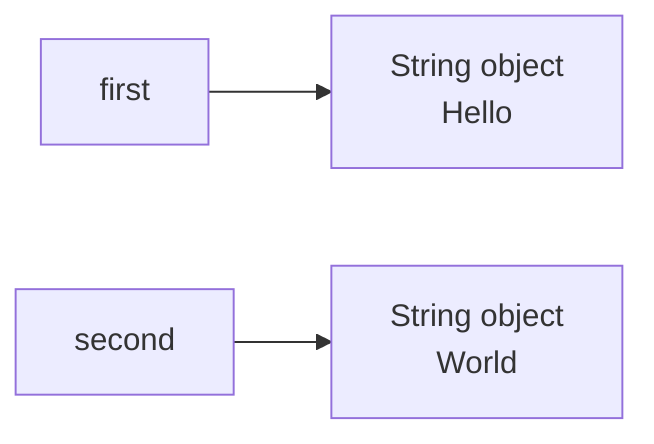
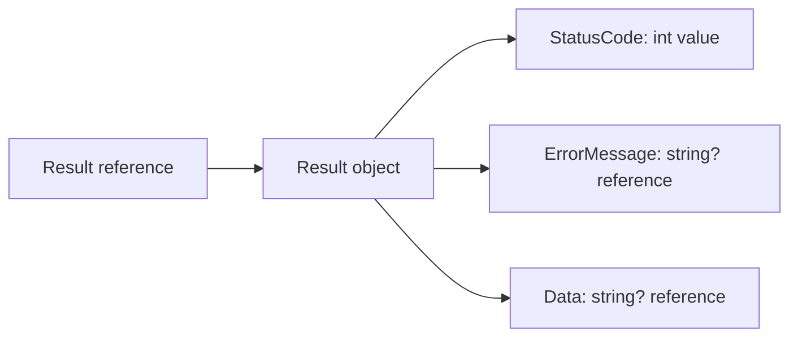

# C# Learning: Value Types vs Reference Types

Let's learn this C# concept with simple examples, memory diagrams, project code,
and interview-style questions.

**Workbook connection:** Day 1 — C# Foundations

**Topic tracker:** T001

**Next topic:** [Nullable reference types and nullability flow](#t002--nullable-reference-types-and-nullability-flow)

## 1. The basic difference

In C#, every variable has a type. The type determines what the variable stores
and how assignment behaves.

A **value-type variable contains its value**. Assigning it to another variable
copies that value.

A **reference-type variable contains a reference to an object**. Assigning it
to another variable copies the reference. Both variables can then refer to the
same object.

This is about **copy behavior**, not a simple rule that “value types live on
the stack and reference types live on the heap.” Actual storage depends on
context. A value-type field can be stored inside an object on the heap.

## 2. Value-type example

```csharp
int first = 10;
int second = first;

second = 20;

Console.WriteLine(first);  // 10
Console.WriteLine(second); // 20
```

When `second = first` runs, C# copies the number `10`. After that, the two
variables are independent.

### Memory diagram: copying a value



```text
first  ── contains ──> 10
second ── contains ──> 20

There are two separate values.
```

## 3. Reference-type example

```csharp
var firstPerson = new Person { Name = "John" };
var secondPerson = firstPerson;

secondPerson.Name = "David";

Console.WriteLine(firstPerson.Name);  // David
Console.WriteLine(secondPerson.Name); // David

sealed class Person
{
    public string Name { get; set; } = "";
}
```

`secondPerson = firstPerson` copies the reference, not the whole `Person`
object. Both variables now refer to one object. Updating that object's `Name`
through either reference is visible through the other.

### Memory diagram: copying a reference



```text
firstPerson ──┐
              ├──> Person object: Name = "David"
secondPerson ─┘

Two references; one shared object.
```

The diagram is conceptual. It shows reference behavior, not a promise about
the exact physical memory layout.

## 4. The difference in one table

| Behavior | Value type | Reference type |
|---|---|---|
| What a variable contains | Its value | A reference to an object, or `null` |
| Assignment | Copies the value | Copies the reference |
| After assignment | Values are independent | Both references may point to the same object |
| Can it be `null`? | Not normally; use `int?`, `bool?`, etc. | Yes, unless nullable analysis warns about it |
| Common examples | `int`, `bool`, `DateTime`, `struct`, `enum` | `class`, `string`, arrays, delegates, `object` |
| Typical use | Small values that behave like independent facts | Objects with identity, behavior, or shared state |

These are useful defaults, not absolute rules. A struct can be large, and a
class can be immutable. Choose based on meaning and behavior, not only on
performance assumptions.

## 5. Special case: `string`

`string` is a reference type, but strings are **immutable**: after a string
object is created, its characters do not change.

```csharp
string first = "Hello";
string second = first;

second = "World";

Console.WriteLine(first);  // Hello
Console.WriteLine(second); // World
```

Assigning `"World"` to `second` does not edit the original `"Hello"` string.
It makes `second` refer to a different string.

### Memory diagram: reassigning an immutable string



This is different from changing a mutable `Person.Name` property. The
reference-type assignment rule is the same; the object's mutability is
different.

## 6. How this appears in this project

The API's [Result](../../Responses/Result.cs) type combines both categories:

```csharp
using System.Text.Json.Serialization;

public sealed record Result(
    int StatusCode,
    string? ErrorMessage,
    [property: JsonPropertyName("result")] string? Data,
    string? DetailErrorMessage = null);
```

- `StatusCode` is an `int`, a value type. Each `Result` contains its own status
  number.
- `ErrorMessage`, `Data`, and `DetailErrorMessage` are nullable `string`
  references. They may be absent (`null`) depending on whether the response is
  success or failure.
- `Result` is a record **class**, so it is still a reference type. The `record`
  keyword adds data-oriented behavior such as value equality; it does not turn
  the type into a value type.
- `sealed` prevents inheritance. It does not mean the object is stored in a
  special memory area, and it does not make referenced objects deeply
  immutable.

The API returns a separate result value per request. It does not share one
mutable response object between users.

### Project-object diagram



See [Result.cs](../../Responses/Result.cs) and how it is created in
[ChatApiService.cs](../../Services/ChatApiService.cs).

## 7. When should I use each?

Use a value type when the value represents a small, self-contained fact and
copying it should make an independent value. Examples include a status number,
boolean, date, or enum.

Use a reference type when the concept has identity, behavior, a larger object
graph, or needs to be shared. Examples include a chat service, an HTTP client,
or a conversation object.

For custom structs, prefer small, immutable values. A large mutable struct can
be surprising because assignment silently copies the whole value. A class
usually communicates shared object identity more clearly.

## 8. Common mistakes and limitations

### Mistake: “Value types are always on the stack”

This is not a reliable rule. Storage depends on where a value is used. For
example, a struct field inside a class object is part of that object.

### Mistake: “Copying a reference clones the object”

It does not. It creates another reference to the same object. To make an
independent object, write an explicit copy operation and decide whether nested
objects should also be copied.

### Mistake: “Reference type means mutable”

`string` is a reference type and immutable. A class can also expose only
read-only state. Reference/value classification and mutability are separate
ideas.

### Limitation: shallow copies

Copying a struct or record that contains a reference copies that reference.
The outer value may be copied while a nested object remains shared. This is
called a **shallow copy**.

## 9. Practice questions

### Question 1

What is printed?

```csharp
int x = 5;
int y = x;
y = 9;
Console.WriteLine(x);
```

- A. `5`
- B. `9`
- C. Compilation error

### Question 2

What is printed?

```csharp
var a = new Person { Name = "Sam" };
var b = a;
b.Name = "Alex";
Console.WriteLine(a.Name);
```

- A. `Sam`
- B. `Alex`
- C. `null`

### Question 3

Which one is a reference type?

- A. `int`
- B. `bool`
- C. `class`
- D. `enum`

<details>
<summary>Check answers</summary>

1. **A — `5`.** `y` receives a copy of the integer value.
2. **B — `Alex`.** `a` and `b` refer to the same `Person` object.
3. **C — `class`.** Classes are reference types. `int`, `bool`, and enum
   values are value types.

</details>

## 10. Interview-style answer

> A value-type assignment copies the value, so the variables are independent.
> A reference-type assignment copies the reference, so both variables can
> point to the same object. I avoid describing this as “stack versus heap”
> because storage depends on context. In our API, `Result` is a record class
> that contains an `int` status and nullable string references.

## 11. Check your understanding

Before marking T001 Done in the [topic tracker](../TOPIC_TRACKER.md), try
these without looking at the answers:

1. If a struct contains a `Person` reference, what is copied when the struct is
   assigned?
2. Why does changing a variable from `"Hello"` to `"World"` not mutate the
   original string?
3. What is the difference between a shallow copy and a deep copy?
4. Why is “all value types are on the stack” an inaccurate explanation?

Once this is clear, continue to
[nullable reference types](#t002--nullable-reference-types-and-nullability-flow).

---

# Other C# and type-system topics

The remaining topics use the module's lesson structure. Each should be read
alongside its code/practice example; do not treat the short summary as a
substitute for the deeper examples above.

## T002 — Nullable reference types and nullability flow

- **What:** Nullable reference types (`string?`) express that a reference may
  be absent; non-nullable references (`string`) express the expectation that
  it is present.
- **Why:** Provider configuration and responses cross external boundaries.
  Making absence visible lets the compiler help find unsafe dereferences.
- **When:** Use nullable types for genuinely optional values, then check them
  before use. Validate external JSON/configuration at runtime too.
- **Limits:** Nullable annotations are compile-time analysis, not runtime
  validation. A `string` can still be null if it comes from untrusted or
  incorrectly annotated code.
- **Diagram:** `external value -> runtime validation -> null check -> safe use`
- **Project example (implemented):** [Result.cs](../../Responses/Result.cs)
  uses nullable error and result strings because a response has either data or
  an error, not necessarily both.
- **Reference:** [Nullable reference types](https://learn.microsoft.com/dotnet/csharp/nullable-references)

## T003 — Records, classes, immutability, and equality

- **What:** A class normally models an object; a record adds data-oriented
  equality and concise construction. Both `record` and `record class` are
  reference types.
- **Why:** Immutable request/response data is easier to reason about; services
  have behavior and dependencies better represented by classes.
- **When:** Use records for small data contracts such as messages and results.
  Use a regular class for services or objects with identity and lifecycle.
- **Limits:** Records are only shallowly immutable; referenced lists can still
  be changed. `sealed` prevents inheritance but does not provide immutability.
- **Diagram:** `same record values -> equal` · `same class values, different instances -> usually not equal`
- **Project example (implemented):** [AIMessage.cs](../../Services/AIMessage.cs)
  is a sealed record. Provider variation is via `IAICompletionProvider`, so
  subclasses are not needed.
- **Reference:** [Records](https://learn.microsoft.com/dotnet/csharp/fundamentals/types/records)

## T004 — Generics, constraints, and variance

- **What:** Generics let code work with a type parameter such as `T`; a
  constraint says which types can be used. Variance describes safe
  substitutions for generic interfaces/delegates.
- **Why:** Generics provide reuse while preserving compile-time type checking.
  `Task<Result>` says exactly what an async operation returns.
- **When:** Use generics for reusable data structures and APIs where the same
  behavior applies to several types.
- **Limits:** A generic abstraction can make a simple concrete operation harder
  to understand. Variance has rules and does not apply to every generic class.
- **Diagram:** `T input -> reusable method<T> -> typed result<T>`
- **Project example (implemented):** [IChatApiService.cs](../../Services/IChatApiService.cs)
  returns `Task<Result>`; `IEnumerable<IAICompletionProvider>` supplies a
  typed collection of adapters.
- **Reference:** [Generics](https://learn.microsoft.com/dotnet/csharp/fundamentals/types/generics)

## T005 — Delegates, events, and callbacks

- **What:** A delegate is a type-safe reference to a method. A callback is a
  method passed to another operation. An event lets an object publish a
  notification to subscribers.
- **Why:** Callbacks can customize behavior without coupling the caller to a
  specific implementation.
- **When:** Use a delegate for a small behavior parameter or an event for
  in-process notifications with clear subscriber lifetimes.
- **Limits:** Event subscriptions can create hidden control flow and retain
  objects. In-process events are not durable and do not replace a queue.
- **Diagram:** `publisher -> event notification -> subscriber(s)`
- **Project exercise (non-production):** imagine notifying local UI code when
  an explanation completes. The current API is request/response, so adding an
  event system to production would not solve a current requirement.
- **Reference:** [Delegates](https://learn.microsoft.com/dotnet/csharp/programming-guide/delegates/)

## T006 — Pattern matching and switch expressions

- **What:** Pattern matching tests a value's type, shape, or state and can
  select behavior for each known case.
- **Why:** Explicit cases help make error mapping and state transitions
  understandable.
- **When:** Use it when a value has a finite set of meaningful cases; use a
  switch expression when each case maps to a result.
- **Limits:** Deeply nested patterns and giant switches can hide
  responsibilities. A switch is not automatically clearer than `if`.
- **Diagram:** `input state -> case A / case B / fallback`
- **Project connection:** provider failures are handled with exception-type
  specific `catch` blocks in
  [ChatApiService.cs](../../Services/ChatApiService.cs). For a direct pattern
  matching exercise, map an exception to a status:
  ```csharp
  var status = exception switch
  {
      HttpRequestException => 502,
      TimeoutException => 504,
      _ => 500
  };
  ```
- **Status:** this switch expression is a learning example, not code currently
  used by the service.
- **Reference:** [Pattern matching](https://learn.microsoft.com/dotnet/csharp/fundamentals/functional/pattern-matching)

## T007 — Exceptions and domain error modeling

- **What:** Exceptions represent failures that interrupt normal execution;
  expected business outcomes can be represented as explicit results.
- **Why:** A provider can fail, time out, or return malformed data. The API
  needs a safe public error while retaining useful server-side diagnostics.
- **When:** Catch exceptions where the application can classify, log, or map
  them. Let truly unexpected errors reach central handling.
- **Limits:** Broad catches can turn programming bugs into misleading
  success-shaped results. Caller cancellation should continue propagating.
- **Diagram:** `known provider failure -> safe 502/504` · `unexpected failure -> exception middleware`
- **Project example (implemented, with a limitation):**
  [ChatApiService.cs](../../Services/ChatApiService.cs) maps expected provider
  errors but also catches unexpected exceptions. That broad catch can make a
  programming defect look like a provider failure; the global
  [ApiExceptionHandler.cs](../../Middleware/ApiExceptionHandler.cs) is the
  intended safety net for unexpected failures.
- **Reference:** [Exception handling](https://learn.microsoft.com/dotnet/csharp/fundamentals/exceptions/)

## T008 — `IEnumerable<T>` vs. `IQueryable<T>`

- **What:** `IEnumerable<T>` represents in-process iteration. `IQueryable<T>`
  represents a query expression that a provider may translate, for example
  into SQL.
- **Why:** Filtering in the database avoids loading every conversation into
  application memory.
- **When:** Compose database filters and ordering before materializing results.
  Convert to a list at a clear boundary where the data is needed in memory.
- **Limits:** Not every .NET method can translate to SQL. Deferred queries can
  execute later than expected, and exposing `IQueryable` outside persistence
  leaks implementation details.
- **Diagram:** `IQueryable -> SQL WHERE/ORDER BY -> small result` vs. `IEnumerable -> loaded rows -> in-memory filtering`
- **Project example (planned — key105):** conversation history will be
  owner-filtered and paginated in SQL. No database query exists yet.
- **Reference:** [LINQ query execution](https://learn.microsoft.com/dotnet/csharp/linq/get-started/introduction-to-linq-queries)

## T009 — Collections: lists, dictionaries, sets, and queues

- **What:** A collection holds multiple values. Different collections provide
  different ordering, uniqueness, and lookup behavior.
- **Why:** Choosing by required behavior makes code clearer and can avoid
  unnecessary searches or duplicates.
- **When:** Use `List<T>` for ordered sequences, `Dictionary<TKey,TValue>` for
  keyed lookup, `HashSet<T>` for uniqueness, and `Queue<T>` for FIFO work.
- **Limits:** In-memory collections are not shared durable storage. A
  `Queue<T>` is not a distributed message broker.
- **Diagram:** `ordered -> List` · `keyed -> Dictionary` · `unique -> HashSet` · `FIFO -> Queue`
- **Project example (implemented):** [AICompletionProviderSelector.cs](../../Services/AICompletionProviderSelector.cs)
  receives registered implementations as `IEnumerable<IAICompletionProvider>`
  and selects the configured adapter.
- **Reference:** [Collections](https://learn.microsoft.com/dotnet/csharp/programming-guide/concepts/collections)

## T010 — `Span<T>`, `Memory<T>`, and allocation-aware APIs

- **What:** `Span<T>` and `Memory<T>` describe a region of existing memory and
  can avoid copying data when slicing buffers.
- **Why:** In a measured hot path, fewer copies and allocations can reduce
  garbage-collection work.
- **When:** Use these APIs when profiling identifies copying/allocation as a
  real bottleneck, such as high-throughput parsing.
- **Limits:** They add lifetime constraints; `Span<T>` is stack-only and
  cannot be kept across an `await`. Optimization can make code harder to read.
- **Diagram:** `buffer [start ........ end] -> Span view (same memory, no copy)`
- **Project exercise (non-production):** chat requests are dominated by model
  network latency, not demonstrated buffer allocations. Compare copied and
  sliced parsing in a small exercise; do not add spans to the API without
  measurement.
- **Reference:** [Memory and span usage guidelines](https://learn.microsoft.com/dotnet/standard/memory-and-spans/)

## Worked examples and practice for T002–T010

### T002 — Nullability flow

`string?` says absence is an allowed state; it does not mean the runtime will
automatically protect every caller. After a null check, the compiler can
narrow the value to non-null for the checked path.

```csharp
string? configuredModel = Environment.GetEnvironmentVariable("AI_MODEL");

if (string.IsNullOrWhiteSpace(configuredModel))
{
    throw new InvalidOperationException("AI_MODEL must be configured.");
}

Console.WriteLine(configuredModel.Length); // safe in this branch
```

Configuration still needs runtime validation even with nullable annotations.
**Self-check:** Does `string` guarantee a value at runtime? **Answer:** no; it
is a compiler contract, and external data must be validated.

### T003 — Record value equality versus class identity

Records are useful when equal data should compare equal. A regular class
usually compares by identity unless equality is explicitly implemented.
`sealed` says no subtype may derive from the class; it does not freeze its
properties or nested objects.

```csharp
public sealed record Message(string Role, string Content);

var one = new Message("user", "Explain this.");
var two = new Message("user", "Explain this.");
Console.WriteLine(one == two); // True: same record data
```

The project's [`AIMessage`](../../Services/AIMessage.cs) uses a sealed record
for a data contract. **Self-check:** Is a record containing a mutable list
deeply immutable? **Answer:** no; the list can still change.

### T004 — Generics keep types connected

The type parameter `T` lets one implementation preserve the caller's type
instead of returning `object` and requiring casts. Constraints narrow which
types are accepted; use them only when the generic operation needs those
capabilities.

```csharp
static T First<T>(IReadOnlyList<T> values) => values[0];
```

`Task<Result>` in the project communicates the asynchronous result type, and
`IEnumerable<IAICompletionProvider>` represents a typed set of provider
implementations. **Self-check:** What does `Task<Result>` say that bare
`Task` does not? **Answer:** the operation eventually returns a `Result`.

### T005 — Delegates, callbacks, and events

A delegate describes a callable method shape. A callback is commonly passed
to an operation to customize one behavior; an event is a publisher's
notification to any current subscribers.

```csharp
static int Transform(int value, Func<int, int> operation)
    => operation(value);

int doubled = Transform(4, value => value * 2);
```

Events can retain subscribers if they are not unsubscribed and are not durable
across process restarts. The API is request/response, so an in-process event
would not solve the current chat flow. **Self-check:** Is an event a message
queue? **Answer:** no; it is an in-memory notification mechanism.

### T006 — Pattern matching makes finite cases visible

A switch expression maps known input cases to a result. It is useful when
there are a few clear cases, such as classifying an exception, but it should
not become a large place for unrelated business logic.

```csharp
static int StatusFor(Exception exception) => exception switch
{
    TimeoutException => 504,
    HttpRequestException => 502,
    _ => 500
};
```

This is a learning example, not the current service mapping.
**Self-check:** What does `_` mean here? **Answer:** any case not matched
above.

### T007 — Exceptions versus expected outcomes

Use exceptions for exceptional control flow such as an unavailable dependency;
represent ordinary expected outcomes, such as invalid user input, with an
explicit result where that fits the API. Catch only where the code can add
meaning, logging, or a safe translation.

```text
invalid input -> validation result / 400
provider timeout -> classified provider failure
unexpected bug -> central exception handler + diagnostic log
```

The current [`ChatApiService`](../../Services/ChatApiService.cs) has a broad
catch limitation already called out above. **Self-check:** Should caller
cancellation be reported as a provider failure? **Answer:** generally no; it
is a cancellation signal and should propagate appropriately.

### T008 — `IQueryable<T>` versus `IEnumerable<T>`

An `IQueryable` stores a query expression for a provider to translate. An
`IEnumerable` is iterated by .NET code. If you materialize all database rows
before filtering, the application may download much more data than needed.

```csharp
var page = await db.Conversations
    .Where(x => x.UserId == userId)
    .OrderByDescending(x => x.CreatedAt)
    .Take(10)
    .ToListAsync(cancellationToken);
```

This is proposed EF Core code for key105; no database exists yet. **Self-check:**
What does `ToListAsync` do? **Answer:** executes the composed query and
materializes the returned rows.

### T009 — Select collections by behavior

Use `List<T>` when order and indexed access matter, `Dictionary<TKey,TValue>`
for keyed lookup, `HashSet<T>` for uniqueness, and `Queue<T>` for FIFO order.
The data structure communicates expected operations to readers.

```csharp
var seen = new HashSet<string>(StringComparer.OrdinalIgnoreCase);
bool firstOccurrence = seen.Add("Ollama");
bool secondOccurrence = seen.Add("ollama"); // false
```

The selector receives registered providers as an enumerable, then locates the
configured one. **Self-check:** Does an in-memory queue survive app restart?
**Answer:** no; durable background work needs a persistent messaging system.

### T010 — Use spans only after measurement

`Span<T>` is a view over existing memory; slicing it can avoid copying a
buffer. It has strict lifetime rules and is not suitable for every API. For a
chat request dominated by network time, optimizing byte slicing is unlikely
to matter without measurements.

```csharp
ReadOnlySpan<char> source = "provider=ollama".AsSpan();
ReadOnlySpan<char> value = source["provider=".Length..];
Console.WriteLine(value.ToString());
```

**Self-check:** Can a `Span<T>` local live across an `await`? **Answer:**
generally no; spans are stack-only and cannot cross an asynchronous suspension.

## Module practice

Build a small console example that:

1. Assigns and changes an `int`.
2. Assigns and changes a mutable `Person` reference.
3. Reassigns a `string` and explains why the original text remains unchanged.
4. Compares two records with equal data and two ordinary class instances.
5. Explains how a copied struct containing a class reference can still share
   the referenced object.

Explain each output aloud and draw the object/reference diagram before checking
the answer. Mark topics learned only after you can explain both the behavior
and one limitation.
