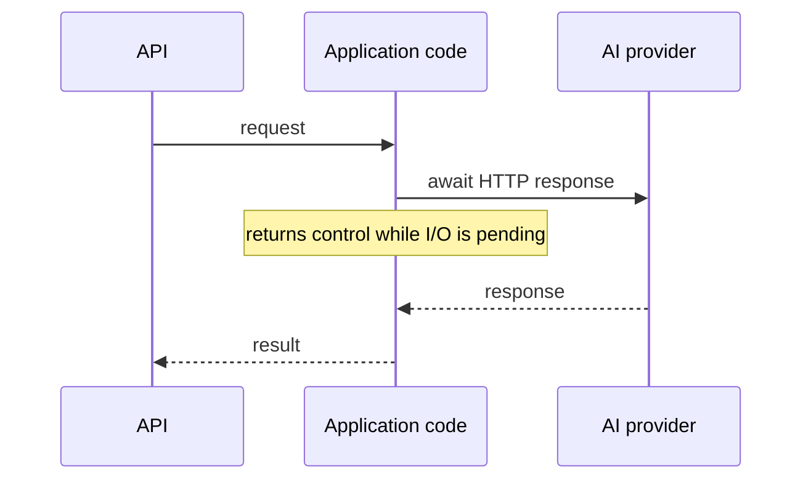
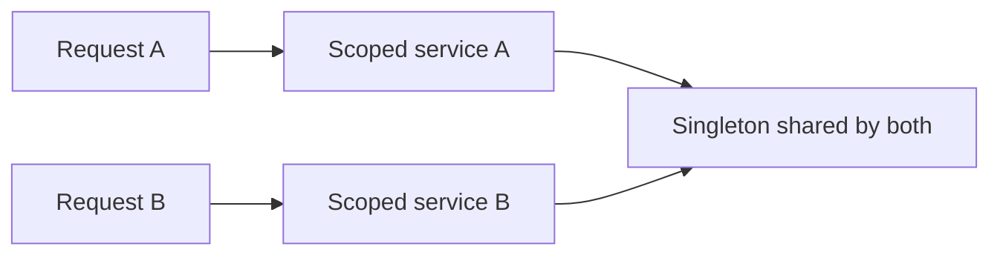

# Module 02 — .NET Runtime, Async, and Dependency Injection

**Workbook alignment:** Days 4–5 — asynchronous I/O, runtime behavior, memory,
dependency injection, configuration, and HTTP clients.
**Topics:** T011–T020. Examples show the current project where possible; planned
work is clearly labeled and does not imply the feature already exists.

## T011 — `async`/`await` and I/O-bound work

### What, why, and when

`async` and `await` let a method pause while I/O is pending without occupying a
thread just to wait. The operating system or remote service is doing the work;
when it completes, the method continues. This is especially useful for network
calls such as asking an AI provider to generate a response. It is not a way to
make CPU-heavy work faster.

### Flow



```text
request -> start network I/O -> free request thread to do other work
                                  |
                                  +-- response arrives -> continue after await
```

### Example and project connection

```csharp
public async Task<string> GetTextAsync(HttpClient client, CancellationToken token)
{
    using var response = await client.GetAsync("/health", token);
    response.EnsureSuccessStatusCode();
    return await response.Content.ReadAsStringAsync(token);
}
```

The `await` expressions yield while the network or content read is pending.
The app's provider adapter uses asynchronous `HttpClient` calls for the same
reason. Use `Task`/`Task<T>` for one eventual result; avoid `.Result` and
`.Wait()`, which block threads and can cause thread-pool starvation.

**Limitation:** `async` does not make CPU work parallel. Use a worker or
carefully bounded parallelism for CPU-heavy jobs, not `Task.Run` around every
web request.

Avoid `async void` except for event handlers: a caller cannot await it or
observe its exception in the normal task flow. Await a task before leaving the
method so failures and completion propagate to the HTTP request.

**Practice:** Why is `await` useful for a slow provider call? **Answer:** it
does not tie up a thread while the network is waiting.

**Reference:** [Asynchronous programming with async and await](https://learn.microsoft.com/dotnet/csharp/asynchronous-programming/).

## T012 — `CancellationToken` propagation

### What, why, and when

A `CancellationToken` is a cooperative signal that work is no longer needed.
It does not forcibly kill code; each operation must receive and observe the
token. For a chat request, cancellation can happen when the browser disconnects
or the request times out. Passing the same token down the call chain avoids
continuing a billable model request after its caller has gone away.

### Flow

```text
HTTP request token -> controller -> chat service -> provider adapter -> HTTP I/O
       cancel -------------------------------------------------------> stop
```

```csharp
public async Task<string> FetchAsync(
    HttpClient client,
    CancellationToken cancellationToken)
{
    using var response = await client.GetAsync("/health", cancellationToken);
    response.EnsureSuccessStatusCode();
    return await response.Content.ReadAsStringAsync(cancellationToken);
}
```

The token must be forwarded to every cancellable operation; accepting it but
not passing it onward gives callers a false impression of cancellation.
ASP.NET Core exposes a request-abort token to endpoints. The chat path should
carry that token from controller through orchestration and into the provider
HTTP request.

**Limitation:** Cancellation is not the same as a failure and may arrive after
the remote provider has already started processing. Cleanup still matters.
Do not swallow `OperationCanceledException` as an ordinary provider error.
If multiple independent operations share one deadline, link cancellation
tokens or use the framework's request-abort token; do not create unrelated
timeouts that outlive the caller.

**Practice:** If the caller disconnects during an awaited HTTP request, what
should the token do? **Answer:** signal cancellation down the call chain so
local work stops as soon as the underlying operation supports it.

**Reference:** [Cancellation in managed threads](https://learn.microsoft.com/dotnet/standard/threading/cancellation-in-managed-threads).

## T013 — Concurrency, thread safety, locks, and races

### What, why, and when

Concurrency means multiple operations make progress during overlapping time.
A race occurs when the result depends on the timing of those operations.
Thread-safe code protects shared mutable state so concurrent requests cannot
corrupt it. Web APIs naturally handle many requests at once, so a service must
not keep per-user or per-request mutable data in shared fields.

### Example

```csharp
// Unsafe: two callers can both read the same value before either writes.
int count = 0;
Parallel.For(0, 1_000, _ => count++);

// Safer for a simple shared counter:
int safeCount = 0;
Parallel.For(0, 1_000, _ => Interlocked.Increment(ref safeCount));
```

```text
Unsafe: request A reads 4 ---+
                             +--> both write 5 (one increment is lost)
         request B reads 4 ---+
```

The project should keep request-specific prompt, code, and provider response
in local variables. A singleton may serve concurrent requests, so its fields
must be immutable, thread-safe, or protected with a correctly scoped
synchronization mechanism.

**Limitation:** A lock held across slow network I/O serializes callers and can
hurt throughput. Prefer no shared mutable state; use a lock only for small,
well-defined critical sections.

**Practice:** Is a local variable shared by two separate HTTP requests?
**Answer:** no; request-local state is a safer default than mutable service
fields.

**Reference:** [Managed threading best practices](https://learn.microsoft.com/dotnet/standard/threading/managed-threading-best-practices).

## T014 — `Task.WhenAll`, bounded concurrency, and `SemaphoreSlim`

### What, why, and when

`Task.WhenAll` waits for several asynchronous tasks and completes when all of
them complete. It is useful when independent I/O operations can run together.
If a provider has a rate limit, however, launching an unbounded number of
requests can overload it. `SemaphoreSlim` can cap how many operations enter a
section at once.

### Example

```csharp
using var limit = new SemaphoreSlim(3);

async Task<string> FetchBoundedAsync(string url, CancellationToken token)
{
    await limit.WaitAsync(token);
    try
    {
        return await client.GetStringAsync(url, token);
    }
    finally
    {
        limit.Release();
    }
}

string[] results = await Task.WhenAll(
    urls.Select(url => FetchBoundedAsync(url, cancellationToken)));
```

```text
many tasks -> [semaphore: at most 3 active] -> remote service
```

`finally` ensures the permit is returned even when the request fails. This is
a learning example, not a feature currently needed by the single-request chat
flow.

**Limitation:** `WhenAll` does not itself limit concurrency; it waits for all
tasks and reports failures. A semaphore created per request only limits that
request's tasks, not the whole application. Production limits need a shared,
intentional scope and observability.

**Practice:** Does `WhenAll` mean "run sequentially"? **Answer:** no; tasks
started before it may proceed concurrently.

**Reference:** [`Task.WhenAll`](https://learn.microsoft.com/dotnet/api/system.threading.tasks.task.whenall) · [`SemaphoreSlim`](https://learn.microsoft.com/dotnet/api/system.threading.semaphoreslim).

## T015 — `IAsyncEnumerable<T>` and streaming

### What, why, and when

`IAsyncEnumerable<T>` produces values over time, asynchronously. A consumer
can process each item as soon as it arrives instead of waiting for a complete
collection. This is useful for large data feeds and can support token-by-token
AI responses if the provider and API contract are designed for streaming.

### Example

```csharp
static async IAsyncEnumerable<int> CountAsync(
    [System.Runtime.CompilerServices.EnumeratorCancellation]
    CancellationToken cancellationToken = default)
{
    for (var value = 1; value <= 3; value++)
    {
        await Task.Delay(100, cancellationToken);
        yield return value;
    }
}

await foreach (var value in CountAsync(cancellationToken))
{
    Console.WriteLine(value);
}
```

```text
producer: 1 ---- 2 ---- 3
consumer:    read/process each item as it arrives
```

**Project connection (planned):** the current chat endpoint returns one
completed response. Streaming should be a deliberate later feature with a
streaming HTTP contract, disconnect cancellation, and frontend handling.

**Limitation:** Streaming complicates errors after response headers are sent,
reconnection, partial output, and moderation. Do not label a normal
`Task<string>` response as streaming.

**Practice:** What does `await foreach` avoid? **Answer:** collecting and
waiting for the entire asynchronous sequence before processing its first item.

**Reference:** [Asynchronous streams](https://learn.microsoft.com/dotnet/csharp/asynchronous-programming/).

## T016 — CLR, JIT, and garbage collection fundamentals

### What, why, and when

The CLR (Common Language Runtime) executes .NET programs and provides services
such as type safety, exceptions, and garbage collection. C# is compiled to
intermediate language; the JIT compiler turns methods into machine code when
needed. The garbage collector reclaims managed objects that are no longer
reachable.

### Conceptual execution

```text
C# source -> compiler -> IL + metadata -> CLR/JIT -> machine instructions
                                         |
                                         +-> GC tracks managed object reachability
```

The GC generally reclaims memory automatically; application code should not
try to manually free ordinary managed objects. It must still dispose resources
that hold external handles, such as `HttpResponseMessage` or streams. In
project code, `using` ensures such disposable resources are released.

The **.NET SDK** is the developer toolset: it includes the CLI, compiler,
build/test tools, and a .NET runtime. A **runtime** executes an already-built
app. The **CLR** is the managed execution engine inside the runtime. These
terms are related but not interchangeable.

```text
Developer machine: .NET SDK -> restore/build/test/publish
Application host:  .NET runtime -> CLR executes app
Source -> C# compiler -> IL -> JIT -> machine code
```

`dotnet --info` reports installed SDKs and runtimes; `dotnet --list-sdks` and
`dotnet --list-runtimes` distinguish them. A target framework in a project
file does not install the corresponding SDK on every developer machine.

**Limitation:** GC is not immediate, does not manage every native resource,
and does not eliminate memory leaks caused by objects that remain reachable.
Finalizers are not a replacement for deterministic disposal.

**Practice:** Does an object become collectible just because a method ended?
**Answer:** only if no live reference can still reach it.

**Reference:** [Garbage collection fundamentals](https://learn.microsoft.com/dotnet/standard/garbage-collection/fundamentals).

## T017 — Allocations, boxing, LOH, and memory profiling

### What, why, and when

Allocating an object uses managed memory. Many short-lived allocations are
normal, but avoidable allocation in a hot path can increase garbage-collection
work. Boxing wraps a value type as an object; unboxing extracts it again.
Large allocations may go to the Large Object Heap (LOH), which has different
collection behavior.

On current .NET implementations, objects around 85,000 bytes or larger are
typically allocated on the LOH. Treat this as a runtime implementation
detail, not a reason to split every large buffer; measure allocation rate and
pause behavior under realistic traffic.

### Example

```csharp
int answer = 42;
object boxed = answer;        // boxing: value copied into an object
int unboxed = (int)boxed;     // unboxing: explicit extraction

Console.WriteLine(unboxed);
```

```text
int value 42 --box--> object containing copied value 42
```

For this chat app, request body size and response size are more practical
memory risks than premature micro-optimization. Measure with a profiler and
representative workloads before changing code.

**Limitation:** A value type is not always allocation-free; boxing and
capturing it can allocate. The LOH is not simply "bad memory." Optimize based
on measurements, not guesses about stack versus heap.

**Practice:** Does assigning an `int` to `object` share the original storage?
**Answer:** no, boxing creates an object containing a copy of the value.

**Reference:** [Fundamentals of garbage collection](https://learn.microsoft.com/dotnet/standard/garbage-collection/fundamentals) · [Large Object Heap](https://learn.microsoft.com/dotnet/standard/garbage-collection/large-object-heap).

## T018 — DI scopes and service lifetimes

### What, why, and when

Dependency injection (DI) creates objects and supplies their dependencies.
**Transient** creates an instance when requested; **scoped** uses one instance
per scope (in a web app, typically one request); **singleton** uses one
instance for the application's lifetime. Choosing a lifetime controls sharing
and disposal.

### Request lifetime diagram



```text
Request A -> its scoped instance      Request B -> another scoped instance
                  \                         /
                   +---- shared singleton -+
```

The application registers provider services and options in
[Program.cs](../../Program.cs). Provider selection is fixed at startup, while
each request uses the registered services through constructor injection.

**Limitation:** A singleton must be safe for concurrent callers and must not
capture a scoped service. That lifetime mismatch can make request data leak
across users or fail at runtime. Choose the shortest lifetime consistent with
the service's state and dependencies.

**Practice:** Should a service storing one user's current prompt be singleton?
**Answer:** no; request-specific mutable state must not be shared globally.

**Reference:** [Dependency injection in .NET](https://learn.microsoft.com/dotnet/core/extensions/dependency-injection).

## T019 — Configuration, Options pattern, and validation

### What, why, and when

Configuration collects settings from sources such as JSON files, environment
variables, and secret providers. The Options pattern binds related settings to
a typed class. Validation catches missing or invalid settings at startup
rather than during a user's first request.

### Flow

```text
appsettings / environment / secret store
                 -> bind typed options -> validate -> inject into service
```

```csharp
public sealed class ProviderOptions
{
    public string BaseUrl { get; init; } = "";
}
```

**Project connection (implemented):** `Program.cs` binds provider-specific
options and validates them on startup. Keep secrets out of committed settings;
use environment-specific secret management. Typed options make configuration
requirements visible to the compiler and reviewers.

The actual provider selection code validates configuration before accepting
requests:

```csharp
builder.Services.AddOptions<AIProviderOptions>()
    .BindConfiguration("AIProvider")
    .Validate(
        options => ProviderOptionsValidation.IsSupportedProvider(options.Name),
        "AIProvider:Name must be either 'Ollama' or 'OpenAI'.")
    .ValidateOnStart();
```

See [`Program.cs`](../../Program.cs) and the typed
[`AIProviderOptions`](../../Options/AIProviderOptions.cs). The options object
is not itself a secret store. Avoid logging bound settings wholesale because
they may contain credentials.

**Limitation:** A default property value is not proof of valid configuration.
Validation rules must match the provider and environment, and error messages
must not expose secret values.

The generic host combines configuration providers; later providers can
override earlier values. In a typical ASP.NET Core deployment, environment
variables can override JSON settings. This is convenient for deployment, but
operators must know which source wins to avoid debugging stale values.

Use the options interface that matches the lifetime:

| Interface | Lifetime/use | Important distinction |
|---|---|---|
| `IOptions<T>` | Simple access to configured options | Does not provide per-request refresh behavior. |
| `IOptionsSnapshot<T>` | Scoped, commonly request-scoped | Re-evaluates options for the scope when configuration supports reload. |
| `IOptionsMonitor<T>` | Singleton-friendly | Can observe changes and named options. |

Do not inject a scoped snapshot into a singleton. The current app uses
`IOptions<T>` in provider selection and named `HttpClient` configuration.

**Practice:** Why validate on startup? **Answer:** fail early with a clear
configuration error, instead of failing unpredictably during a chat request.

**Reference:** [Options pattern in .NET](https://learn.microsoft.com/dotnet/core/extensions/options).

## T020 — `IHttpClientFactory`, typed clients, and HTTP timeouts

### What, why, and when

`IHttpClientFactory` creates configured `HttpClient` instances while managing
underlying handler reuse. A named client is selected by a string; a typed
client packages an HTTP client with a domain-specific service. Configure
timeouts and base addresses close to the provider integration so outbound
calls have explicit boundaries.

### Flow

```text
chat service -> provider adapter -> configured HttpClient -> provider endpoint
                                      timeout + handler reuse
```

```csharp
services.AddHttpClient("ExampleProvider", client =>
{
    client.BaseAddress = new Uri("https://example.invalid/");
    client.Timeout = TimeSpan.FromSeconds(30);
});
```

**Project connection (implemented):** `Program.cs` configures separate named
clients for the supported AI providers, with independent timeout settings.
The adapter uses the client associated with its provider; settings should be
environment-configurable where needed.

**Limitation:** `HttpClient.Timeout` applies to the request and can conflict
with a separate cancellation/deadline policy. Do not create and dispose a new
`HttpClient` for every request; do not retry non-idempotent generation calls
without considering duplicate cost and provider semantics.

**Practice:** Why use independent provider clients? **Answer:** each provider
can have its own base address and timeout policy without leaking settings into
the other adapter.

**Reference:** [Use IHttpClientFactory to implement resilient HTTP requests](https://learn.microsoft.com/dotnet/core/extensions/httpclient-factory).
